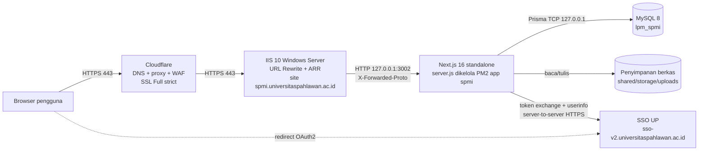
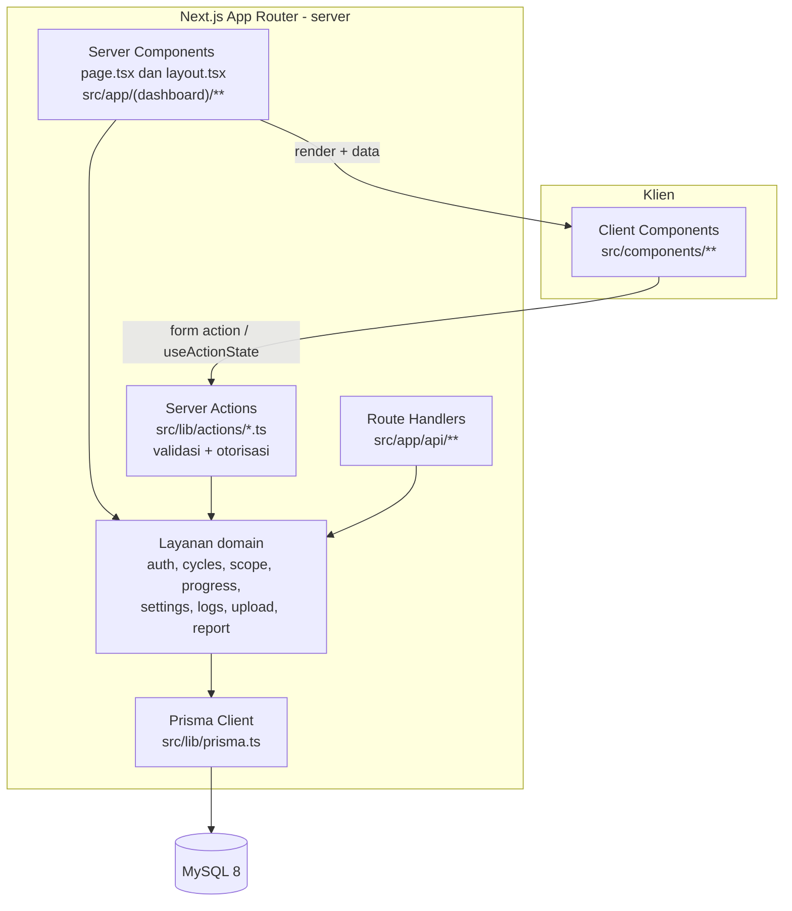
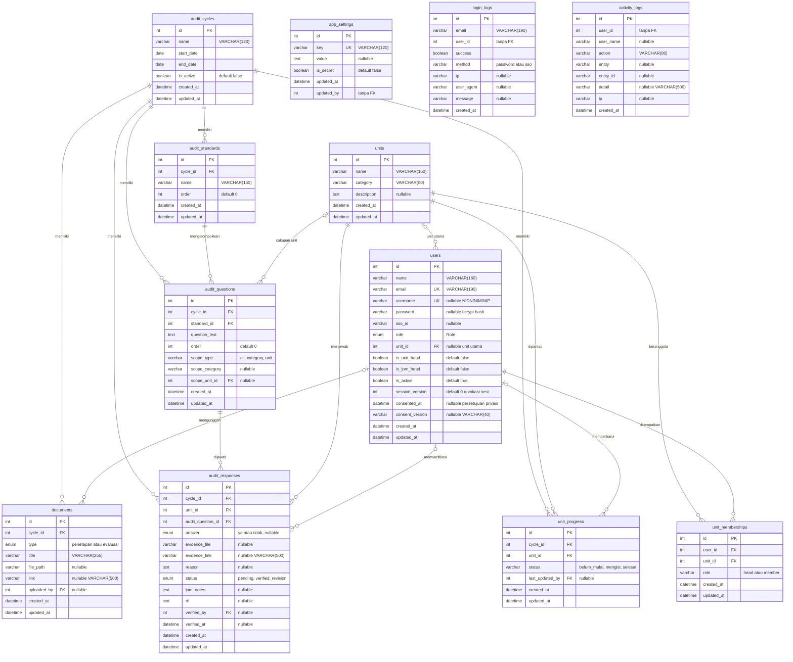
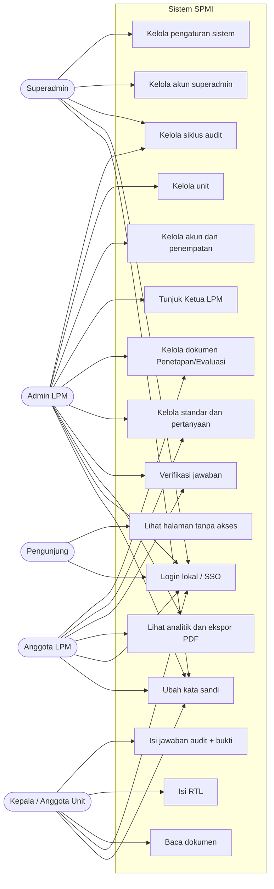
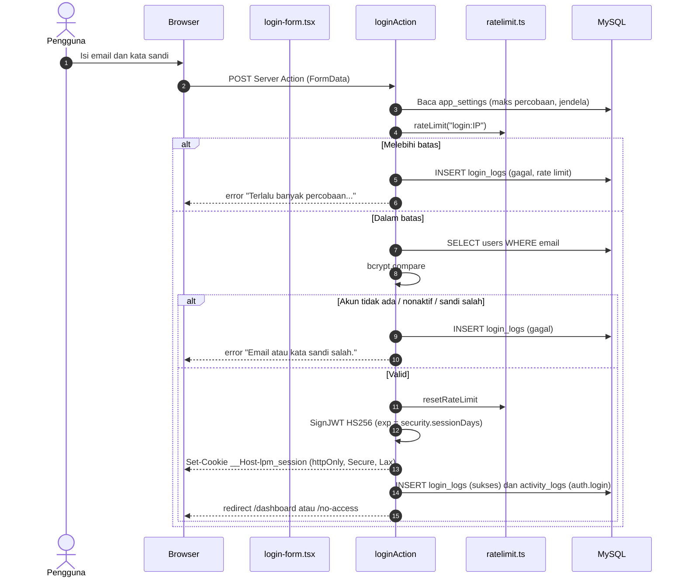
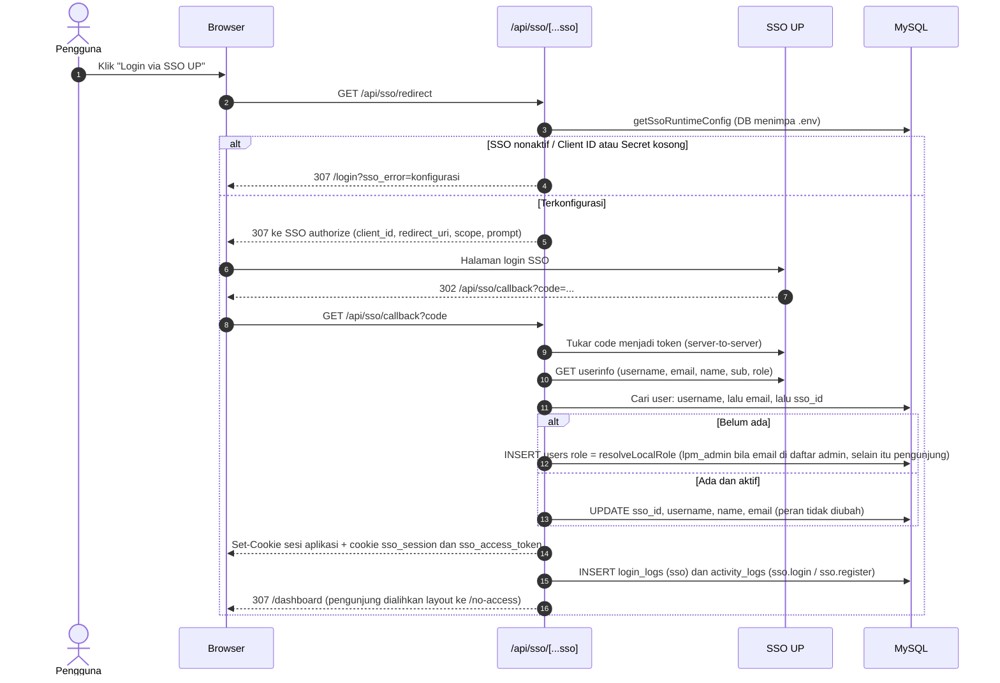
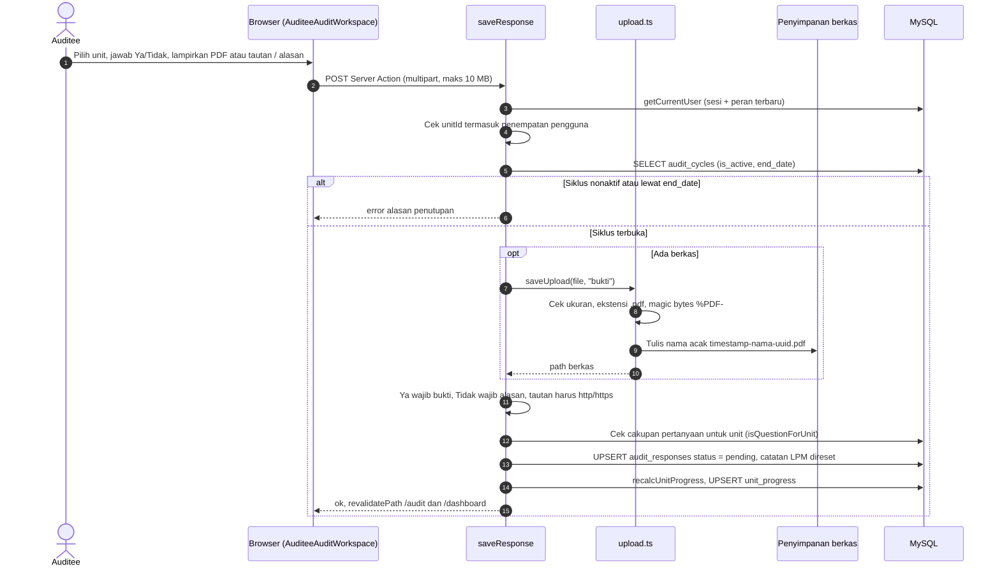
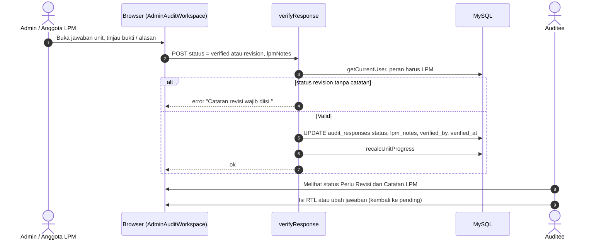
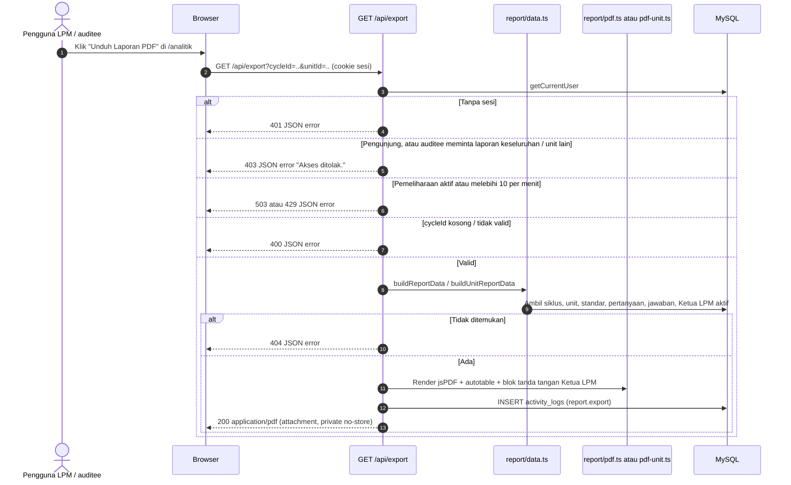

# 01 — Dokumen Perancangan Sistem

**Sistem:** SPMI — Sistem Penjaminan Mutu Internal, LPM Universitas Pahlawan Tuanku Tambusai
**URL produksi:** <https://spmi.universitaspahlawan.ac.id>
**Versi dokumen:** 1.0 (2026-10-17) — mengacu pada kode di branch `main`

> Dokumen ini disusun dari kode sumber. Setiap aturan merujuk berkas sumbernya agar dapat diverifikasi.
> Bila kode berubah, perbarui dokumen ini dalam PR yang sama (lihat [07-STANDAR-ENGINEERING.md](07-STANDAR-ENGINEERING.md)).

---

## 1. Ruang Lingkup

SPMI adalah aplikasi web internal untuk mengelola **audit mutu internal (AMI)** unit-unit universitas
(Program Studi, Wakil Rektor, Pusat, Perpustakaan, Biro, Lembaga, dll.). Siklus kerjanya:

1. LPM membuat **siklus audit** dan menetapkan batas waktu pengisian.
2. LPM menyusun **Standar** dan **butir pertanyaan** dengan cakupan _semua unit / per kategori / per unit_.
3. Auditee (Kepala/Anggota Unit) menjawab **Ya/Tidak** disertai bukti atau alasan.
4. LPM **memverifikasi** jawaban (terverifikasi / perlu revisi), auditee mengisi **RTL**.
5. LPM memantau progres, menganalisis kepatuhan, dan **mengekspor laporan PDF** yang ditandatangani Ketua LPM.

Di luar lingkup saat ini: modul **Monev** (placeholder, `src/app/(dashboard)/monev/page.tsx`), API publik,
dan integrasi data akademik (SAINS).

---

## 2. Aktor dan Peran

Peran disimpan pada enum `Role` (`prisma/schema.prisma`) dan diperiksa ulang dari database pada setiap
permintaan melalui `getCurrentUser()` (`src/lib/auth.ts`) — perubahan peran berlaku tanpa perlu login ulang.

| Peran (`Role`)   | Label UI (`src/lib/format.ts`) | Ringkasan hak akses                                                                                                                                                               |
| ---------------- | ------------------------------ | --------------------------------------------------------------------------------------------------------------------------------------------------------------------------------- |
| `superadmin`     | Superadmin                     | Semua hak `lpm_admin` + menu **Pengaturan** (identitas/SEO, SSO, log, keamanan, pemeliharaan, akun superadmin). Satu-satunya peran yang tetap dapat masuk saat mode pemeliharaan. |
| `lpm_admin`      | Admin LPM                      | Kelola siklus, unit, akun & penempatan, Ketua LPM, dokumen, standar & pertanyaan, verifikasi, analitik & ekspor PDF.                                                              |
| `lpm_member`     | Anggota LPM                    | Kelola standar & pertanyaan, dokumen, verifikasi, dashboard & analitik/ekspor. **Tidak** dapat mengelola akun/unit/siklus.                                                        |
| `auditee_head`   | Kepala Unit                    | Mengisi jawaban audit & RTL untuk unit tempatnya ditempatkan, membaca dokumen Penetapan/Evaluasi.                                                                                 |
| `auditee_member` | Anggota Unit                   | Sama dengan Kepala Unit (pengisian tidak dibedakan di sisi server).                                                                                                               |
| `pengunjung`     | Pengunjung (Tamu)              | Tanpa akses fitur. Setelah login diarahkan ke `/no-access` (tanpa sidebar/navbar). Default untuk akun baru via SSO.                                                               |

Aktor eksternal:

- **SSO UP** (`https://sso-v2.universitaspahlawan.ac.id`) — penyedia identitas OAuth 2.0.
- **Cloudflare** — DNS, proksi TLS, WAF.
- **Administrator server** — menjalankan deploy, backup, dan pemulihan.

Matriks menu (sumber: `src/components/layout/nav-items.ts` dan guard di setiap `page.tsx`):

| Menu / rute                              |     superadmin      |      lpm_admin      |     lpm_member      |     auditee_*     | pengunjung |
| ---------------------------------------- | :-----------------: | :-----------------: | :-----------------: | :---------------: | :--------: |
| `/dashboard`                             |       ✔ (LPM)       |       ✔ (LPM)       |       ✔ (LPM)       |    ✔ (auditee)    |     ✖      |
| `/siklus`, `/unit`, `/role-penempatan`   |          ✔          |          ✔          |          ✖          |         ✖         |     ✖      |
| `/penetapan`, `/evaluasi`                |       kelola        |       kelola        |       kelola        |       baca        |     ✖      |
| `/monev`                                 |          ✔          |          ✔          |          ✔          |         ✔         |     ✖      |
| `/audit`                                 | kelola + verifikasi | kelola + verifikasi | kelola + verifikasi | isi jawaban & RTL |     ✖      |
| `/analitik`, `/api/export` (keseluruhan) |          ✔          |          ✔          |          ✔          |         ✖         |     ✖      |
| `/api/export?unitId=` (per unit)         |          ✔          |          ✔          |          ✔          |   unit sendiri    |     ✖      |
| `/pengaturan`                            |          ✔          |          ✖          |          ✖          |         ✖         |     ✖      |
| `/profil`                                |          ✔          |          ✔          |          ✔          |         ✔         |     ✖      |

---

## 3. Kebutuhan Fungsional

| Kode  | Kebutuhan                                                                                          | Implementasi                                                                           |
| ----- | -------------------------------------------------------------------------------------------------- | -------------------------------------------------------------------------------------- |
| KF-01 | Login email + kata sandi (bcrypt) dengan pembatas percobaan                                        | `src/lib/actions/auth.ts` (`loginAction`), `src/lib/ratelimit.ts`                      |
| KF-02 | Login via SSO UP (OAuth 2.0 Authorization Code) dengan auto-provisioning akun sebagai `pengunjung` | `src/app/api/sso/[...sso]/route.ts`, `src/lib/sso.ts`                                  |
| KF-03 | Logout (hapus cookie sesi aplikasi + cookie SSO)                                                   | `logoutAction` di `src/lib/actions/auth.ts`                                            |
| KF-04 | Ubah kata sandi mandiri (min. 8 karakter; akun SSO-only ditolak)                                   | `src/lib/actions/profile.ts`                                                           |
| KF-05 | CRUD siklus audit; hanya satu siklus aktif; nonaktifkan manual                                     | `src/lib/actions/cycles.ts`                                                            |
| KF-06 | CRUD unit audit dengan kategori bebas (saran: `CATEGORIES`)                                        | `src/lib/actions/units.ts`, `src/lib/scope.ts`                                         |
| KF-07 | CRUD akun, penempatan multi-unit (rangkap jabatan), maks. 1 Kepala Unit per unit                   | `src/lib/actions/units.ts` (`assignMember`, `removeMember`, `syncUserAccess`)          |
| KF-08 | Penunjukan tunggal Ketua LPM (penandatangan laporan)                                               | `setLpmHead` / `unsetLpmHead` di `src/lib/actions/units.ts`                            |
| KF-09 | Repositori dokumen Penetapan & Evaluasi (PDF atau tautan http/https)                               | `src/lib/actions/documents.ts`                                                         |
| KF-10 | Standar (induk) dan butir pertanyaan (tunggal & massal) dengan cakupan all/category/unit           | `src/lib/actions/questions.ts`, `src/lib/scope.ts`                                     |
| KF-11 | Pengisian jawaban Ya/Tidak + bukti/alasan, ditolak bila siklus tertutup                            | `saveResponse` di `src/lib/actions/responses.ts`                                       |
| KF-12 | Verifikasi LPM (verified / revision + catatan wajib)                                               | `verifyResponse` di `src/lib/actions/responses.ts`                                     |
| KF-13 | Pengisian RTL oleh auditee                                                                         | `saveRtl` di `src/lib/actions/responses.ts`                                            |
| KF-14 | Progres unit otomatis (`belum_mulai` / `mengisi` / `selesai`)                                      | `src/lib/progress.ts`                                                                  |
| KF-15 | Dashboard monitoring & analitik kepatuhan per standar/kategori                                     | `src/app/(dashboard)/dashboard`, `src/app/(dashboard)/analitik`                        |
| KF-16 | Ekspor PDF keseluruhan dan per unit dengan blok tanda tangan Ketua LPM                             | `src/app/api/export/route.ts`, `src/lib/report/*`                                      |
| KF-17 | Pengaturan sistem (identitas/SEO, SSO, log, keamanan, pemeliharaan, superadmin)                    | `src/lib/actions/settings.ts`, `src/lib/settings.ts`                                   |
| KF-18 | Log login & log aktivitas (dapat dimatikan, retensi log login)                                     | `src/lib/logs.ts`                                                                      |
| KF-19 | Privasi: persetujuan (consent), ekspor data pribadi (`/api/me/export`), pembersihan data terjadwal | _Sedang ditambahkan_ — lihat [legal/RoPA.md](legal/RoPA.md) dan [03-API.md](03-API.md) |

## 4. Kebutuhan Non-Fungsional

| Kode   | Kategori        | Kebutuhan                                                                                                       | Implementasi / catatan                                   |
| ------ | --------------- | --------------------------------------------------------------------------------------------------------------- | -------------------------------------------------------- |
| KNF-01 | Keamanan        | Sesi JWT HS256 di cookie `httpOnly`, `SameSite=Lax`, prefix `__Host-` + `Secure` di produksi                    | `src/lib/auth.ts`                                        |
| KNF-02 | Keamanan        | `AUTH_SECRET` ≥ 32 karakter wajib di produksi (server gagal start bila tidak)                                   | `resolveAuthSecret()` di `src/lib/auth.ts`               |
| KNF-03 | Keamanan        | Header keamanan: CSP, HSTS, X-Frame-Options DENY, nosniff, Referrer-Policy, Permissions-Policy                  | `next.config.ts`                                         |
| KNF-04 | Keamanan        | Unggahan: whitelist folder & ekstensi, verifikasi _magic bytes_, PDF ≤ 10 MB, gambar branding ≤ 2 MB, tanpa SVG | `src/lib/upload.ts`                                      |
| KNF-05 | Keamanan        | Pesan error generik ke klien, detail hanya di log server                                                        | `src/lib/errors.ts` (`AppError`, `toActionError`)        |
| KNF-06 | Keamanan        | Peran SSO tidak dipercaya kecuali email ada di daftar admin atau `SSO_TRUST_ROLE=true`                          | `resolveLocalRole()` di `src/lib/sso.ts`                 |
| KNF-07 | Ketersediaan    | Satu instance Next.js (PM2 fork) di belakang IIS ARR; rollback otomatis bila smoke test gagal                   | [04-DEPLOYMENT-IIS.md](04-DEPLOYMENT-IIS.md)             |
| KNF-08 | Kinerja         | Server Actions `bodySizeLimit` 10 MB; kompresi gzip; output `standalone`                                        | `next.config.ts`                                         |
| KNF-09 | Aksesibilitas   | Target WCAG 2.1 AA, diuji dengan axe                                                                            | [06-PENGUJIAN.md](06-PENGUJIAN.md)                       |
| KNF-10 | Lokalisasi      | UI berbahasa Indonesia, `lang="id"`, format tanggal `id-ID`, zona waktu Asia/Jakarta                            | `src/app/layout.tsx`, `src/lib/format.ts`                |
| KNF-11 | Privasi         | Kepatuhan UU 27/2022 (PDP)                                                                                      | [legal/](legal/RoPA.md)                                  |
| KNF-12 | Keterpeliharaan | TypeScript strict, lint, format, uji unit/E2E di CI                                                             | [02-PANDUAN-PENGEMBANGAN.md](02-PANDUAN-PENGEMBANGAN.md) |

---

## 5. Arsitektur

### 5.1 Arsitektur Deployment

### 5.2 Arsitektur Aplikasi (lapisan)

Catatan arsitektur:

- **Tidak ada `middleware.ts`/`proxy.ts`.** Otentikasi ditegakkan di `src/app/(dashboard)/layout.tsx`
  (redirect ke `/login`, `/no-access`, atau halaman pemeliharaan), diulang di setiap `page.tsx` dan
  di setiap Server Action / Route Handler melalui penjaga terpusat `src/lib/guards.ts` (_defense in depth_) —
  Server Action dapat dipanggil langsung via POST tanpa melewati layout.
- **Pengaturan runtime** disimpan di tabel `app_settings` dan dibaca sekali per permintaan
  (`getSettings` dibungkus `React.cache`, `src/lib/settings.ts`). Nilai SSO di DB menimpa `.env`.
- **Pembatas laju login** bersifat _in-memory_ (`src/lib/ratelimit.ts`) — valid untuk satu instance PM2.

---

## 6. Model Data (ERD)

Dihasilkan dari `prisma/schema.prisma`. Nama tabel/kolom fisik (snake_case via `@@map`/`@map`) yang ditampilkan.
Kolom `users.session_version`, `users.consented_at`, `users.consent_version` dan indeks `file_path`/`evidence_file`
ditambahkan pada pekerjaan pengerasan keamanan & privasi (revokasi sesi, persetujuan kebijakan privasi, unduhan berkas terotorisasi).

Batasan & indeks penting:

| Tabel                         | Batasan                                                                                                      | Perilaku hapus                                                                                |
| ----------------------------- | ------------------------------------------------------------------------------------------------------------ | --------------------------------------------------------------------------------------------- |
| `users`                       | `email` UNIQUE, `username` UNIQUE, indeks `unit_id`                                                          | Hapus unit → `unit_id` = NULL                                                                 |
| `documents`                   | indeks `cycle_id`, `type`, `file_path` (pencarian otorisasi unduhan)                                         | CASCADE dari siklus; uploader → NULL                                                          |
| `unit_memberships`            | UNIQUE (`user_id`, `unit_id`)                                                                                | CASCADE dari user dan unit                                                                    |
| `audit_standards`             | UNIQUE (`cycle_id`, `name`)                                                                                  | Hapus standar → CASCADE ke pertanyaan → CASCADE ke jawaban                                    |
| `audit_responses`             | UNIQUE (`cycle_id`, `unit_id`, `audit_question_id`); indeks `unit_id`, `cycle_id`, `status`, `evidence_file` | CASCADE dari siklus/unit/pertanyaan; verifikator → NULL                                       |
| `unit_progress`               | UNIQUE (`cycle_id`, `unit_id`)                                                                               | CASCADE dari siklus/unit                                                                      |
| `audit_cycles`                | —                                                                                                            | **Hapus siklus menghapus seluruh dokumen, standar, pertanyaan, jawaban, progres siklus tsb.** |
| `login_logs`, `activity_logs` | indeks `created_at`, `email`/`user_id`                                                                       | Tidak ber-FK (jejak tetap ada meski user dihapus)                                             |

---

## 7. Use Case per Peran

> Superadmin mewarisi seluruh use case Admin LPM (garis tidak digambar agar diagram terbaca).

| Peran               | Use case utama                                                                                                   |
| ------------------- | ---------------------------------------------------------------------------------------------------------------- |
| Superadmin          | UC1–UC11, UC16; ditambah UC2 (Identitas & SEO, Integrasi SSO + Uji Koneksi, Log, Keamanan, Pemeliharaan) dan UC3 |
| Admin LPM           | UC1, UC4–UC11, UC16                                                                                              |
| Anggota LPM         | UC1, UC8–UC11, UC16                                                                                              |
| Kepala/Anggota Unit | UC1, UC12–UC14, UC16 (dashboard auditee)                                                                         |
| Pengunjung          | UC1, UC15 (tautan email ke `lpm@universitaspahlawan.ac.id`, tombol Keluar)                                       |

---

## 8. Diagram Sekuens

### 8.1 Login lokal (email + kata sandi)

### 8.2 Login SSO UP

### 8.3 Pengisian audit + unggah bukti

### 8.4 Verifikasi LPM

### 8.5 Ekspor laporan PDF

---

## 9. Aturan Bisnis

| Kode  | Aturan                                                                                                                                                                                                               | Penegakan (sumber)                                                                                   |
| ----- | -------------------------------------------------------------------------------------------------------------------------------------------------------------------------------------------------------------------- | ---------------------------------------------------------------------------------------------------- |
| AB-01 | **Hanya satu siklus aktif.** Mengaktifkan siklus menonaktifkan semua siklus lain dalam satu transaksi.                                                                                                               | `createCycle`, `updateCycle`, `setActiveCycle` — `src/lib/actions/cycles.ts`                         |
| AB-02 | **Siklus terbuka** hanya bila `is_active = true` **dan** waktu sekarang < akhir hari `end_date` (inklusif s.d. 23:59:59 waktu server).                                                                               | `isCycleOpen`, `cycleClosedReason` — `src/lib/cycles.ts`                                             |
| AB-03 | Pengisian jawaban **dan** RTL ditolak di server bila siklus tertutup (nonaktif manual atau lewat `end_date`).                                                                                                        | `saveResponse`, `saveRtl` — `src/lib/actions/responses.ts`                                           |
| AB-04 | `end_date` tidak boleh sebelum `start_date`.                                                                                                                                                                         | `readCycleForm` dipakai `createCycle` & `updateCycle`                                                |
| AB-05 | Auditee hanya melihat/mengisi **siklus aktif**; LPM dapat melihat siklus terakhir walau nonaktif.                                                                                                                    | `src/app/(dashboard)/audit/page.tsx`                                                                 |
| AB-06 | **Jawaban Ya wajib bukti** (berkas PDF atau tautan http/https); **jawaban Tidak wajib alasan**.                                                                                                                      | `saveResponse`                                                                                       |
| AB-07 | Bukti berkas hanya PDF (cek ekstensi + _magic bytes_ `%PDF-`), maks. 10 MB.                                                                                                                                          | `saveUpload` — `src/lib/upload.ts`                                                                   |
| AB-08 | Pengguna hanya boleh menjawab untuk unit tempat ia ditempatkan, dan hanya pertanyaan yang berlaku bagi unit tsb. (cakupan `all` / `category` sesuai kategori unit / `unit` sesuai id).                               | `saveResponse` + `isQuestionForUnit` — `src/lib/scope.ts`                                            |
| AB-09 | Setiap perubahan jawaban mengembalikan status ke `pending` dan menghapus catatan & data verifikasi LPM.                                                                                                              | `saveResponse` (upsert `update`)                                                                     |
| AB-10 | Verifikasi hanya oleh `lpm_admin`, `lpm_member`, `superadmin`; status `revision` **wajib** catatan.                                                                                                                  | `verifyResponse`                                                                                     |
| AB-11 | Status progres unit: `belum_mulai` (0 dijawab), `mengisi` (sebagian), `selesai` (semua pertanyaan relevan dijawab). Status verifikasi tidak memengaruhi progres.                                                     | `recalcUnitProgress` — `src/lib/progress.ts`                                                         |
| AB-12 | **Satu Kepala Unit per unit.** Penempatan sebagai `head` ditolak bila unit sudah memiliki kepala lain.                                                                                                               | `assertHeadAvailable` — `src/lib/actions/units.ts`                                                   |
| AB-13 | Satu akun dapat ditempatkan di banyak unit (rangkap jabatan). Peran global disinkronkan: punya ≥1 `head` → `auditee_head`, selain itu `auditee_member`; tanpa penempatan → `pengunjung`.                             | `syncUserAccess`                                                                                     |
| AB-14 | Akun LPM/superadmin tidak dapat ditempatkan pada unit audit; peran tanpa unit: `superadmin`, `lpm_admin`, `lpm_member`, `pengunjung`.                                                                                | `assignMember`, `NO_UNIT_ROLES`                                                                      |
| AB-15 | **Satu Ketua LPM** aktif; menunjuk yang baru mencabut yang lama (transaksi). Hanya akun `lpm_admin`/`superadmin` yang aktif. Ketua LPM menjadi penandatangan PDF.                                                    | `setLpmHead`; `report/data.ts`                                                                       |
| AB-16 | Akun baru via SSO menjadi `pengunjung`, kecuali email tercantum di `sso.adminEmails` (→ `lpm_admin`). Klaim `role` SSO diabaikan kecuali `SSO_TRUST_ROLE=true`. Peran akun yang sudah ada **tidak** diubah oleh SSO. | `resolveLocalRole` — `src/lib/sso.ts`; `route.ts`                                                    |
| AB-17 | Pencocokan akun SSO: `username` (NIDN/NIM/NIP) → `email` → `sso_id`.                                                                                                                                                 | `src/app/api/sso/[...sso]/route.ts`                                                                  |
| AB-18 | Kata sandi minimal 8 karakter (akun baru, ubah akun, ubah mandiri, superadmin, seed).                                                                                                                                | `units.ts`, `profile.ts`, `settings.ts`, `prisma/seed.ts`                                            |
| AB-19 | Pesan login seragam ("Email atau kata sandi salah.") untuk mencegah enumerasi akun; akun nonaktif ditolak.                                                                                                           | `loginAction`                                                                                        |
| AB-20 | Mode pemeliharaan: hanya `superadmin` yang dapat membuka dashboard maupun menjalankan aksi/ekspor.                                                                                                                   | `src/app/(dashboard)/layout.tsx`, `assertNotMaintenance` di `src/lib/guards.ts`, `/api/export` (503) |
| AB-21 | Nama standar unik per siklus; urutan standar baru = urutan terakhir + 1. Hapus standar menghapus seluruh butirnya.                                                                                                   | `createStandard`, `deleteStandard`                                                                   |
| AB-22 | Dokumen wajib berkas PDF **atau** tautan http/https; jenis hanya `penetapan`/`evaluasi`.                                                                                                                             | `createDocument`                                                                                     |
| AB-23 | Nilai rahasia pengaturan (`sso.clientSecret`) tidak pernah dikirim ke klien; nilai kosong/terselubung tidak menimpa nilai tersimpan.                                                                                 | `getSettingsForAdmin`, `saveSettings` — `src/lib/settings.ts`                                        |
| AB-24 | Log login dihapus otomatis setelah `log.loginRetentionDays` (default 90 hari) saat ada login baru.                                                                                                                   | `recordLogin` — `src/lib/logs.ts`                                                                    |
| AB-25 | Admin tidak dapat menghapus akunnya sendiri.                                                                                                                                                                         | `deleteAccount`                                                                                      |

---

## 10. Keputusan Arsitektur

Lihat ADR di [adr/](adr/):
[0001](adr/0001-nextjs-app-router-server-actions.md) ·
[0002](adr/0002-prisma-mysql.md) ·
[0003](adr/0003-sso-up-oauth2.md) ·
[0004](adr/0004-jwt-cookie-session.md) ·
[0005](adr/0005-iis-arr-pm2-deployment.md) ·
[0006](adr/0006-private-upload-storage.md)
