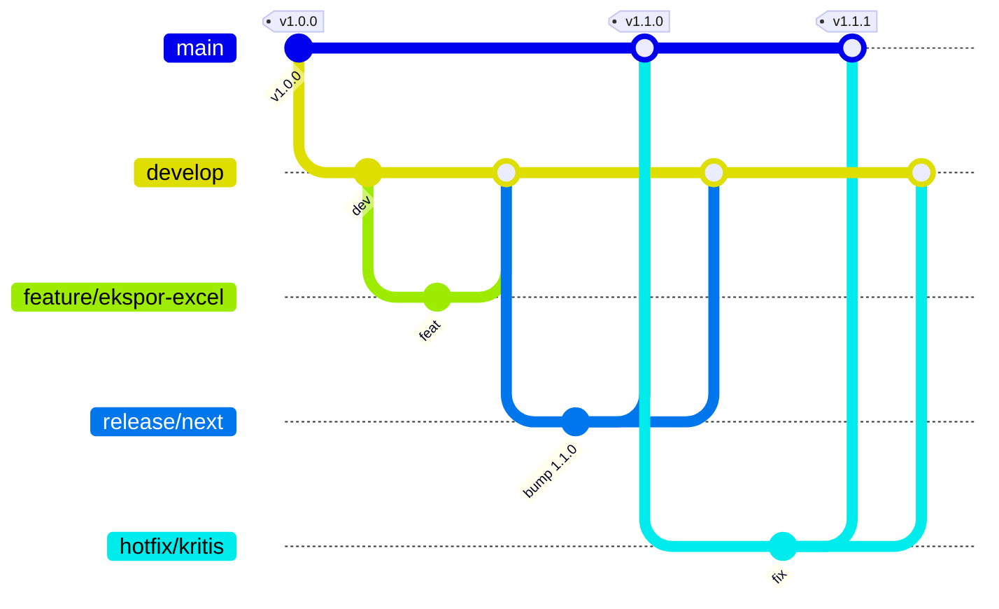

# 02 — Panduan Pengembangan

Panduan bagi pengembang yang bekerja pada repositori SPMI (`E:\www\lpm-new` di server pengembangan).

---

## 1. Prasyarat

| Perangkat | Versi                                      | Catatan                                                                                                                           |
| --------- | ------------------------------------------ | --------------------------------------------------------------------------------------------------------------------------------- |
| Node.js   | 20 LTS minimum (disarankan **22 LTS**)     | Node 20 berakhir dukungannya (EOL) pada 30 April 2026; image Docker sudah memakai `node:22-slim`.                                 |
| npm       | ≥ 10                                       | Gunakan `npm ci` agar sesuai `package-lock.json`.                                                                                 |
| MySQL     | 8.0                                        | Lokal via `docker compose up -d` (port **3307**, DB `lpm_spmi`, lihat `docker-compose.yml`).                                      |
| Git       | ≥ 2.40                                     | Konfigurasi `core.autocrlf=false`; normalisasi baris diatur `.gitattributes` & `.editorconfig` (LF; CRLF untuk `.ps1/.cmd/.bat`). |
| Editor    | VS Code + ESLint + Prettier + EditorConfig | Format mengikuti `.prettierrc.json` (titik koma, kutip ganda, `printWidth` 80).                                                   |

> Baca catatan di `AGENTS.md`: Next.js 16 memiliki perubahan API/konvensi. Rujuk dokumentasi di
> `node_modules/next/dist/docs/` sebelum memakai API Next.js yang belum pernah dipakai di proyek ini.

## 2. Setup Lokal

```bash
git clone <url-repo> lpm-new && cd lpm-new
git checkout develop

docker compose up -d                # MySQL 8 di localhost:3307
cp .env.example .env                # isi AUTH_SECRET (>= 32 karakter)
npm ci                              # postinstall menjalankan `prisma generate`
npm run db:push                     # sinkronkan skema ke database
SEED_SUPERADMIN_PASSWORD='rahasia-kuat-1' \
SEED_ADMIN_PASSWORD='rahasia-kuat-2' \
npm run db:seed                     # buat akun superadmin + admin LPM
npm run hooks:install               # arahkan Git ke hook di scripts/hooks
npm run dev                         # http://localhost:3002
```

Variabel `.env` minimal untuk pengembangan: `DATABASE_URL`, `AUTH_SECRET`. SSO bersifat opsional
di lokal; bila diuji, daftarkan Redirect URI `http://localhost:3002/api/sso/callback` ke Admin SSO UP.
Daftar lengkap variabel lingkungan ada di [04-DEPLOYMENT-IIS.md §3](04-DEPLOYMENT-IIS.md#3-variabel-lingkungan).

## 3. Struktur Folder

```
prisma/
  schema.prisma            # Model data (tabel snake_case via @@map)
  seed.ts                  # Seed akun awal (superadmin + admin LPM) dari env
src/
  app/
    layout.tsx             # Root layout, metadata dinamis dari pengaturan
    page.tsx               # Redirect ke /login | /dashboard | /no-access
    login/                 # Halaman login (form lokal + tombol SSO)
    no-access/             # Halaman pengunjung (tanpa sidebar)
    (dashboard)/           # Grup rute terproteksi; layout.tsx = guard sesi + pemeliharaan
      dashboard/ siklus/ unit/ role-penempatan/ penetapan/ evaluasi/
      monev/ audit/ analitik/ pengaturan/ profil/
    api/
      sso/[...sso]/        # /api/sso/redirect | callback | logout
      export/              # /api/export (PDF)
  components/              # Komponen UI per modul (kebab-case.tsx)
    ui/ layout/ audit/ accounts/ cycles/ units/ documents/ analytics/ settings/ ...
  lib/
    actions/               # Server Actions per modul ("use server")
    report/                # Pengumpulan data & render PDF (jsPDF)
    auth.ts                # Sesi JWT, hashing, helper peran
    sso.ts settings.ts logs.ts upload.ts errors.ts ratelimit.ts
    cycles.ts scope.ts progress.ts format.ts prisma.ts
deploy/                    # ecosystem.config.cjs (PM2), iis/web.config, docker-compose.db.yml
scripts/deploy/            # setup-production.ps1, deploy-production.ps1, rollback.ps1, smoke-test.ps1
docs/                      # Dokumentasi (docs-as-code)
```

## 4. Alur Git (Git Flow)



| Branch                        | Asal      | Tujuan merge       | Kegunaan                                                                                         |
| ----------------------------- | --------- | ------------------ | ------------------------------------------------------------------------------------------------ |
| `main`                        | —         | —                  | Kode produksi. Setiap commit di `main` = rilis bertag `vX.Y.Z`. Dilindungi: tanpa push langsung. |
| `develop`                     | `main`    | —                  | Integrasi fitur untuk rilis berikutnya.                                                          |
| `feature/<deskripsi-singkat>` | `develop` | `develop`          | Fitur baru, mis. `feature/ekspor-excel`.                                                         |
| `fix/<deskripsi>`             | `develop` | `develop`          | Perbaikan bug non-darurat.                                                                       |
| `release/<X.Y.Z>`             | `develop` | `main` + `develop` | Stabilisasi rilis: bump versi `package.json`, catatan rilis, hanya perbaikan bug.                |
| `hotfix/<X.Y.Z>`              | `main`    | `main` + `develop` | Perbaikan darurat produksi.                                                                      |

Aturan PR:

1. Minimal **1 reviewer**; CI (`npm run ci`) wajib hijau.
2. PR kecil dan fokus; sertakan langkah uji dan tangkapan layar untuk perubahan UI.
3. Isi checklist keamanan di [07-STANDAR-ENGINEERING.md §6](07-STANDAR-ENGINEERING.md#6-keamanan-wajib-per-pr).
4. Perubahan skema Prisma, perilaku, atau endpoint wajib memperbarui `docs/` pada PR yang sama.
5. Merge ke `main` hanya dari `release/*` atau `hotfix/*`; gunakan _merge commit_ (bukan squash) agar tag konsisten.

## 5. Conventional Commits

Format: `<tipe>(<cakupan opsional>): <ringkasan imperatif, huruf kecil>`

| Tipe           | Kapan                                  | Dampak SemVer      |
| -------------- | -------------------------------------- | ------------------ |
| `feat`         | Fitur baru                             | MINOR              |
| `fix`          | Perbaikan bug                          | PATCH              |
| `perf`         | Peningkatan kinerja                    | PATCH              |
| `refactor`     | Perubahan struktur tanpa ubah perilaku | —                  |
| `docs`         | Dokumentasi                            | —                  |
| `test`         | Tambah/ubah pengujian                  | —                  |
| `build` / `ci` | Build, dependensi, pipeline            | —                  |
| `chore`        | Pemeliharaan lain                      | —                  |
| `style`        | Format kode                            | —                  |
| `revert`       | Membatalkan commit                     | sesuai commit asal |

Perubahan yang memutus kompatibilitas: tambahkan `!` (`feat(api)!: ...`) atau footer `BREAKING CHANGE:` → MAJOR.

Contoh:

```
feat(audit): tambah filter status verifikasi pada panel LPM
fix(sso): tolak login untuk akun nonaktif
docs(deploy): perbarui langkah rollback
```

Cakupan yang lazim: `auth`, `sso`, `audit`, `siklus`, `unit`, `akun`, `dokumen`, `laporan`, `pengaturan`, `privasi`, `deploy`, `db`.

## 6. Versi (SemVer)

- Versi aplikasi tercatat di `package.json` (`"version"`, saat ini `1.0.0`) dan tag Git `vX.Y.Z`.
- **MAJOR**: perubahan tidak kompatibel (mis. skema DB destruktif, perubahan alur login).
- **MINOR**: fitur baru kompatibel.
- **PATCH**: perbaikan bug/keamanan.
- Versi ditampilkan oleh `/api/health` (`version`) untuk verifikasi setelah deploy.

## 7. Skrip npm

| Skrip                                           | Fungsi                                                                                             |
| ----------------------------------------------- | -------------------------------------------------------------------------------------------------- |
| `npm run dev`                                   | Server pengembangan (Turbopack) di port 3002                                                       |
| `npm run build` / `npm run start`               | Build produksi (`output: "standalone"`) / jalankan build di port 3002                              |
| `npm run lint` / `lint:fix`                     | ESLint (`eslint .`, konfigurasi `eslint.config.mjs`) / perbaiki otomatis                           |
| `npm run format` / `npm run format:check`       | Prettier tulis / periksa (`.prettierrc.json`, `.prettierignore`)                                   |
| `npm run typecheck`                             | `tsc --noEmit`                                                                                     |
| `npm run test` / `test:watch` / `test:coverage` | Uji unit Vitest (`vitest.config.mts`, berkas `tests/unit/**/*.test.ts`) / mode pantau / cakupan v8 |
| `npm run test:e2e`                              | Uji E2E lintas browser (Playwright)                                                                |
| `npm run test:a11y`                             | Uji aksesibilitas — test Playwright bertag `@a11y` (axe)                                           |
| `npm run test:e2e:install`                      | Pasang browser Playwright (`playwright install --with-deps`)                                       |
| `npm run audit`                                 | `npm audit --omit=dev --audit-level=high`                                                          |
| `npm run ci`                                    | Gerbang CI: `lint` → `format:check` → `typecheck` → `test`                                         |
| `npm run hooks:install`                         | `git config core.hooksPath scripts/hooks`                                                          |
| `npm run db:push` / `db:seed` / `db:studio`     | Prisma: sinkron skema / seed akun awal / Prisma Studio                                             |

> `next lint` telah dihapus pada Next.js 16, sehingga `lint` memanggil ESLint langsung.
> Gerbang test pada `scripts/deploy/deploy-production.ps1` menjalankan `lint`, `format:check`, `typecheck`, `test`.

Urutan sebelum membuka PR:

```bash
npm run format && npm run lint && npm run typecheck && npm run test
npm run test:e2e        # bila mengubah alur UI
```

## 8. Perubahan Skema Database

1. Ubah `prisma/schema.prisma` (model PascalCase, kolom camelCase + `@map("snake_case")`, tabel `@@map("snake_case")`).
2. `npm run db:push` di lokal, uji, lalu commit skema.
3. Proyek **belum** memakai `prisma migrate`; produksi memakai `prisma db push` di skrip deploy.
   Hindari perubahan destruktif (hapus/ganti nama kolom). Bila tak terhindarkan, tulis skrip migrasi data
   dan catat di catatan rilis; deploy akan berhenti bila `db push` memerlukan `--accept-data-loss`.
4. Perbarui ERD di [01-PERANCANGAN.md §6](01-PERANCANGAN.md#6-model-data-erd) dan [legal/RoPA.md](legal/RoPA.md) bila menyangkut data pribadi.

## 9. Kiat Debugging

| Gejala                                             | Penyebab umum                                                                                                       |
| -------------------------------------------------- | ------------------------------------------------------------------------------------------------------------------- |
| `AUTH_SECRET wajib diatur` saat `npm start`        | `NODE_ENV=production` tanpa `AUTH_SECRET` ≥ 32 karakter.                                                            |
| Login berhasil tetapi kembali ke `/login` di lokal | Menjalankan build produksi via HTTP: cookie `__Host-` + `Secure` ditolak browser. Gunakan `npm run dev` atau HTTPS. |
| Tombol SSO tidak tampil                            | `sso.enabled` mati atau Client ID/Secret kosong (`isSsoConfigured`).                                                |
| Pesan "Terjadi kesalahan..."                       | Error tak terduga disembunyikan `toActionError`; lihat konsol server `[action-error]`.                              |
