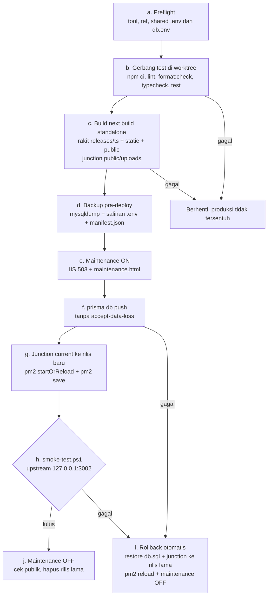

# 04 — Runbook Deployment Produksi (Windows Server + IIS)

**Target:** <https://spmi.universitaspahlawan.ac.id>
**Topologi:** Browser → Cloudflare → IIS 10 (URL Rewrite + ARR) → Next.js standalone (PM2, `127.0.0.1:3002`) → MySQL 8
**Skrip:** `scripts/deploy/` · **Konfigurasi:** `deploy/`

---

## 1. Prasyarat Server

| Komponen       | Versi / pengaturan                                                                                                                                                                                   | Verifikasi                       |
| -------------- | ---------------------------------------------------------------------------------------------------------------------------------------------------------------------------------------------------- | -------------------------------- |
| Windows Server | 2019/2022/2025, akun Administrator                                                                                                                                                                   | `winver`                         |
| Node.js        | 20 LTS minimum; **disarankan 22 LTS** (Node 20 EOL 30-04-2026)                                                                                                                                       | `node -v`                        |
| PM2            | terbaru, global; layanan Windows via `pm2-installer` atau Task Scheduler _At startup_ `pm2 resurrect`                                                                                                | `pm2 -v`                         |
| IIS            | 10 + modul **URL Rewrite 2.1** + **Application Request Routing 3.0**                                                                                                                                 | IIS Manager → server → _Modules_ |
| ARR proxy      | **Enable proxy** aktif; **Preserve Host header** aktif                                                                                                                                               | lihat §1.1                       |
| MySQL          | 8.0 — default sebagai container Docker `spmi-db` (`deploy/docker-compose.db.yml`, hanya `127.0.0.1:33063`); MySQL 8 native juga dapat dipakai dengan menyesuaikan `DATABASE_URL` dan perintah backup | `docker inspect spmi-db`         |
| Docker         | Docker Engine/Desktop dengan Compose v2 (bila memakai `spmi-db`)                                                                                                                                     | `docker compose version`         |
| Git            | ≥ 2.40 (deploy memakai `git worktree`)                                                                                                                                                               | `git --version`                  |
| win-acme       | `C:\win-acme\wacs.exe` (opsional, untuk sertifikat Let's Encrypt)                                                                                                                                    | —                                |

### 1.1 Aktifkan proxy ARR (sekali)

```powershell
$appcmd = "$env:windir\System32\inetsrv\appcmd.exe"
& $appcmd set config -section:system.webServer/proxy /enabled:"True" /commit:apphost
& $appcmd set config -section:system.webServer/proxy /preserveHostHeader:"True" /commit:apphost
# Streaming respons Next.js (RSC) tanpa buffer, timeout cukup untuk ekspor PDF besar
& $appcmd set config -section:system.webServer/proxy /responseBufferLimit:"0" /timeout:"00:02:00" /commit:apphost
```

`preserveHostHeader` **wajib**: tanpa itu Next.js melihat `Host: 127.0.0.1:3002` sehingga redirect
(mis. setelah callback SSO) mengarah ke alamat internal.

## 2. Struktur Direktori

```
E:\www\lpm-new\                         # Repo pengembangan (sumber deploy; tidak pernah dilayani langsung)
E:\www\spmi-prod\                       # SPMI_HOME
├── current\  ──junction──►  releases\<yyyyMMdd-HHmmss>\
├── releases\<yyyyMMdd-HHmmss>\         # Rilis immutable (5 terakhir disimpan)
│   ├── server.js, .next\, node_modules\, release.json
│   └── public\uploads  ──junction──►  shared\public-uploads\
├── shared\                             # ACL: hanya Administrators + SYSTEM
│   ├── .env                            # Variabel lingkungan aplikasi (rahasia)
│   ├── db.env                          # Kredensial MySQL container
│   ├── storage\uploads\                # Berkas privat (bukti, dokumen) — UPLOAD_DIR
│   └── public-uploads\branding\        # Aset publik (logo/favicon/OG)
├── builds\<ts>\                        # git worktree sementara (dihapus setelah deploy)
├── backups\<ts>\                       # Backup pra-deploy: db.sql, .env, manifest.json
├── backups\daily-<ts>\                 # Backup harian (backup.ps1), retensi 30 hari
├── backups\uploads-mirror\             # Mirror inkremental berkas unggahan
├── iis\web.config                      # Reverse proxy aktif (salinan deploy\iis\web.config)
├── iis\maintenance.html
├── ecosystem.config.cjs                # PM2 (salinan deploy\ecosystem.config.cjs)
└── logs\                               # pm2-out.log, pm2-error.log, deploy-<ts>.log, backup.log
E:\backup\spmi\                         # Salinan off-host / disk terpisah (disarankan; lihat §9)
```

> Skrip saat ini menyimpan backup di `E:\www\spmi-prod\backups`. Karena berada di disk yang sama dengan
> aplikasi, salin rutin ke `E:\backup\spmi` (disk/volume berbeda) dan ke lokasi luar server (aturan 3-2-1).

## 3. Variabel Lingkungan

Sumber: `.env.example`, `shared\.env` yang dibuat `setup-production.ps1`, dan `deploy/ecosystem.config.cjs`
(PM2 membaca `shared\.env`, lalu memaksa `NODE_ENV=production`, `PORT=3002`, `HOSTNAME=127.0.0.1`, `TZ=Asia/Jakarta`).

| Variabel                             | Wajib  | Contoh / default                                          | Keterangan                                                                                                                                      |
| ------------------------------------ | :----: | --------------------------------------------------------- | ----------------------------------------------------------------------------------------------------------------------------------------------- |
| `DATABASE_URL`                       |   ✔    | `mysql://spmi:<acak>@127.0.0.1:33063/lpm_spmi`            | Dibuat otomatis dari `db.env`                                                                                                                   |
| `AUTH_SECRET`                        |   ✔    | 48 byte acak (base64url)                                  | ≥ 32 karakter; server menolak start bila kurang. Mengganti nilai ini **mengakhiri seluruh sesi**.                                               |
| `AUTH_COOKIE_NAME`                   |   —    | `lpm_session`                                             | Di produksi menjadi `__Host-lpm_session`                                                                                                        |
| `APP_URL` / `NEXT_PUBLIC_APP_URL`    |   ✔    | `https://spmi.universitaspahlawan.ac.id`                  | URL kanonik. `setup-production.ps1` menulis `APP_URL`; samakan nama dengan yang dibaca kode. Variabel `NEXT_PUBLIC_*` dibakukan saat **build**. |
| `APP_TIMEZONE`                       |   ✔    | `Asia/Jakarta`                                            | Zona waktu tampilan/batas waktu; PM2 juga menyetel `TZ=Asia/Jakarta`                                                                            |
| `UPLOAD_DIR`                         |   ✔    | `E:/www/spmi-prod/shared/storage/uploads`                 | Penyimpanan berkas privat di luar `public` (lihat [ADR-0006](adr/0006-private-upload-storage.md))                                               |
| `SSO_URL`                            |   —    | `https://sso-v2.universitaspahlawan.ac.id`                | _Fallback_; nilai di menu Pengaturan (DB) menimpa                                                                                               |
| `SSO_CLIENT_ID`, `SSO_CLIENT_SECRET` |   —    | dari Admin SSO UP                                         | Disarankan diisi via **Pengaturan → Integrasi SSO**                                                                                             |
| `SSO_REDIRECT_URI`                   |   —    | `https://spmi.universitaspahlawan.ac.id/api/sso/callback` | Harus identik dengan yang terdaftar di SSO UP                                                                                                   |
| `SSO_SCOPE` / `SSO_PROMPT`           |   —    | `*` / `login`                                             |                                                                                                                                                 |
| `SSO_ADMIN_EMAILS`                   |   —    | `lpm@universitaspahlawan.ac.id`                           | Email yang otomatis menjadi `lpm_admin` saat akun SSO pertama kali dibuat                                                                       |
| `SSO_TRUST_ROLE`                     |   —    | kosong                                                    | Biarkan kosong. `true` = percaya klaim role SSO (tidak aman)                                                                                    |
| `TRUST_PROXY`                        |   —    | `cloudflare`                                              | `cloudflare` \| `xff` \| `none` — penentuan IP klien (`src/lib/net.ts`)                                                                         |
| `TRUSTED_PROXY_CIDRS`                |   —    | kosong                                                    | CIDR proxy tambahan yang dipercaya                                                                                                              |
| `SEED_SUPERADMIN_*`, `SEED_ADMIN_*`  | sekali | —                                                         | Hanya saat seed awal; jangan disimpan permanen di `shared\.env`                                                                                 |

## 4. Penyiapan Pertama (sekali)

Jalankan PowerShell **sebagai Administrator** dari `E:\www\lpm-new`:

```powershell
# 1. Direktori, rahasia acak, container MySQL, site + app pool IIS, PM2 config
.\scripts\deploy\setup-production.ps1

# 2. Lengkapi E:\www\spmi-prod\shared\.env (SSO_CLIENT_ID/SECRET bila tidak via UI)

# 3. Deploy pertama (lihat §5)
.\scripts\deploy\deploy-production.ps1 -Ref v1.0.0

# 4. Seed akun awal (dari repo dev, menunjuk DB produksi; seed idempoten)
$env:DATABASE_URL = (Select-String -Path E:\www\spmi-prod\shared\.env -Pattern '^DATABASE_URL=').Line.Split('=',2)[1].Trim('"')
$env:SEED_SUPERADMIN_PASSWORD = '<kuat>'; $env:SEED_ADMIN_PASSWORD = '<kuat>'
npm run db:seed
Remove-Item Env:SEED_*, Env:DATABASE_URL

# 5. Sertifikat (setelah DNS mengarah dan HTTP dapat diakses)
.\scripts\deploy\setup-production.ps1 -Ssl -Email lpm@universitaspahlawan.ac.id

# 6. PM2 bertahan setelah reboot
pm2 save
```

`setup-production.ps1` bersifat idempoten (berkas rahasia yang sudah ada tidak ditimpa) dan membuat:
app pool `spmi` (_No Managed Code_), site `spmi.universitaspahlawan.ac.id` (fisik `E:\www\spmi-prod\iis`),
dan `allowedServerVariables` `HTTP_X_FORWARDED_PROTO`.

## 5. Deploy Rilis

```powershell
cd E:\www\lpm-new
git fetch --tags && git checkout main && git pull
.\scripts\deploy\deploy-production.ps1 -Ref v1.1.0          # interaktif: ketik 'ya'
.\scripts\deploy\deploy-production.ps1 -Ref v1.1.0 -Yes     # non-interaktif
```

| Parameter                                | Fungsi                                                                   |
| ---------------------------------------- | ------------------------------------------------------------------------ |
| `-Ref`                                   | Tag/branch/commit (default `HEAD`). Gunakan tag SemVer.                  |
| `-SkipTests`                             | **Darurat saja** (hotfix kritis); catat alasan di catatan rilis.         |
| `-NoAutoRollback`                        | Bila smoke test gagal, situs tetap dalam pemeliharaan untuk investigasi. |
| `-Yes`                                   | Tanpa konfirmasi.                                                        |
| `-SpmiHome`, `-BaseUrl`, `-KeepReleases` | Default `E:\www\spmi-prod`, URL produksi, `5`.                           |

Tahapan (`scripts/deploy/deploy-production.ps1`):



Catatan:

- Kegagalan di tahap a–d **tidak** menyentuh produksi. Kegagalan sejak tahap e memicu rollback otomatis.
- Backup pra-deploy berisi **database + `.env`**. Berkas unggahan tidak disalin per deploy karena berada di
  `shared\` (tidak diubah oleh deploy) dan dicadangkan oleh backup harian (§9).
- Log lengkap: `E:\www\spmi-prod\logs\deploy-<ts>.log`. Versi aktif: `current\release.json` dan `GET /api/health`.

## 6. Smoke Test & Rollback Manual

```powershell
# Ke upstream langsung (bisa saat IIS dalam pemeliharaan)
.\scripts\deploy\smoke-test.ps1
# Ujung-ke-ujung via Cloudflare
.\scripts\deploy\smoke-test.ps1 -BaseUrl https://spmi.universitaspahlawan.ac.id -HostHeader ''
```

`smoke-test.ps1` memeriksa: `/api/health` = 200 dengan `"db":"ok"`; `/login` 200; `/` 200/3xx;
`/dashboard` tanpa sesi → 3xx; `/kebijakan-privasi`, `/syarat-ketentuan`, `/robots.txt`, `/sitemap.xml` 200;
rute acak → 404; header CSP, HSTS, X-Frame-Options, X-Content-Type-Options, Referrer-Policy, Permissions-Policy
ada, dan `X-Powered-By` tidak ada.

```powershell
.\scripts\deploy\rollback.ps1                                    # ke rilis sebelum yang aktif
.\scripts\deploy\rollback.ps1 -To 20261017-101500                # ke rilis tertentu
.\scripts\deploy\rollback.ps1 -To 20261017-101500 -RestoreDb 20261017-113000   # + pulihkan DB
```

> `-RestoreDb` menimpa database dengan dump tersebut — **data yang masuk setelah backup hilang**.
> Gunakan hanya bila skema rilis lama tidak kompatibel dengan data saat ini; umumkan ke pengguna.

## 7. SSL / TLS dan Cloudflare

1. **DNS Cloudflare:** rekaman `A spmi` → IP publik server, status **Proxied** (awan oranye).
2. **SSL/TLS mode:** **Full (strict)**. Jangan memakai _Flexible_ (menyebabkan loop redirect dan cookie `Secure` gagal).
3. **Sertifikat origin di IIS** — pilih salah satu:
   - **win-acme (Let's Encrypt):** `setup-production.ps1 -Ssl`; perpanjangan otomatis oleh task _win-acme renew_.
     Validasi HTTP-01 dilayani aturan `acme-challenge` di `deploy/iis/web.config`. Bila Cloudflare memblokir
     HTTP-01, gunakan validasi DNS-01 (plugin Cloudflare win-acme).
   - **Cloudflare Origin Certificate** (berlaku hingga 15 tahun, hanya dipercaya Cloudflare): buat di
     _SSL/TLS → Origin Server_, impor PFX ke _Local Computer\Personal_, ikat ke binding `https` 443 (SNI).
4. **Edge:** aktifkan _Always Use HTTPS_, TLS minimum 1.2, _HSTS_ (aplikasi sudah mengirim `max-age=63072000; includeSubDomains; preload`).
5. **Batasi origin:** firewall Windows hanya mengizinkan port 80/443 dari rentang IP Cloudflare
   (<https://www.cloudflare.com/ips/>) agar header `CF-Connecting-IP` tidak dapat dipalsukan.

## 8. Integrasi SSO UP

1. Minta Client ID & Secret ke Admin SSO UP dan **daftarkan Redirect URI persis**:
   `https://spmi.universitaspahlawan.ac.id/api/sso/callback`
2. Login sebagai superadmin → **Pengaturan → Integrasi SSO**: isi URL, Client ID, Client Secret, Redirect URI
   (sama dengan di atas), Scope `*`, Prompt `login`, daftar email admin; aktifkan, klik **Uji Koneksi**.
3. Uji dari jendela _private_: **Login via SSO UP** → harus kembali ke `/dashboard` atau `/no-access`.

## 9. Tugas Terjadwal (Windows Task Scheduler)

Didaftarkan oleh `scripts\deploy\register-tasks.ps1` (idempoten, akun `SYSTEM`, folder `\SPMI\`).
Skrip yang dijalankan adalah salinan di `E:\www\spmi-prod\ops\` (diperbarui setiap deploy), bukan repo dev.

| Tugas                      | Jadwal          | Skrip                   | Isi                                                                                                                              |
| -------------------------- | --------------- | ----------------------- | -------------------------------------------------------------------------------------------------------------------------------- |
| `\SPMI\SPMI Backup Harian` | 01:30 harian    | `ops\backup.ps1`        | Dump DB → `backups\daily-<ts>\db.sql`, mirror unggahan → `backups\uploads-mirror\`, retensi 30 hari, salinan ke `D:\backup\spmi` |
| `\SPMI\SPMI Retensi Data`  | 02:00 harian    | `ops\privacy-purge.ps1` | Menjalankan `current\tools\privacy-purge.cjs` (hapus log login/aktivitas melewati masa simpan; UU PDP)                           |
| `PM2 Resurrect`            | saat startup    | (sudah ada di server)   | Memulihkan proses PM2 dari `C:\pm2\dump.pm2` — jalankan `pm2 save` setelah perubahan proses                                      |
| win-acme renew             | dibuat win-acme | otomatis                | Perpanjangan sertifikat Let's Encrypt                                                                                            |

### Docker tetap hidup (tanpa login)

Didaftarkan oleh `scripts\deploy\docker-autostart.ps1` (Administrator; opsional `-Credential`):

| Tugas                            | Akun                | Pemicu                         | Isi                                                                                                                                                   |
| -------------------------------- | ------------------- | ------------------------------ | ----------------------------------------------------------------------------------------------------------------------------------------------------- |
| `\SPMI\Docker Desktop Autostart` | Administrator (S4U) | saat boot (+45 dtk)            | Menjalankan Docker Desktop tanpa perlu login; semua kontainer `restart: unless-stopped` ikut hidup                                                    |
| `\SPMI\SPMI Watchdog`            | SYSTEM              | saat boot (+3 mnt), tiap 5 mnt | `ops\watchdog.ps1`: engine Docker mati → picu tugas Autostart; `spmi-db` tidak running → `docker start`; `/api/health` gagal 2× → `pm2 startOrReload` |

Log hanya ditulis saat ada pemulihan: `E:\www\spmi-prod\logs\watchdog.log`. Docker Desktop terpasang
per-pengguna (Administrator), sehingga tugas Autostart **harus** memakai akun itu; bila akun sedang
terkunci (lockout), watchdog mengulang pemicu setiap 5 menit sampai berhasil.

Dump/restore memakai `scripts\deploy\lib-db.ps1`: kredensial dibaca dari env **di dalam** kontainer
`spmi-db`, berkas dipindah dengan `docker cp` (tidak ada sandi di baris perintah host).
**Uji restore minimal sekali per semester** ke database terpisah (contoh: `Invoke-DbRestore <dump> restore_test`).

> Folder `shared` dan `backups` dikunci (Administrators + SYSTEM). **Jangan** mengunci folder `logs`
> atau memakai `icacls /T` dengan flag `(OI)(CI)` pada berkas — daemon PM2 harus bisa menulis log
> (insiden 17 Okt 2026: PM2 gagal start dengan `EPERM` pada `pm2-out.log`).

## 10. Pemantauan

| Sumber              | Lokasi / perintah                                                                                                                            |
| ------------------- | -------------------------------------------------------------------------------------------------------------------------------------------- |
| Status proses       | `pm2 status`, `pm2 monit`, `pm2 describe spmi`                                                                                               |
| Log aplikasi        | `pm2 logs spmi --lines 200`; berkas `E:\www\spmi-prod\logs\pm2-out.log`, `pm2-error.log` (cari `[action-error]`, `[security]`, `[settings]`) |
| Log IIS             | `C:\inetpub\logs\LogFiles\W3SVC<siteId>\` (status 502/503, waktu respons)                                                                    |
| Log deploy & backup | `E:\www\spmi-prod\logs\deploy-*.log`, `backup.log`                                                                                           |
| Kesehatan           | `GET /api/health` (pasang monitor uptime eksternal, interval 1–5 menit)                                                                      |
| Keamanan aplikasi   | Menu **Pengaturan → Log & Pemantauan** (log login & aktivitas)                                                                               |
| Cloudflare          | _Analytics → Security / Traffic_ (WAF, 5xx dari origin)                                                                                      |

Rotasi log PM2: `pm2 install pm2-logrotate` lalu `pm2 set pm2-logrotate:max_size 20M` dan `retain 14`.

## 11. Troubleshooting

| Gejala                                                               | Kemungkinan penyebab                                                                                                 | Penanganan                                                                                                                                             |
| -------------------------------------------------------------------- | -------------------------------------------------------------------------------------------------------------------- | ------------------------------------------------------------------------------------------------------------------------------------------------------ |
| **PM2 `spmi` stopped / `EPERM` pada `logs\pm2-*.log`**               | ACL folder `logs` dikunci sehingga daemon PM2 tidak bisa menulis log                                                 | `takeown /F E:\www\spmi-prod\logs /R /A` lalu `icacls E:\www\spmi-prod\logs /reset /T`; `pm2 start E:\www\spmi-prod\ecosystem.config.cjs`              |
| **Node listen di IP publik / `http://<nama-host>:3002`**             | `pm2 restart --update-env` menimpa `HOSTNAME` dengan env shell                                                       | Jangan `pm2 restart --update-env`; selalu `pm2 startOrReload E:\www\spmi-prod\ecosystem.config.cjs` (env eksplisit `HOSTNAME=127.0.0.1`)               |
| **Docker/`spmi-db` mati setelah reboot**                             | Docker Desktop hanya hidup saat Administrator login; atau akun Administrator terkunci (event 4740)                   | Cek `logs\watchdog.log`; `Get-ScheduledTaskInfo -TaskPath \SPMI\ -TaskName 'Docker Desktop Autostart'`; hentikan sumber login gagal (event 4625)       |
| **502.3 / 502 Bad Gateway** dari IIS                                 | Proses Node mati/restart, belum listen di 3002, atau ARR timeout                                                     | `pm2 status`, `pm2 logs spmi`; pastikan `HOSTNAME=127.0.0.1 PORT=3002`; naikkan `proxy timeout`; cek `max_memory_restart`                              |
| **502.4** "No server is available"                                   | Proxy ARR belum diaktifkan                                                                                           | §1.1 `proxy /enabled:True`                                                                                                                             |
| 500.50 URL Rewrite                                                   | Server variable belum diizinkan                                                                                      | `allowedServerVariables` `HTTP_X_FORWARDED_PROTO` (dibuat oleh setup)                                                                                  |
| **500 / "Terjadi kesalahan"**, log `PrismaClientInitializationError` | DB mati, `DATABASE_URL` salah, atau engine Prisma tidak ikut rilis                                                   | `docker ps`, `docker logs spmi-db`; cek `shared\.env`; pastikan `releases\<ts>\node_modules\.prisma` ada                                               |
| 500 log `P2021/P2022` (tabel/kolom tidak ada)                        | `prisma db push` belum berhasil                                                                                      | Jalankan ulang deploy; periksa log tahap f                                                                                                             |
| Server gagal start: `AUTH_SECRET wajib diatur`                       | `AUTH_SECRET` kosong / < 32 karakter                                                                                 | Perbaiki `shared\.env`, `pm2 reload spmi --update-env`                                                                                                 |
| **SSO: `redirect_uri mismatch` / invalid client**                    | Redirect URI di SSO UP ≠ nilai Pengaturan/`.env` (http vs https, garis miring akhir)                                 | Samakan persis: `https://spmi.universitaspahlawan.ac.id/api/sso/callback`                                                                              |
| SSO kembali ke `/login?sso_error=konfigurasi`                        | SSO nonaktif atau Client ID/Secret kosong                                                                            | Pengaturan → Integrasi SSO                                                                                                                             |
| Setelah SSO diarahkan ke `127.0.0.1:3002`                            | `preserveHostHeader` ARR mati                                                                                        | §1.1                                                                                                                                                   |
| **Login berhasil tetapi selalu kembali ke /login**                   | Cookie `__Host-` ditolak karena koneksi bukan HTTPS (Cloudflare _Flexible_, akses via `http://IP`)                   | Cloudflare **Full (strict)**, akses hanya via `https://` domain                                                                                        |
| **Unggahan gagal / 413 / 404.13**                                    | Melebihi `maxAllowedContentLength` IIS (20 MB di `deploy/iis/web.config`) atau batas Cloudflare (100 MB, paket Free) | Aplikasi membatasi PDF 10 MB (`src/lib/upload.ts`) dan Server Action 10 MB (`next.config.ts`); sesuaikan `requestLimits` bila batas aplikasi dinaikkan |
| Unggahan "Body exceeded 10 MB limit"                                 | Batas `serverActions.bodySizeLimit`                                                                                  | Kompres PDF atau naikkan batas di `next.config.ts` (rilis baru)                                                                                        |
| Berkas unggahan hilang setelah deploy                                | Junction `public\uploads` / `UPLOAD_DIR` tidak menunjuk `shared\`                                                    | `dir E:\www\spmi-prod\current\public` (harus `<JUNCTION>`); pulihkan dari `backups\uploads-mirror`                                                     |
| Semua pengguna logout mendadak                                       | `AUTH_SECRET` berubah                                                                                                | Normal setelah rotasi rahasia                                                                                                                          |
| Situs menampilkan halaman pemeliharaan terus                         | Deploy gagal tanpa rilis sehat / `-NoAutoRollback`                                                                   | Perbaiki, lalu `Copy-Item deploy\iis\web.config E:\www\spmi-prod\iis\web.config -Force`                                                                |
| Rate limit login tidak efektif / semua pengguna terblokir bersamaan  | IP klien terbaca sebagai IP Cloudflare/IIS                                                                           | Pastikan `TRUST_PROXY=cloudflare` dan origin hanya menerima IP Cloudflare                                                                              |
