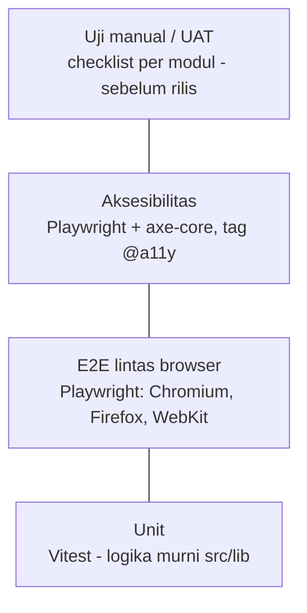

# 06 — Strategi dan Rencana Pengujian

## 1. Strategi (Piramida Uji)



| Lapisan       | Alat                                                                    | Cakupan                                                                                                                                                                                                                                                                                                                            | Kapan dijalankan                                    |
| ------------- | ----------------------------------------------------------------------- | ---------------------------------------------------------------------------------------------------------------------------------------------------------------------------------------------------------------------------------------------------------------------------------------------------------------------------------- | --------------------------------------------------- |
| Unit          | **Vitest** (`vitest.config.mts`, environment `node`, `TZ=Asia/Jakarta`) | Fungsi murni di `src/lib/**`: `cycles.ts` (batas waktu), `scope.ts` (cakupan pertanyaan), `format.ts`; target berikutnya `errors.ts` (`isSafeHttpUrl`), `sso.ts` (`resolveLocalRole`), `upload.ts` (validasi berkas), `ratelimit.ts`, `net.ts`, `redact.ts`. Cakupan dihitung untuk `src/lib/**` kecuali `report/` dan `actions/`. | Setiap commit (pre-commit hook), CI, gerbang deploy |
| E2E           | **Playwright**                                                          | Alur kritis lewat UI: login lokal, guard peran, siklus, penempatan, pengisian Ya/Tidak + unggah, verifikasi, ekspor PDF, mode pemeliharaan                                                                                                                                                                                         | PR yang menyentuh UI/alur, sebelum rilis            |
| Aksesibilitas | **@axe-core/playwright** (`npm run test:a11y` = test bertag `@a11y`)    | Halaman `/login`, `/no-access`, `/dashboard`, `/audit`, `/analitik`, `/pengaturan`; aturan WCAG 2.1 A/AA; gagal bila ada pelanggaran _serious/critical_                                                                                                                                                                            | Sebelum rilis                                       |
| Keamanan      | `npm run audit`, smoke test header, checklist PR                        | Dependensi rentan (high+), header keamanan                                                                                                                                                                                                                                                                                         | CI / setiap deploy                                  |
| Smoke         | `scripts/deploy/smoke-test.ps1`                                         | Health, rute dasar, header                                                                                                                                                                                                                                                                                                         | Setiap deploy (otomatis)                            |
| UAT           | Checklist §4                                                            | Seluruh modul per peran                                                                                                                                                                                                                                                                                                            | Setiap rilis MINOR/MAJOR                            |

Prinsip:

- Uji unit tidak menyentuh database; logika yang perlu diuji dipisahkan ke fungsi murni di `src/lib/`.
- E2E memakai database uji terpisah (`lpm_spmi_test`) yang di-_seed_ ulang; jangan pernah menjalankan E2E ke produksi.
- Setiap bug yang diperbaiki disertai uji regresi pada lapisan serendah mungkin.

## 2. Cara Menjalankan

```bash
npm run test                 # unit sekali jalan
npm run test:watch           # unit mode pantau
npm run test:coverage        # laporan cakupan (text, html di coverage/, lcov)

npm run test:e2e:install     # sekali: unduh browser Playwright
npm run test:e2e             # seluruh E2E (semua browser yang dikonfigurasi)
npx playwright test --project=chromium   # satu browser
npm run test:a11y            # hanya test bertag @a11y
npx playwright show-report   # laporan HTML

npm run ci                   # lint + format:check + typecheck + test
```

Data uji E2E: siapkan `.env.test` dengan `DATABASE_URL` ke `lpm_spmi_test`, lalu `npm run db:push` dan seed akun
uji (superadmin, admin LPM, anggota LPM, kepala unit, anggota unit, pengunjung).

## 3. Kriteria Lulus Rilis

1. `npm run ci` hijau; `npm run audit` tanpa kerentanan _high/critical_ pada dependensi produksi.
2. E2E hijau di Chromium, Firefox, WebKit.
3. `test:a11y` tanpa pelanggaran _serious/critical_.
4. UAT §4 seluruh butir prioritas tinggi berstatus ☑; butir lain gagal tercatat sebagai isu dengan keputusan penerimaan.
5. Smoke test produksi lulus pasca-deploy.

## 4. Checklist UAT

Isi kolom Status: ☐ belum diuji · ☑ lulus · ☒ gagal (tulis nomor isu). Penguji: ________ Tanggal: ________ Versi: ________

### 4.1 Login & SSO

| No   | Skenario                | Langkah                                       | Hasil yang diharapkan                                                               | Status |
| ---- | ----------------------- | --------------------------------------------- | ----------------------------------------------------------------------------------- | :----: |
| L-01 | Login lokal valid       | Isi email & sandi benar                       | Masuk ke `/dashboard` (atau `/no-access` untuk pengunjung)                          |   ☐    |
| L-02 | Sandi salah             | Isi sandi salah                               | Pesan "Email atau kata sandi salah."; tercatat di log login (gagal)                 |   ☐    |
| L-03 | Email tidak terdaftar   | Isi email acak                                | Pesan sama dengan L-02 (tanpa enumerasi)                                            |   ☐    |
| L-04 | Akun nonaktif           | Nonaktifkan akun, coba login                  | Pesan sama dengan L-02                                                              |   ☐    |
| L-05 | Pembatasan percobaan    | Gagal > batas (default 8) dalam 5 menit       | Pesan "Terlalu banyak percobaan…"; login benar pun ditolak sampai jendela habis     |   ☐    |
| L-06 | Cookie sesi aman        | Login di produksi, periksa DevTools           | Cookie `__Host-lpm_session` HttpOnly, Secure, SameSite=Lax, Path=/                  |   ☐    |
| L-07 | SSO pengguna baru       | Login SSO dengan akun yang belum ada          | Akun dibuat sebagai Pengunjung → `/no-access`                                       |   ☐    |
| L-08 | SSO email admin         | Email ada di daftar admin SSO, akun belum ada | Akun dibuat sebagai Admin LPM                                                       |   ☐    |
| L-09 | SSO akun yang ada       | Akun lokal dengan username/email sama         | Akun dipakai, peran tidak berubah, nama/email tersinkron                            |   ☐    |
| L-10 | SSO belum dikonfigurasi | Kosongkan Client ID                           | Tombol SSO tidak tampil; akses `/api/sso/redirect` → `/login?sso_error=konfigurasi` |   ☐    |
| L-11 | Logout                  | Klik Keluar                                   | Kembali ke `/login`; tombol Back tidak membuka dashboard                            |   ☐    |
| L-12 | Akses tanpa login       | Buka `/dashboard` di jendela private          | Dialihkan ke `/login`                                                               |   ☐    |

### 4.2 Dashboard

| No   | Skenario           | Langkah                  | Hasil yang diharapkan                                             | Status |
| ---- | ------------------ | ------------------------ | ----------------------------------------------------------------- | :----: |
| D-01 | Dashboard LPM      | Login Admin/Anggota LPM  | Statistik unit/siklus/pertanyaan, progres per unit, grafik tampil |   ☐    |
| D-02 | Dashboard auditee  | Login Kepala Unit        | Hanya data unit sendiri + status siklus terbuka/tertutup          |   ☐    |
| D-03 | Progres real-time  | Auditee menjawab 1 butir | Status unit berubah ke "Sedang Mengisi" di dashboard LPM          |   ☐    |
| D-04 | Tanpa siklus aktif | Nonaktifkan semua siklus | Dashboard tetap terbuka tanpa error                               |   ☐    |

### 4.3 Siklus

| No   | Skenario           | Langkah                            | Hasil yang diharapkan                                                      | Status |
| ---- | ------------------ | ---------------------------------- | -------------------------------------------------------------------------- | :----: |
| S-01 | Buat siklus        | Isi nama + tanggal, centang Aktif  | Siklus tersimpan dan aktif                                                 |   ☐    |
| S-02 | Satu siklus aktif  | Aktifkan siklus kedua              | Siklus pertama otomatis nonaktif                                           |   ☐    |
| S-03 | Validasi tanggal   | Tanggal selesai < tanggal mulai    | Ditolak dengan pesan                                                       |   ☐    |
| S-04 | Nonaktifkan manual | Klik Nonaktifkan                   | Auditee melihat "Periode pengisian ditutup"; simpan jawaban ditolak server |   ☐    |
| S-05 | Lewat batas waktu  | Set tanggal selesai = kemarin      | Pengisian & RTL ditolak; hari ini (= tanggal selesai) masih bisa           |   ☐    |
| S-06 | Akses non-admin    | Anggota LPM/auditee buka `/siklus` | Dialihkan ke `/dashboard`                                                  |   ☐    |

### 4.4 Unit

| No   | Skenario        | Langkah                      | Hasil yang diharapkan                                             | Status |
| ---- | --------------- | ---------------------------- | ----------------------------------------------------------------- | :----: |
| U-01 | Tambah unit     | Nama + kategori              | Muncul di daftar dan di tab kategori Audit                        |   ☐    |
| U-02 | Kategori baru   | Ketik kategori di luar saran | Tersimpan dan muncul sebagai kategori                             |   ☐    |
| U-03 | Ubah/hapus unit | Ubah nama, lalu hapus        | Perubahan tampil; setelah hapus, penempatan & jawaban unit hilang |   ☐    |

### 4.5 Role & Penempatan

| No   | Skenario                  | Langkah                                                    | Hasil yang diharapkan                                   | Status |
| ---- | ------------------------- | ---------------------------------------------------------- | ------------------------------------------------------- | :----: |
| R-01 | Tambah akun auditee       | Peran Anggota Unit tanpa unit                              | Ditolak "wajib ditautkan ke sebuah unit"                |   ☐    |
| R-02 | Sandi pendek              | Sandi 7 karakter                                           | Ditolak (min. 8)                                        |   ☐    |
| R-03 | Email duplikat            | Email yang sudah ada                                       | Ditolak "Email sudah terdaftar."                        |   ☐    |
| R-04 | Satu Kepala Unit          | Tempatkan kepala kedua pada unit yang sama                 | Ditolak dengan nama kepala yang ada                     |   ☐    |
| R-05 | Rangkap jabatan           | Tempatkan satu akun di 2 unit                              | Akun melihat pemilih unit di Audit                      |   ☐    |
| R-06 | Pengunjung → auditee      | Tempatkan akun pengunjung                                  | Peran menjadi Anggota/Kepala Unit; bisa masuk dashboard |   ☐    |
| R-07 | Lepas penempatan terakhir | Hapus satu-satunya penempatan                              | Akun kembali Pengunjung                                 |   ☐    |
| R-08 | Ketua LPM tunggal         | Tunjuk Ketua LPM A lalu B                                  | Hanya B yang bertanda mahkota; PDF menampilkan B        |   ☐    |
| R-09 | Akun LPM sebagai auditee  | Tempatkan Admin LPM ke unit                                | Ditolak                                                 |   ☐    |
| R-10 | Eskalasi peran            | Admin LPM mencoba membuat/mengubah akun menjadi Superadmin | Ditolak (hanya superadmin yang mengelola superadmin)    |   ☐    |
| R-11 | Hapus diri sendiri        | Admin menghapus akunnya                                    | Ditolak                                                 |   ☐    |
| R-12 | Nonaktifkan akun          | Set nonaktif saat pengguna sedang login                    | Permintaan berikutnya pengguna dialihkan ke `/login`    |   ☐    |

### 4.6 Penetapan / Evaluasi

| No   | Skenario           | Langkah                                      | Hasil yang diharapkan            | Status |
| ---- | ------------------ | -------------------------------------------- | -------------------------------- | :----: |
| P-01 | Unggah PDF         | Pilih siklus, judul, PDF ≤ 10 MB             | Tersimpan; dapat dibuka          |   ☐    |
| P-02 | Tautan             | Isi `https://…`                              | Tersimpan; tautan terbuka        |   ☐    |
| P-03 | Tautan berbahaya   | Isi `javascript:alert(1)` / `data:…`         | Ditolak                          |   ☐    |
| P-04 | Berkas palsu       | Unggah `.html` / `.exe` berganti nama `.pdf` | Ditolak ("bukan PDF yang valid") |   ☐    |
| P-05 | Auditee hanya baca | Login auditee                                | Tidak ada tombol tambah/hapus    |   ☐    |

### 4.7 Audit & Verifikasi

| No   | Skenario                   | Langkah                                       | Hasil yang diharapkan                                    | Status |
| ---- | -------------------------- | --------------------------------------------- | -------------------------------------------------------- | :----: |
| A-01 | Tambah standar             | Nama unik                                     | Tersimpan; nama duplikat dalam siklus ditolak            |   ☐    |
| A-02 | Butir massal               | Kelola Butir → tambah 3 butir → Simpan        | 3 butir tersimpan berurutan                              |   ☐    |
| A-03 | Cakupan kategori           | Butir cakupan "Biro"                          | Hanya unit kategori Biro yang melihatnya                 |   ☐    |
| A-04 | Cakupan unit               | Butir cakupan 1 unit                          | Hanya unit tersebut melihatnya                           |   ☐    |
| A-05 | Ya tanpa bukti             | Pilih Ya, tanpa berkas/tautan                 | Ditolak "wajib disertai bukti"                           |   ☐    |
| A-06 | Tidak tanpa alasan         | Pilih Tidak tanpa alasan                      | Ditolak "wajib disertai alasan"                          |   ☐    |
| A-07 | Ya + PDF                   | Unggah PDF valid                              | Tersimpan, status Menunggu Verifikasi                    |   ☐    |
| A-08 | Unit orang lain            | Manipulasi `unitId` ke unit lain (DevTools)   | Ditolak "tidak memiliki akses"                           |   ☐    |
| A-09 | Verifikasi                 | LPM pilih Terverifikasi                       | Status Terverifikasi, nama verifikator tampil            |   ☐    |
| A-10 | Revisi tanpa catatan       | Pilih Perlu Revisi tanpa catatan              | Ditolak                                                  |   ☐    |
| A-11 | Revisi + RTL               | LPM revisi dengan catatan; auditee isi RTL    | Catatan tampil di auditee; RTL tampil di LPM             |   ☐    |
| A-12 | Ubah jawaban terverifikasi | Auditee ubah jawaban                          | Status kembali Menunggu Verifikasi, catatan LPM terhapus |   ☐    |
| A-13 | Progres selesai            | Jawab semua butir relevan                     | Status unit Selesai                                      |   ☐    |
| A-14 | Hapus standar              | Hapus standar berisi jawaban                  | Konfirmasi; butir & jawabannya terhapus                  |   ☐    |
| A-15 | Akses bukti                | Auditee unit lain membuka URL bukti unit lain | Ditolak (401/403)                                        |   ☐    |

### 4.8 Analitik & Laporan PDF

| No   | Skenario                | Langkah                                                                      | Hasil yang diharapkan                                                 | Status |
| ---- | ----------------------- | ---------------------------------------------------------------------------- | --------------------------------------------------------------------- | :----: |
| N-01 | Analitik per standar    | Pilih siklus → Tampilkan                                                     | Grafik & rekap sesuai data                                            |   ☐    |
| N-02 | PDF keseluruhan         | Unduh Laporan PDF                                                            | Berkas `Laporan_Audit_SPMI_<siklus>.pdf`, blok tanda tangan Ketua LPM |   ☐    |
| N-03 | PDF per unit            | Unduh di baris unit                                                          | Tabel No/Standar/Pertanyaan/Hasil Observasi/Y\*/T\*/Catatan Khusus    |   ☐    |
| N-04 | Tanpa Ketua LPM         | Cabut Ketua LPM, unduh PDF                                                   | PDF tetap terbentuk dengan penanda tangan kosong/default              |   ☐    |
| N-05 | Auditee akses ekspor    | Auditee buka `/api/export?cycleId=1` (keseluruhan) dan `&unitId=<unit lain>` | 403 `{"error":"Akses ditolak."}`; `&unitId=<unit sendiri>` → 200 PDF  |   ☐    |
| N-07 | Tanpa sesi / batas laju | Buka ekspor di jendela private; unduh > 10× dalam 1 menit                    | 401; 429 dengan `Retry-After`                                         |   ☐    |
| N-06 | Parameter salah         | `/api/export` tanpa `cycleId`; `unitId=abc`; `cycleId=99999`                 | 400 / 400 / 404 JSON                                                  |   ☐    |

### 4.9 Pengaturan (Superadmin)

| No   | Skenario             | Langkah                           | Hasil yang diharapkan                                           | Status |
| ---- | -------------------- | --------------------------------- | --------------------------------------------------------------- | :----: |
| G-01 | Identitas            | Ubah nama sistem                  | Judul tab & login berubah                                       |   ☐    |
| G-02 | Logo                 | Unggah PNG ≤ 2 MB; coba SVG       | PNG diterima; SVG ditolak                                       |   ☐    |
| G-03 | Secret SSO           | Simpan secret, buka ulang tab     | Tampil disamarkan; simpan tanpa mengubah tidak menghapus secret |   ☐    |
| G-04 | Uji Koneksi SSO      | Klik Uji Koneksi                  | Berhasil bila server SSO terjangkau                             |   ☐    |
| G-05 | Log login            | Login gagal lalu lihat tab log    | Entri tercatat (email, IP, user-agent, pesan)                   |   ☐    |
| G-06 | Masa sesi            | Ubah ke 1 hari, login ulang       | Cookie kedaluwarsa 1 hari                                       |   ☐    |
| G-07 | Pemeliharaan         | Aktifkan; login sebagai Admin LPM | Admin melihat pesan pemeliharaan; superadmin tetap bisa         |   ☐    |
| G-08 | Tambah superadmin    | Buat superadmin baru              | Bisa login & melihat Pengaturan                                 |   ☐    |
| G-09 | Akses non-superadmin | Admin LPM buka `/pengaturan`      | Dialihkan ke `/dashboard`                                       |   ☐    |

### 4.10 Privasi, Persetujuan & Ekspor Data

| No   | Skenario             | Langkah                                                       | Hasil yang diharapkan                                                                          | Status |
| ---- | -------------------- | ------------------------------------------------------------- | ---------------------------------------------------------------------------------------------- | :----: |
| V-01 | Halaman kebijakan    | Buka `/kebijakan-privasi` dan `/syarat-ketentuan` tanpa login | Tampil (200)                                                                                   |   ☐    |
| V-02 | Persetujuan pertama  | Login pertama kali akun baru                                  | Diminta menyetujui kebijakan privasi; tercatat `consented_at` & `consent_version`              |   ☐    |
| V-03 | Versi kebijakan baru | Naikkan versi kebijakan                                       | Pengguna diminta menyetujui ulang                                                              |   ☐    |
| V-04 | Ekspor data pribadi  | Login → unduh data saya (`/api/me/export`)                    | JSON berisi profil, penempatan, log milik sendiri; **tanpa** hash sandi; tanpa data orang lain |   ☐    |
| V-05 | Ekspor tanpa login   | Buka `/api/me/export` di jendela private                      | 401                                                                                            |   ☐    |
| V-06 | Log tersamarkan      | Periksa log server setelah login gagal                        | Email tersamarkan (`a***@domain`), tidak ada sandi/token                                       |   ☐    |
| V-07 | Purge terjadwal      | Jalankan tugas purge privasi                                  | Log melewati retensi terhapus; dicatat di log aktivitas                                        |   ☐    |
| V-08 | Revokasi sesi        | Ganti kata sandi di perangkat A                               | Sesi di perangkat B berakhir                                                                   |   ☐    |
