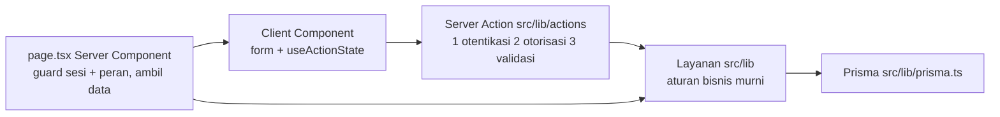

# 07 — Standar Engineering

Standar ini mengikat semua kontribusi ke repositori SPMI. Penyimpangan harus dijelaskan di deskripsi PR.

## 1. Konvensi Penamaan

| Objek                         | Konvensi                                                        | Contoh di kode                                                   |
| ----------------------------- | --------------------------------------------------------------- | ---------------------------------------------------------------- |
| Variabel, fungsi, properti TS | `camelCase`                                                     | `getCurrentUser`, `cycleClosedReason`, `unitIdsOf`               |
| Komponen React, tipe, kelas   | `PascalCase`                                                    | `AuditeeAuditWorkspace`, `SessionUser`, `AppError`               |
| Konstanta modul               | `UPPER_SNAKE_CASE`                                              | `MAX_BYTES`, `SETTING_DEFAULTS`, `NAV_ITEMS`, `UMUM_SLUG`        |
| Berkas & folder kode          | `kebab-case`                                                    | `audit-workspace.tsx`, `change-password-form.tsx`, `pdf-unit.ts` |
| Rute (segmen URL)             | Bahasa Indonesia, `kebab-case`                                  | `/role-penempatan`, `/no-access`, `/kebijakan-privasi`           |
| Model Prisma                  | `PascalCase` tunggal                                            | `AuditCycle`, `UnitMembership`                                   |
| Field Prisma                  | `camelCase` + `@map("snake_case")`                              | `startDate @map("start_date")`                                   |
| Tabel MySQL                   | `snake_case` jamak via `@@map`                                  | `audit_cycles`, `unit_memberships`, `login_logs`                 |
| Nilai enum                    | `snake_case` huruf kecil                                        | `lpm_admin`, `auditee_head`, `belum_mulai`                       |
| Kunci pengaturan              | `domain.namaKey`                                                | `security.sessionDays`, `sso.clientSecret`                       |
| Aksi log aktivitas            | `entitas.kata_kerja`                                            | `auth.login`, `sso.register`, `settings.update`                  |
| Server Action                 | kata kerja + objek                                              | `createCycle`, `verifyResponse`, `assignMember`                  |
| Branch / commit               | lihat [02 §4–5](02-PANDUAN-PENGEMBANGAN.md#4-alur-git-git-flow) | `feature/ekspor-excel`, `feat(audit): …`                         |

## 2. Bahasa

- **UI:** Bahasa Indonesia baku untuk semua teks, label, pesan error, dan judul (`<html lang="id">`).
  Istilah SPMI dipertahankan (Standar, Butir, KTS, RTL, Monev, Penetapan, Evaluasi).
- **Komentar & JSDoc:** Bahasa Indonesia (konsisten dengan basis kode), boleh memakai istilah teknis Inggris
  (_server action_, _rate limit_, _magic bytes_). Komentar menjelaskan **mengapa**, terutama untuk keamanan
  (prefiks `KEAMANAN:`).
- **Identifier kode:** Bahasa Inggris (`saveResponse`, `isCycleOpen`), kecuali nilai domain yang memang
  berbahasa Indonesia (`penetapan`, `evaluasi`, `belum_mulai`, `pengunjung`).
- **Log server:** prefiks tag dalam kurung siku (`[action-error]`, `[security]`, `[login-log]`) + pesan Indonesia.
- **Dokumentasi:** Bahasa Indonesia, Markdown di `docs/`, diagram Mermaid.

## 3. Pola Lapisan

Aturan:

1. **Page (Server Component)**: panggil `getCurrentUser()`; `redirect()` bila tidak berhak; ambil data via Prisma/layanan;
   kirim ke komponen klien **hanya** field yang diperlukan (jangan kirim objek Prisma utuh — mis. hash sandi).
2. **Server Action** (`"use server"`, satu berkas per modul di `src/lib/actions/`):
   urutan wajib **otentikasi → otorisasi (peran + kepemilikan sumber daya) → validasi input → aturan bisnis → tulis DB →
   `revalidatePath` → `recordActivity`**. Bentuk kembalian `{ ok?: boolean; error?: string }`.
   Seluruh isi dibungkus `try/catch` dengan `toActionError(e, "<pesan fallback>")`.
3. **Layanan** (`src/lib/*.ts`): logika murni yang dapat diuji unit (`cycles.ts`, `scope.ts`, `progress.ts`).
   Aturan bisnis yang berlaku di banyak tempat **harus** di sini, bukan disalin di komponen.
4. **Prisma**: hanya melalui singleton `src/lib/prisma.ts`. Operasi multi-tabel yang harus konsisten memakai `prisma.$transaction`.
5. **Route Handler** (`src/app/api/**`) hanya untuk redirect OAuth, unduhan biner, dan health check — lihat [03-API.md](03-API.md).
6. Penegakan aturan **selalu di server**; validasi/penyembunyian di UI hanya untuk kenyamanan.

## 4. Penanganan Error

- Lempar `AppError("<pesan aman>")` (atau `fail()`) untuk kesalahan yang boleh dilihat pengguna (`src/lib/errors.ts`).
- Error lain **tidak boleh** diteruskan ke klien: `toActionError` mengembalikan pesan generik dan mencatat detail di log server.
- Jangan menampilkan `e.message`, nama tabel/kolom, stack trace, atau respons sistem pihak ketiga ke pengguna.
- Pesan autentikasi seragam untuk mencegah enumerasi akun.
- Route Handler mengembalikan JSON `{ "error": "<pesan aman>" }` dengan kode status yang tepat (400/401/403/404/503).
- Pencatatan log bersifat _best-effort_: kegagalan log tidak boleh menggagalkan aksi (pola `src/lib/logs.ts`).
- Data pribadi di log disamarkan dengan `src/lib/redact.ts` (`maskEmail`, `maskToken`, …).

## 5. Keamanan & Validasi Input

- Validasi semua input `FormData` di server: tipe (`Number(...)` + cek `!id`), enum melalui _whitelist_
  (contoh `DOCUMENT_TYPES` di `documents.ts`), panjang, dan URL hanya `http/https` (`isSafeHttpUrl`).
- Nilai yang menentukan path berkas **tidak pernah** berasal langsung dari pengguna (whitelist folder di `upload.ts`).
- Nilai peran (`role`) dari form wajib divalidasi terhadap enum dan hak pemanggil (Admin LPM tidak boleh memberi/mengubah `superadmin`).
- Rahasia hanya di `shared\.env` atau `app_settings` (`isSecret`), tidak pernah di repo, log, atau respons klien.
- Kata sandi: bcrypt cost 10, minimal 8 karakter.

## 6. Keamanan Wajib per PR

Salin ke deskripsi PR dan centang:

- [ ] Setiap Server Action / Route Handler baru memeriksa **otentikasi** dan **otorisasi** (peran + kepemilikan data, mis. `unitIdsOf(user)`).
- [ ] Semua input divalidasi di server (tipe, enum whitelist, panjang, URL `http/https`).
- [ ] Tidak ada `e.message` / detail internal ke klien; memakai `AppError` / `toActionError`.
- [ ] Tidak ada rahasia, kredensial, atau data pribadi asli di kode, test, fixture, atau log.
- [ ] Unggahan memakai `saveUpload` (whitelist folder & ekstensi, magic bytes, batas ukuran).
- [ ] Data yang dikirim ke komponen klien diminimalkan (tanpa hash sandi, secret, data unit lain).
- [ ] Operasi multi-langkah yang harus konsisten memakai transaksi.
- [ ] Perubahan sensitif dicatat `recordActivity` (tanpa data pribadi berlebih).
- [ ] Header keamanan/CSP tidak dilonggarkan tanpa alasan tertulis.
- [ ] Dependensi baru: lisensi kompatibel, aktif dipelihara, `npm run audit` bersih.
- [ ] Perubahan pemrosesan data pribadi → perbarui [legal/RoPA.md](legal/RoPA.md).
- [ ] Uji unit/E2E untuk aturan baru atau bug yang diperbaiki.

## 7. Aksesibilitas (WCAG 2.1 AA)

- Gunakan elemen semantik (`<button>`, `<a>`, `<label>`, `<table>` dengan `<th>`), bukan `div` yang dapat diklik.
- Setiap input memiliki `<label>` terkait; pesan error form diumumkan (`role="alert"` / `aria-live="polite"`).
- Kontras teks minimum 4.5:1 di tema terang **dan** gelap; jangan menyampaikan status hanya dengan warna
  (badge status menyertakan teks: "Terverifikasi", "Perlu Revisi").
- Semua fungsi dapat dioperasikan dengan keyboard; fokus terlihat; modal (`src/components/ui/modal.tsx`)
  menjebak fokus dan dapat ditutup dengan `Esc`.
- Ikon tanpa teks memiliki `aria-label`; gambar bermakna memiliki `alt`.
- Hormati `prefers-reduced-motion` untuk animasi Framer Motion.
- Diverifikasi otomatis dengan `npm run test:a11y` (axe) dan manual dengan keyboard + pembaca layar (NVDA).

## 8. Tanggal, Waktu, dan Angka

- **Penyimpanan:** `DATETIME` (UTC oleh Prisma) untuk stempel waktu; `DATE` untuk tanggal siklus (`start_date`, `end_date`).
- **Pertukaran data** (JSON, ekspor, log, nama berkas): **ISO 8601** (`2026-10-17T09:15:00+07:00`, `toISOString()`).
- **Tampilan:** `Intl.DateTimeFormat("id-ID")` melalui `formatDate` / `formatDateTime` (`src/lib/format.ts`), mis. `17 Okt 2026`.
- **Zona waktu:** **Asia/Jakarta (WIB, UTC+7)** — proses Node (`TZ` di PM2 & Vitest), MySQL (`--default-time-zone=+07:00`),
  dan `APP_TIMEZONE`. Batas pengisian dihitung sampai akhir hari `end_date` waktu server (`src/lib/cycles.ts`).
- **Persentase:** bilangan bulat dibulatkan (`percent()` di `src/lib/format.ts`).
- **Uang / mata uang:** tidak berlaku (N/A) — sistem tidak memproses nilai moneter.

## 9. Gaya Kode

- TypeScript `strict`; hindari `any` (gunakan `unknown` + penyempitan tipe).
- Format otomatis Prettier (`.prettierrc.json`): titik koma, kutip ganda, `trailingComma: es5`, lebar 80, LF.
- ESLint (`eslint.config.mjs`) tanpa peringatan pada berkas yang diubah.
- Impor memakai alias `@/` untuk `src/`.
- Komponen klien ditandai `"use client"` hanya bila perlu state/efek/browser API.
- Tidak ada `console.log` sisa debug; gunakan `console.error`/`console.warn` dengan tag untuk log operasional.
