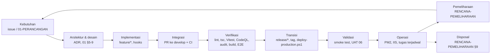

# ISO/IEC/IEEE 12207:2017 — Proses Siklus Hidup Perangkat Lunak SPMI

Pemetaan proses nyata pengembangan & operasi **Sistem Informasi SPMI — LPM Universitas Pahlawan Tuanku Tambusai**
ke kelompok proses ISO/IEC/IEEE 12207:2017 beserta bukti yang dapat diverifikasi di repositori/server.

| Versi dokumen | Tanggal         | Versi aplikasi | Klasifikasi      |
| ------------- | --------------- | -------------- | ---------------- |
| 1.0           | 17 Oktober 2026 | v1.1.3         | Dokumen Internal |

Keterangan status: ✅ dijalankan & berbukti · ⚠️ sebagian · ⏳ butuh keputusan/tindakan institusi · N/A tidak berlaku.

## 1. Model Siklus Hidup

SPMI memakai model **iteratif-inkremental** dengan rilis kecil bertag SemVer: setiap perubahan mengalir
`feature/*`/`fix/*` → `develop` → `release/X.Y.Z` → `main` (+ tag) → deploy bergerbang → verifikasi.
Perbaikan darurat memakai `hotfix/*` dari `main`. Model ini ditetapkan di [CONTRIBUTING.md](../../CONTRIBUTING.md)
dan [02-PANDUAN-PENGEMBANGAN](../02-PANDUAN-PENGEMBANGAN.md).

## 2. Proses Perjanjian (Agreement Processes, 6.1)

| Proses         | Penerapan di SPMI                                                                                                                                                                    | Bukti                                                                                  | Status |
| -------------- | ------------------------------------------------------------------------------------------------------------------------------------------------------------------------------------ | -------------------------------------------------------------------------------------- | :----: |
| 6.1.1 Akuisisi | LPM (pemilik) memperoleh sistem dari tim pengembang internal; kebutuhan dirumuskan bersama LPM. Akuisisi layanan pihak ketiga: Cloudflare (Free), GitHub (privat), SSO UP (internal) | [01-PERANCANGAN §1–3](../01-PERANCANGAN.md), [legal/RoPA](../legal/RoPA.md) (prosesor) |   ⚠️   |
| 6.1.2 Pasokan  | Tim pengembang memasok rilis bertag + catatan rilis + dokumentasi + runbook kepada LPM/Puskom                                                                                        | Tag `v1.0.0`…`v1.1.3`, [CHANGELOG](../../CHANGELOG.md), `docs/`                        |   ✅   |

Kesenjangan (⏳): belum ada dokumen perjanjian layanan formal (SLA internal LPM–Puskom–tim pengembang) dan
perjanjian pemrosesan data dengan Cloudflare/pengelola SSO ([CHECKLIST-KEPATUHAN T-06](../legal/CHECKLIST-KEPATUHAN.md)).
SLA operasional diusulkan di [RENCANA-PEMELIHARAAN §2](RENCANA-PEMELIHARAAN.md#2-tingkat-prioritas-dan-sla).

## 3. Proses Pemungkin Proyek Organisasi (Organizational Project-Enabling, 6.2)

| Proses                             | Penerapan                                                                                                                                               | Bukti                                                                                                                     | Status |
| ---------------------------------- | ------------------------------------------------------------------------------------------------------------------------------------------------------- | ------------------------------------------------------------------------------------------------------------------------- | :----: |
| 6.2.1 Manajemen model siklus hidup | Git Flow, Conventional Commits, SemVer; standar engineering mengikat semua kontribusi                                                                   | [CONTRIBUTING](../../CONTRIBUTING.md), [07-STANDAR-ENGINEERING](../07-STANDAR-ENGINEERING.md), `scripts/hooks/commit-msg` |   ✅   |
| 6.2.2 Manajemen infrastruktur      | Infrastruktur sebagai kode/skrip: IIS `web.config`, PM2 `ecosystem.config.cjs`, MySQL `docker-compose.db.yml`, setup idempoten; runner CI GitHub-hosted | `deploy/`, `scripts/deploy/setup-production.ps1`, `.github/workflows/`                                                    |   ✅   |
| 6.2.3 Manajemen portofolio         | SPMI salah satu sistem universitas di server IIS bersama; prioritas antar-sistem ditentukan institusi                                                   | —                                                                                                                         |   ⏳   |
| 6.2.4 Manajemen SDM                | Panduan onboarding pengembang; kompetensi & pelatihan pengguna belum diformalkan                                                                        | [CONTRIBUTING §1](../../CONTRIBUTING.md), [05-PANDUAN-PENGGUNA](../05-PANDUAN-PENGGUNA.md)                                |   ⚠️   |
| 6.2.5 Manajemen mutu               | Sasaran mutu terukur (0 error lint, 0 kerentanan high, Lighthouse, WCAG AA) & daftar standar                                                            | [09-DAFTAR-STANDAR](../09-DAFTAR-STANDAR.md), [9001-PEMETAAN](9001-PEMETAAN.md)                                           |   ✅   |
| 6.2.6 Manajemen pengetahuan        | Docs-as-code; ADR; laporan audit; runbook troubleshooting berbasis insiden nyata                                                                        | `docs/`, `docs/adr/`, `LAPORAN_KEAMANAN.md`, [04 §11](../04-DEPLOYMENT-IIS.md#11-troubleshooting)                         |   ✅   |

## 4. Proses Manajemen Teknis (Technical Management, 6.3)

| Proses                                | Penerapan                                                                                                                                                                              | Bukti                                                                                                                                           | Status |
| ------------------------------------- | -------------------------------------------------------------------------------------------------------------------------------------------------------------------------------------- | ----------------------------------------------------------------------------------------------------------------------------------------------- | :----: |
| 6.3.1 Perencanaan proyek              | Backlog & tindakan di luar kode dengan pemilik; rencana rilis                                                                                                                          | [09 Backlog](../09-DAFTAR-STANDAR.md#backlog--tindakan-di-luar-kode), `implementation_plan.md` (historis)                                       |   ⚠️   |
| 6.3.2 Penilaian & pengendalian proyek | Status kepatuhan per kategori (✅/⚠️/⏳); "Temuan Terbuka"                                                                                                                             | [09](../09-DAFTAR-STANDAR.md), [docs/README](../README.md#temuan-terbuka)                                                                       |   ✅   |
| 6.3.3 Manajemen keputusan             | Architecture Decision Records (konteks–keputusan–konsekuensi)                                                                                                                          | [adr/0001–0006](../adr/)                                                                                                                        |   ✅   |
| 6.3.4 Manajemen risiko                | Register risiko dengan skor kemungkinan × dampak, pemilik, perlakuan; model ancaman STRIDE                                                                                             | [RISK-REGISTER](RISK-REGISTER.md), [THREAT-MODEL-STRIDE](THREAT-MODEL-STRIDE.md)                                                                |   ✅   |
| 6.3.5 Manajemen konfigurasi           | Git (branch, tag beranotasi), `package-lock.json` + `npm ci`, rilis immutable `releases\<ts>` + `release.json`, junction `current`, 5 rilis disimpan; konfigurasi rahasia di `shared\` | `scripts/deploy/deploy-production.ps1`, [04 §2](../04-DEPLOYMENT-IIS.md#2-struktur-direktori)                                                   |   ✅   |
| 6.3.6 Manajemen informasi             | Dokumentasi Markdown ber-versi; RoPA; klasifikasi "Dokumen Internal"                                                                                                                   | `docs/`, [legal/RoPA](../legal/RoPA.md)                                                                                                         |   ✅   |
| 6.3.7 Pengukuran                      | Jumlah uji (287 unit, 108 E2E), cakupan (`test:coverage`), Lighthouse, `npm audit`, temuan audit per tingkat                                                                           | [09 §6, §12](../09-DAFTAR-STANDAR.md), artefak `coverage` CI                                                                                    |   ✅   |
| 6.3.8 Penjaminan mutu                 | Gerbang otomatis (hook pre-commit/commit-msg, CI, gerbang test deploy), PR ≥ 1 reviewer + checklist keamanan                                                                           | `scripts/hooks/`, `.github/workflows/ci.yml`, `.github/pull_request_template.md`, [07 §6](../07-STANDAR-ENGINEERING.md#6-keamanan-wajib-per-pr) |   ✅   |

## 5. Proses Teknis (Technical Processes, 6.4)

| Proses                                          | Penerapan                                                                                                                                                                                             | Bukti                                                                                                                                      |                 Status                 |
| ----------------------------------------------- | ----------------------------------------------------------------------------------------------------------------------------------------------------------------------------------------------------- | ------------------------------------------------------------------------------------------------------------------------------------------ | :------------------------------------: |
| 6.4.1 Analisis bisnis/misi                      | SPMI mendukung siklus AMI/PPEPP sesuai UU 12/2012 & Permendikbudristek 53/2023                                                                                                                        | [01 §1](../01-PERANCANGAN.md), [legal/RoPA](../legal/RoPA.md) (rujukan)                                                                    |                   ✅                   |
| 6.4.2 Definisi kebutuhan pemangku kepentingan   | Aktor/peran (superadmin, Admin/Anggota LPM, Kepala/Anggota Unit, pengunjung) & use case per peran                                                                                                     | [01 §2, §7](../01-PERANCANGAN.md)                                                                                                          |                   ✅                   |
| 6.4.3 Definisi kebutuhan sistem/perangkat lunak | Kebutuhan fungsional & non-fungsional; kebutuhan keamanan ASVS L2; kebutuhan privasi UU PDP                                                                                                           | [01 §3–4](../01-PERANCANGAN.md), [27034 §3](27034-KEAMANAN-APLIKASI.md), [27701](27701-PRIVASI.md)                                         |                   ✅                   |
| 6.4.4 Definisi arsitektur                       | Topologi Browser → Cloudflare → IIS ARR → Next.js/PM2 → MySQL; lapisan Page → Server Action → lib → Prisma                                                                                            | [01 §5](../01-PERANCANGAN.md), [ADR-0001/0005](../adr/), [THREAT-MODEL-STRIDE §2](THREAT-MODEL-STRIDE.md)                                  |                   ✅                   |
| 6.4.5 Definisi desain                           | ERD, diagram sekuens, aturan bisnis; konvensi penamaan & penanganan error                                                                                                                             | [01 §6, §8, §9](../01-PERANCANGAN.md), [07](../07-STANDAR-ENGINEERING.md)                                                                  |                   ✅                   |
| 6.4.6 Analisis sistem                           | Analisis performa (Lighthouse), analisis keamanan (audit, STRIDE), analisis dampak perubahan                                                                                                          | [09 §6](../09-DAFTAR-STANDAR.md), `LAPORAN_KEAMANAN.md`                                                                                    |                   ✅                   |
| 6.4.7 Implementasi                              | TypeScript strict, ESLint + Prettier, hook pre-commit, Conventional Commits                                                                                                                           | `eslint.config.mjs`, `.prettierrc.json`, `scripts/hooks/pre-commit`                                                                        |                   ✅                   |
| 6.4.8 Integrasi                                 | PR ke `develop`; CI (`ci.yml`) menjalankan lint, format, typecheck, unit test + coverage, `npm audit`, `next build`; CodeQL (`codeql.yml`)                                                            | `.github/workflows/ci.yml`, `.github/workflows/codeql.yml`                                                                                 |  ✅ (⏳ aktif setelah push ke GitHub)  |
| 6.4.9 Verifikasi                                | Vitest 287 uji (regresi temuan keamanan), Playwright 108 E2E di 5 profil browser, axe WCAG 2.1 AA, CodeQL SAST, smoke test header keamanan                                                            | `tests/unit`, `tests/e2e`, `.github/workflows/e2e.yml`, [06](../06-PENGUJIAN.md)                                                           |                   ✅                   |
| 6.4.10 Transisi                                 | `release/*` → tag → `deploy-production.ps1`: worktree bersih → gerbang test → build standalone → backup → maintenance 503 → `prisma db push` → junction atomik → PM2 → smoke test → rollback otomatis | `scripts/deploy/deploy-production.ps1`, [04 §5](../04-DEPLOYMENT-IIS.md#5-deploy-rilis), [ADR-0005](../adr/0005-iis-arr-pm2-deployment.md) |                   ✅                   |
| 6.4.11 Validasi                                 | Smoke test upstream & publik; checklist UAT per modul; uji login nyata di produksi (`auth.spec.ts` 4/4)                                                                                               | `scripts/deploy/smoke-test.ps1`, [06 §4](../06-PENGUJIAN.md)                                                                               |                   ✅                   |
| 6.4.12 Operasi                                  | PM2 (`instances: 1`, `max_memory_restart`), IIS ARR, tugas terjadwal (backup 01:30, retensi 02:00, watchdog 5 menit), pemantauan log, `/api/health`                                                   | `deploy/ecosystem.config.cjs`, `scripts/deploy/register-tasks.ps1`, `scripts/deploy/watchdog.ps1`, [04 §9–10](../04-DEPLOYMENT-IIS.md)     |                   ✅                   |
| 6.4.13 Pemeliharaan                             | Korektif/adaptif/perfektif/preventif dengan SLA P1–P4 & prosedur perubahan                                                                                                                            | [RENCANA-PEMELIHARAAN](RENCANA-PEMELIHARAAN.md), [CHANGELOG](../../CHANGELOG.md)                                                           |                   ✅                   |
| 6.4.14 Disposal                                 | Prosedur penonaktifan, ekspor arsip, pemusnahan data & media                                                                                                                                          | [RENCANA-PEMELIHARAAN §9](RENCANA-PEMELIHARAAN.md#9-disposal-penonaktifan-dan-retensi-data)                                                | ✅ (prosedur; belum pernah dijalankan) |

## 6. Jejak Bukti Contoh (Rilis v1.1.2)

Ilustrasi alur penuh pada satu perubahan nyata:

1. **Kejadian operasi** (6.4.12): 17 Okt 2026 PM2 gagal start `EPERM` pada `logs\pm2-out.log`; restore DB
   rollback rapuh — tercatat di log deploy `E:\www\spmi-prod\logs\deploy-<ts>.log`.
2. **Analisis & keputusan** (6.3.3–6.3.4): akar masalah ACL `logs` dan dump DB via redirect shell.
3. **Implementasi** (6.4.7): `scripts/deploy/lib-db.ps1` (dump/restore via `docker cp`, kredensial dari env kontainer).
4. **Integrasi/verifikasi** (6.4.8–6.4.9): commit `3e4a343 fix(ops): dump/restore DB andal, rollback bertahap, ACL logs`.
5. **Transisi** (6.4.10): `chore(release): v1.1.2`, tag `v1.1.2`, deploy bergerbang.
6. **Pengetahuan** (6.2.6): baris troubleshooting baru di [04 §11](../04-DEPLOYMENT-IIS.md#11-troubleshooting), entri [CHANGELOG 1.1.2](../../CHANGELOG.md).

## 7. Kesenjangan & Tindak Lanjut

| No  | Kesenjangan                                                                | Proses 12207   | Tindak lanjut                                                                   | Pemilik               |
| --- | -------------------------------------------------------------------------- | -------------- | ------------------------------------------------------------------------------- | --------------------- |
| 1   | Tidak ada lingkungan staging (validasi sebelum produksi hanya di lokal/CI) | 6.4.10, 6.4.11 | Siapkan staging (site IIS + DB terpisah)                                        | Tim pengembang/Puskom |
| 2   | Skema DB disinkronkan `prisma db push` tanpa riwayat migrasi               | 6.3.5          | Beralih ke `prisma migrate deploy` ([ADR-0002](../adr/0002-prisma-mysql.md))    | Tim pengembang        |
| 3   | CI belum aktif sampai repositori di-push & branch dilindungi               | 6.4.8, 6.3.8   | Push `main`/`develop`/tag; aktifkan aturan branch (bila paket GitHub mendukung) | Tim pengembang        |
| 4   | SLA & perjanjian layanan belum disahkan                                    | 6.1.1, 6.1.2   | Sahkan [RENCANA-PEMELIHARAAN](RENCANA-PEMELIHARAAN.md) oleh Ketua LPM & Puskom  | LPM / Puskom          |
| 5   | Tinjauan keamanan independen belum ada                                     | 6.4.9          | Uji penetrasi pihak ketiga                                                      | LPM                   |
