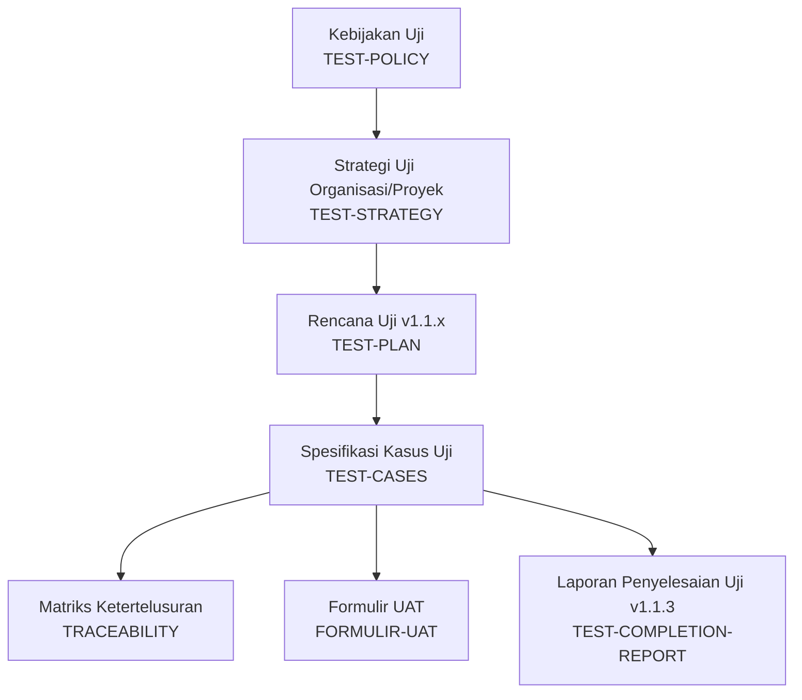

# ISO/IEC/IEEE 29119 — Dokumentasi Pengujian SPMI

Dokumentasi pengujian Sistem Informasi SPMI mengikuti **ISO/IEC/IEEE 29119-2** (proses pengujian) dan
**29119-3** (dokumentasi pengujian). Dokumen ini melengkapi — bukan menggantikan —
[06-PENGUJIAN.md](../../06-PENGUJIAN.md) (cara menjalankan & checklist UAT ringkas).

| Versi dokumen | Tanggal         | Versi aplikasi | Klasifikasi      |
| ------------- | --------------- | -------------- | ---------------- |
| 1.0           | 17 Oktober 2026 | v1.1.3         | Dokumen Internal |

## Hierarki Dokumen (29119-3)

| Dokumen (29119-3)                        | Berkas                                                 | Isi                                                                                   |
| ---------------------------------------- | ------------------------------------------------------ | ------------------------------------------------------------------------------------- |
| Organizational Test Policy               | [TEST-POLICY.md](TEST-POLICY.md)                       | Tujuan, prinsip, peran, standar acuan, perbaikan proses                               |
| Organizational / Project Test Strategy   | [TEST-STRATEGY.md](TEST-STRATEGY.md)                   | Risiko, level & jenis uji, teknik desain, kriteria masuk/keluar, lingkungan, data uji |
| Test Plan                                | [TEST-PLAN.md](TEST-PLAN.md)                           | Cakupan v1.1.x, jadwal, peran, lingkungan (termasuk MySQL sekali pakai), risiko       |
| Test Case Specification                  | [TEST-CASES.md](TEST-CASES.md)                         | 130 kasus uji bernomor per modul & peran, dengan rujukan test otomatis                |
| Traceability (bagian Test Design Spec.)  | [TRACEABILITY.md](TRACEABILITY.md)                     | KF/KNF/AB → kasus uji → test otomatis; ringkasan cakupan & celah                      |
| Test Completion Report                   | [TEST-COMPLETION-REPORT.md](TEST-COMPLETION-REPORT.md) | Hasil rilis v1.1.3, defect, risiko residual, rekomendasi                              |
| Formulir UAT (Test Execution Log manual) | [FORMULIR-UAT.md](FORMULIR-UAT.md)                     | Lembar cetak per modul + pengesahan                                                   |

## Ringkasan Status v1.1.3

| Level / jenis               | Hasil                                                                     |
| --------------------------- | ------------------------------------------------------------------------- |
| Unit (Vitest)               | ✅ 287 lulus / 17 berkas                                                  |
| E2E (Playwright, 5 profil)  | ✅ 108 lulus, 27 dilewati, 0 gagal                                        |
| E2E terautentikasi produksi | ✅ 4/4 lulus                                                              |
| Aksesibilitas (axe)         | ✅ 0 pelanggaran halaman publik                                           |
| Keamanan dependensi         | ✅ `npm audit --omit=dev` 0 kerentanan                                    |
| Kinerja (Lighthouse)        | ⚠️ Desktop 96–97 ✅, **mobile 66–77 ❌** (target ≥ 90)                    |
| Smoke test pasca-deploy     | ✅ lulus                                                                  |
| UAT manual                  | ⏳ belum dieksekusi                                                       |
| Uji usabilitas (ISO 9241)   | ⏳ belum dieksekusi — [../9241-USABILITAS/](../9241-USABILITAS/README.md) |
