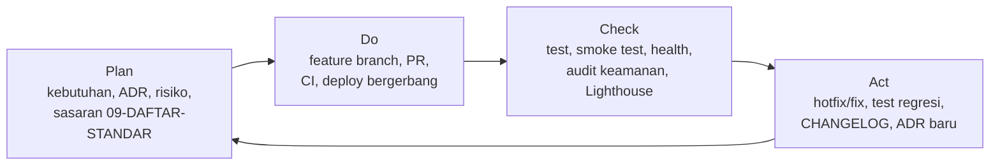

# ISO 9001:2015 — Pemetaan Klausul 4–10 (Opsional)

| Versi dokumen | Tanggal         | Versi aplikasi | Klasifikasi      |
| ------------- | --------------- | -------------- | ---------------- |
| 1.0           | 17 Oktober 2026 | v1.1.3         | Dokumen Internal |

**Sifat:** informatif. SPMI tidak disertifikasi ISO 9001; pemetaan ini menunjukkan bagaimana proses pengembangan
dan operasi SPMI selaras dengan siklus **PDCA** sehingga dapat diintegrasikan bila universitas/LPM menerapkan
sistem manajemen mutu. Catatan: SPMI sendiri adalah alat siklus PPEPP (Penetapan–Pelaksanaan–Evaluasi–
Pengendalian–Peningkatan) Permendikbudristek 53/2023 — padanan PDCA di pendidikan tinggi.

## Pemetaan

| Klausul                                                                                     |  PDCA   | Proses/artefak SPMI yang ada                                                                                                                                                                                                                                                              | Status  |
| ------------------------------------------------------------------------------------------- | :-----: | ----------------------------------------------------------------------------------------------------------------------------------------------------------------------------------------------------------------------------------------------------------------------------------------- | :-----: |
| **4 Konteks organisasi**                                                                    |  Plan   | Ruang lingkup, aktor & peran ([01 §1–2](../01-PERANCANGAN.md)); pihak berkepentingan (LPM, unit, pimpinan, asesor BAN-PT/LAM); kewajiban hukum ([legal/CHECKLIST-KEPATUHAN](../legal/CHECKLIST-KEPATUHAN.md))                                                                             |   ✅    |
| **5 Kepemimpinan**                                                                          |  Plan   | Ketua LPM sebagai pemilik sistem; kebijakan mutu & penunjukan peran formal (SK) belum ada                                                                                                                                                                                                 |   ⏳    |
| **6 Perencanaan** (risiko & sasaran)                                                        |  Plan   | [RISK-REGISTER](RISK-REGISTER.md); sasaran terukur di [09-DAFTAR-STANDAR](../09-DAFTAR-STANDAR.md) (Lighthouse ≥ 90, 0 kerentanan high, WCAG AA); backlog                                                                                                                                 |   ✅    |
| **7 Dukungan** (sumber daya, kompetensi, informasi terdokumentasi)                          | Plan/Do | Docs-as-code `docs/` ditinjau via PR; [CONTRIBUTING](../../CONTRIBUTING.md); infrastruktur ([04](../04-DEPLOYMENT-IIS.md)); pelatihan pengguna ⏳ ([05](../05-PANDUAN-PENGGUNA.md) tersedia)                                                                                              |   ✅    |
| **8 Operasi** (perencanaan, kebutuhan, desain & pengembangan, penyediaan, kendali keluaran) |   Do    | Kebutuhan & desain ([01](../01-PERANCANGAN.md), [ADR](../adr/)); pengembangan Git Flow + CI; rilis bergerbang (`deploy-production.ps1`); kendali perubahan ([RENCANA-PEMELIHARAAN §4](RENCANA-PEMELIHARAAN.md#4-prosedur-manajemen-perubahan)); keluaran tidak sesuai → rollback otomatis |   ✅    |
| **9 Evaluasi kinerja** (pemantauan, audit internal, tinjauan manajemen)                     |  Check  | Unit/E2E/a11y test ([06](../06-PENGUJIAN.md)); smoke test; `GET /api/health`; audit keamanan internal ([LAPORAN_KEAMANAN](../../LAPORAN_KEAMANAN.md)); Lighthouse; tinjauan manajemen berkala ⏳                                                                                          | ✅ / ⏳ |
| **10 Peningkatan** (ketidaksesuaian, tindakan korektif, peningkatan berkelanjutan)          |   Act   | Temuan → perbaikan + test regresi (B-1…B-18); insiden 17 Okt 2026 (EPERM, restore) → perbaikan v1.1.2; [CHANGELOG](../../CHANGELOG.md); "Temuan Terbuka" di [docs/README](../README.md)                                                                                                   |   ✅    |

## Siklus PDCA dalam Praktik

Tindak lanjut institusi (⏳): kebijakan mutu tertulis untuk layanan TI LPM, tinjauan manajemen minimal 1×/tahun
(masukan: register risiko, insiden, hasil audit, kepuasan pengguna), dan survei kepuasan pengguna SPMI.
