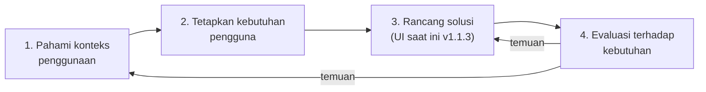

# ISO 9241 — Kegunaan (Usability) SPMI

Penerapan seri **ISO 9241** (_Ergonomics of human-system interaction_) pada Sistem Informasi SPMI —
LPM Universitas Pahlawan Tuanku Tambusai (`https://spmi.universitaspahlawan.ac.id`, rilis **v1.1.3**).

| Versi dokumen | Tanggal         | Versi aplikasi | Klasifikasi      |
| ------------- | --------------- | -------------- | ---------------- |
| 1.0           | 17 Oktober 2026 | v1.1.3         | Dokumen Internal |

## Acuan

| Standar           | Pokok bahasan                                                                                                 | Dipakai di                                                                                                                          |
| ----------------- | ------------------------------------------------------------------------------------------------------------- | ----------------------------------------------------------------------------------------------------------------------------------- |
| ISO 9241-11:2018  | Kegunaan = efektivitas, efisiensi, kepuasan dalam **konteks penggunaan** tertentu                             | [KONTEKS-PENGGUNAAN](KONTEKS-PENGGUNAAN.md), [RENCANA-UJI-USABILITAS](RENCANA-UJI-USABILITAS.md), [KUESIONER-SUS](KUESIONER-SUS.md) |
| ISO 9241-210:2019 | Proses perancangan berpusat pada manusia (HCD): pahami konteks → kebutuhan → rancang → evaluasi               | Seluruh folder (siklus di bawah)                                                                                                    |
| ISO 9241-110:2020 | 7 prinsip interaksi                                                                                           | [PRINSIP-9241-110](PRINSIP-9241-110.md), [EVALUASI-HEURISTIK](EVALUASI-HEURISTIK.md)                                                |
| Nielsen (1994)    | 10 heuristik kegunaan (pelengkap, sudah dirujuk di [09-DAFTAR-STANDAR §4](../../09-DAFTAR-STANDAR.md#4-uiux)) | [EVALUASI-HEURISTIK](EVALUASI-HEURISTIK.md)                                                                                         |

## Siklus HCD (ISO 9241-210) dan Status

| Aktivitas HCD             | Dokumen                                                                      | Status                                                                 |
| ------------------------- | ---------------------------------------------------------------------------- | ---------------------------------------------------------------------- |
| Pahami konteks penggunaan | [KONTEKS-PENGGUNAAN.md](KONTEKS-PENGGUNAAN.md)                               | ✅ disusun dari kode & panduan                                         |
|                           | [PERSONA.md](PERSONA.md)                                                     | ✅ 6 persona (fiktif, berbasis peran) — ⏳ validasi wawancara pengguna |
|                           | [USER-JOURNEY.md](USER-JOURNEY.md)                                           | ✅ 7 perjalanan berbasis alur UI nyata                                 |
| Tetapkan kebutuhan        | [KONTEKS-PENGGUNAAN.md §5](KONTEKS-PENGGUNAAN.md#5-sasaran-kegunaan-terukur) | ✅ sasaran terukur (sukses tugas, waktu, SUS)                          |
| Evaluasi — inspeksi ahli  | [EVALUASI-HEURISTIK.md](EVALUASI-HEURISTIK.md)                               | ✅ 31 temuan (8 berat, 14 sedang, 9 ringan) — semua **open**           |
|                           | [PRINSIP-9241-110.md](PRINSIP-9241-110.md)                                   | ✅ bukti implementasi per prinsip                                      |
| Evaluasi — uji pengguna   | [RENCANA-UJI-USABILITAS.md](RENCANA-UJI-USABILITAS.md)                       | ✅ rencana siap — ⏳ **uji dengan pengguna belum dilaksanakan**        |
|                           | [KUESIONER-SUS.md](KUESIONER-SUS.md)                                         | ✅ instrumen siap cetak — ⏳ hasil belum ada                           |

## Ringkasan

- SPMI sudah memiliki fondasi kegunaan & aksesibilitas yang baik (komponen `Field` dengan validasi inline
  berbahasa Indonesia, `ConfirmAction` untuk aksi destruktif, live region, focus trap, Lighthouse A11y 100,
  axe 0 pelanggaran di halaman publik — lihat [PRINSIP-9241-110.md](PRINSIP-9241-110.md)).
- Evaluasi heuristik menemukan celah terutama pada **visibilitas status** bagi auditee (batas waktu tidak
  tampil, butir "Perlu Revisi" tersembunyi), **pencegahan kesalahan** pada penghapusan berantai, dan
  **kehilangan input** saat pengisian per butir. Tidak ada temuan katastrofik (severity 4).
- **Belum ada data empiris** (sukses tugas, waktu, SUS). Klaim kegunaan v1.1.3 baru berdasarkan inspeksi
  ahli; sasaran ISO 9241-11 dinyatakan **belum terverifikasi** sampai uji pengguna dijalankan.

## Tindak Lanjut

| No  | Tindakan                                                                                                                            | Pemilik                 | Status |
| --- | ----------------------------------------------------------------------------------------------------------------------------------- | ----------------------- | ------ |
| 1   | Rekrut peserta dan laksanakan uji usabilitas moderasi sesuai rencana                                                                | LPM + tim pengembang    | ⏳     |
| 2   | Siapkan lingkungan uji berisi data fiktif (bukan produksi) — staging belum ada (09 §14)                                             | Tim pengembang / Puskom | ⏳     |
| 3   | Prioritaskan perbaikan temuan severity 3 (HE-01–HE-06, HE-08, HE-11) di backlog rilis berikutnya                                    | Tim pengembang          | ⏳     |
| 4   | Ulangi evaluasi heuristik & SUS setelah perbaikan (evaluasi ulang ISO 9241-210 §8)                                                  | Tim pengembang + LPM    | ⏳     |
| 5   | Tambahkan kebutuhan kegunaan terukur (KNF-17, diusulkan) ke [01-PERANCANGAN §4](../../01-PERANCANGAN.md#4-kebutuhan-non-fungsional) | Pemilik dokumen 01      | ⏳     |

Terkait pengujian perangkat lunak (ISO/IEC/IEEE 29119), lihat [../29119-PENGUJIAN/](../29119-PENGUJIAN/README.md).
