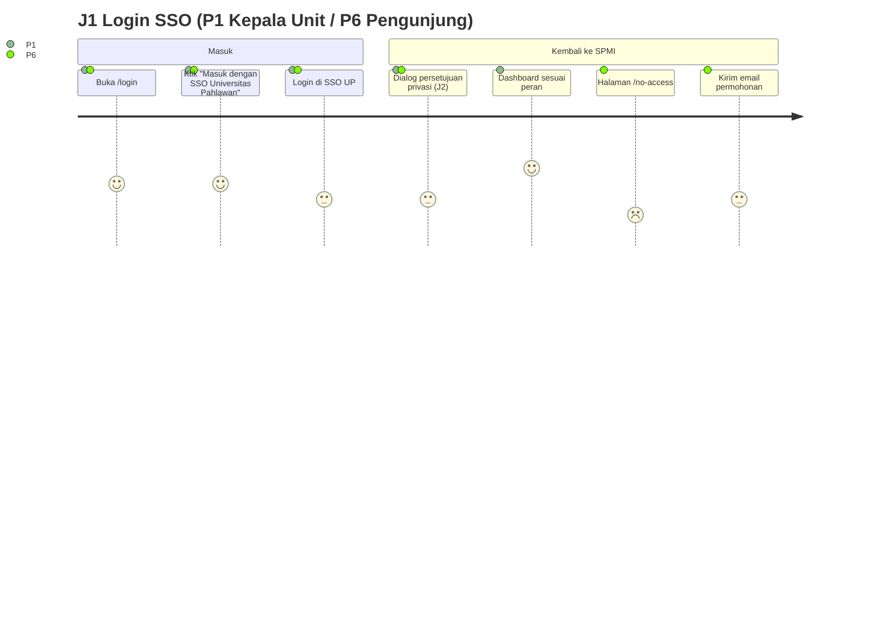
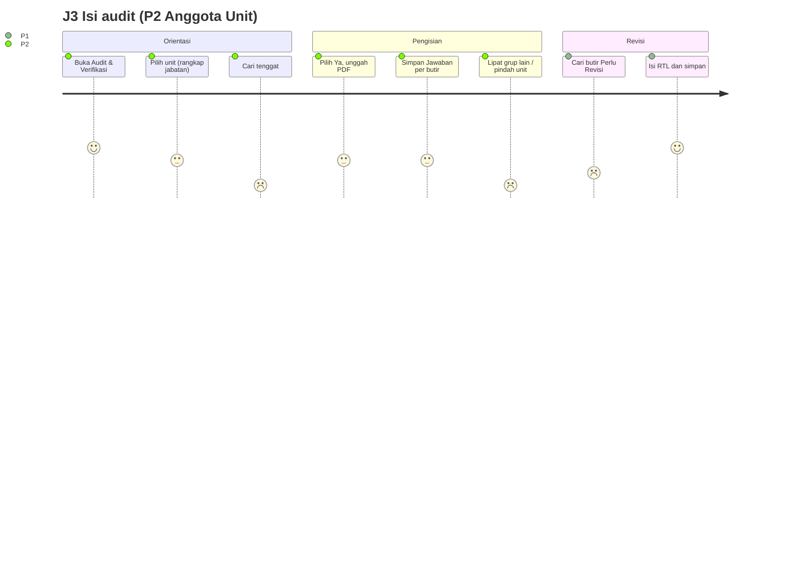

# Peta Perjalanan Pengguna (User Journey)

Disusun dari alur UI nyata pada kode v1.1.3 (komponen & rute dirujuk per langkah). Skor emosi 1–5
(1 = frustrasi, 5 = senang) adalah **hipotesis evaluator** — ⏳ divalidasi pada uji usabilitas.
Kode temuan `HE-xx` merujuk [EVALUASI-HEURISTIK](EVALUASI-HEURISTIK.md).

| ID  | Perjalanan                                         | Persona    | Tugas    |
| --- | -------------------------------------------------- | ---------- | -------- |
| J1  | Login SSO (termasuk jalur Pengunjung)              | P1, P6     | T01, T03 |
| J2  | Persetujuan Kebijakan Privasi                      | semua      | T02      |
| J3  | Isi audit + unggah bukti, tindak lanjut revisi/RTL | P1, P2     | T04–T06  |
| J4  | Verifikasi LPM                                     | P3         | T09      |
| J5  | Ekspor laporan PDF                                 | P3, P4, P1 | T12, T07 |
| J6  | Kelola siklus, unit, akun & penempatan             | P4         | T13–T15  |

---

## J1 — Login SSO

| Langkah | Tindakan                  | Titik sentuh (kode)                                | Emosi | Pain point                                                                                                 | Peluang                                                             |
| ------- | ------------------------- | -------------------------------------------------- | ----- | ---------------------------------------------------------------------------------------------------------- | ------------------------------------------------------------------- |
| 1       | Buka `/login`             | `src/app/login/page.tsx`                           | 4     | —                                                                                                          | —                                                                   |
| 2       | Klik tombol SSO           | `<a href="/api/sso/redirect">` di `login-form.tsx` | 4     | Tombol tetap tampil walau SSO belum dikonfigurasi; label berbeda dari panduan ("Login via SSO UP") (HE-15) | Sembunyikan/nonaktifkan bila `ssoConfigured=false`; samakan istilah |
| 3       | Login di SSO UP           | `sso-v2.universitaspahlawan.ac.id`                 | 3     | Di luar kendali SPMI                                                                                       | —                                                                   |
| 4       | Callback → sesi dibuat    | `src/app/api/sso/[...sso]/route.ts`                | 3     | Galat SSO dipetakan ke `?sso_error=` dengan pesan jelas (baik); kode tak dikenal → pesan umum              | —                                                                   |
| 5a      | (Berperan) Dashboard      | `src/app/(dashboard)/layout.tsx` → `/dashboard`    | 5     | —                                                                                                          | —                                                                   |
| 5b      | (Pengunjung) `/no-access` | `src/app/no-access/page.tsx`                       | 2     | Tidak ada cara memeriksa ulang akses selain memuat ulang; tidak ada estimasi waktu layanan (HE-28)         | Tombol "Periksa akses saya"; info SLA LPM                           |
| 6       | Kirim email permohonan    | `mailto:` berisi nama & email otomatis             | 3     | Bergantung klien email terpasang (ponsel/PC kantor sering tanpa klien)                                     | Tampilkan juga tombol salin alamat email                            |

## J2 — Persetujuan Kebijakan Privasi

| Langkah | Tindakan                          | Titik sentuh                                                            | Emosi | Pain point                                                                       | Peluang                                 |
| ------- | --------------------------------- | ----------------------------------------------------------------------- | ----- | -------------------------------------------------------------------------------- | --------------------------------------- |
| 1       | Dialog muncul setelah login       | `ConsentDialog` (`dismissible={false}`) di layout dasbor & `/no-access` | 3     | Dialog memblokir (benar secara hukum) — ringkasan 3 butir mudah dibaca           | —                                       |
| 2       | Buka kebijakan lengkap (opsional) | Tautan `target="_blank"` dengan teks sr-only "(membuka tab baru)"       | 4     | —                                                                                | —                                       |
| 3       | Centang & "Setuju & Lanjutkan"    | `recordConsent` → `users.consented_at`, `consent_version`               | 4     | Centang wajib; pesan validasi Indonesia ("Centang kotak ini untuk melanjutkan.") | —                                       |
| 3b      | "Tidak setuju, keluar"            | `formAction={logoutAction}`                                             | 3     | Tidak dijelaskan konsekuensinya (tidak bisa memakai SPMI)                        | Satu kalimat konsekuensi di atas tombol |

## J3 — Isi Audit + Unggah Bukti, Tindak Lanjut Revisi

| Langkah | Tindakan                                    | Titik sentuh                                                                        | Emosi | Pain point                                                                                                       | Peluang                                                                     |
| ------- | ------------------------------------------- | ----------------------------------------------------------------------------------- | ----- | ---------------------------------------------------------------------------------------------------------------- | --------------------------------------------------------------------------- |
| 1       | Buka Dashboard Unit                         | `dashboard/page.tsx` (cabang auditee): StatCard Pertanyaan/Terjawab/Ya/Perlu Revisi | 3     | **Batas waktu (`end_date`) tidak ditampilkan** (HE-01); tak ada tombol "Lanjutkan pengisian" ke `/audit` (HE-31) | Kartu tenggat + hitung mundur; CTA ke butir berikutnya                      |
| 2       | Buka `/audit`, pilih unit                   | `AuditeeAuditWorkspace` — pemilih unit (`aria-pressed`) bila > 1 unit               | 4     | —                                                                                                                | —                                                                           |
| 3       | Baca ringkasan progres                      | Kartu "Unit • Siklus • Progres x/y (z%)"                                            | 4     | Tenggat lagi-lagi tidak tampil                                                                                   | Tampilkan "Ditutup 30 Nov 2026 23:59 WIB"                                   |
| 4       | Buka grup standar                           | `AspectGroup` (grup "Lengkap" otomatis terlipat)                                    | 3     | —                                                                                                                | —                                                                           |
| 5       | Pilih **Ya**, unggah PDF / isi tautan       | `ResponseForm` — `input type=file accept=.pdf`, hint "maks 10 MB"                   | 3     | Tidak ada validasi ukuran di klien — berkas 15 MB diunggah dulu lalu ditolak (HE-09)                             | Cek `file.size` sebelum kirim; tautan panduan kompres PDF                   |
| 5b      | Pilih **Tidak**, isi alasan                 | `textarea required` dengan pesan inline                                             | 4     | —                                                                                                                | —                                                                           |
| 6       | Klik **Simpan Jawaban** (per butir)         | `saveResponse` → badge "Menunggu Verifikasi", `ActionFeedback` (aria-live)          | 3     | Satu tombol per butir; tidak ada "simpan semua"                                                                  | Simpan otomatis/draf                                                        |
| 7       | Lipat grup / pindah unit sebelum menyimpan  | `{open && …}` & `key={activeUnitId-…}` me-_unmount_ formulir                        | 1     | **Input yang belum disimpan hilang tanpa peringatan** (HE-08)                                                    | Peringatan perubahan belum disimpan; pertahankan state                      |
| 8       | (Kemudian) LPM minta revisi — cari butirnya | Badge "Perlu Revisi" hanya di dalam butir; grup berstatus "Lengkap" terlipat        | 2     | **Butir revisi tersembunyi di grup terlipat** (HE-02); tidak ada notifikasi email                                | Filter/daftar "Perlu Revisi" di atas; buka otomatis grup yang memuat revisi |
| 9       | Baca Catatan LPM, isi RTL → **Simpan RTL**  | Kotak RTL (`saveRtl`)                                                               | 4     | Kotak RTL tampil untuk jawaban Tidak **atau** revisi — jelas                                                     | —                                                                           |
| 10      | Siklus ditutup                              | Banner "Periode pengisian ditutup" (`role="status"`), formulir menjadi baca-saja    | 3     | Pengguna baru tahu setelah tertutup                                                                              | Pengingat H-7/H-1                                                           |

## J4 — Verifikasi LPM

| Langkah | Tindakan                                   | Titik sentuh                                                       | Emosi | Pain point                                                                                             | Peluang                                    |
| ------- | ------------------------------------------ | ------------------------------------------------------------------ | ----- | ------------------------------------------------------------------------------------------------------ | ------------------------------------------ |
| 1       | Buka `/audit` → tab "Panel Verifikasi LPM" | `AdminAuditWorkspace` (`role="tablist"`)                           | 4     | Siklus otomatis (aktif/terakhir) — tidak bisa memilih siklus lain (HE-23)                              | Pemilih siklus seperti di Analitik         |
| 2       | Saring unit & status                       | Dua `<select>` (`aria-label`), jumlah jawaban `aria-live`          | 3     | Default "Semua Status" (HE-21)                                                                         | Default "Menunggu Verifikasi"              |
| 3       | Baca jawaban per unit                      | Kartu unit dengan "avatar" berisi ID numerik unit (HE-22)          | 3     | Baris tidak menampilkan nama standar / nomor butir (HE-19)                                             | Tampilkan "Standar X · Butir n"            |
| 4       | Klik **Verifikasi** → buka bukti           | `VerifyRow` — tautan "Lihat Bukti PDF"/"Tautan Bukti" ke tab baru  | 3     | Berpindah tab berulang; tautan tanpa keterangan tab baru bagi pembaca layar (HE-30)                    | Pratinjau PDF di panel samping             |
| 5       | "Verifikasi (Sesuai)" / "Minta Revisi"     | `verifyResponse`; catatan wajib untuk revisi divalidasi **server** | 3     | Istilah tombol ≠ label status ("Terverifikasi", "Perlu Revisi") (HE-20); tidak ada aksi massal (HE-21) | Samakan istilah; pilih banyak → verifikasi |
| 6       | Pantau RTL                                 | RTL tampil di panel bila diisi auditee                             | 4     | —                                                                                                      | —                                          |

## J5 — Ekspor Laporan PDF

| Langkah | Tindakan                                     | Titik sentuh                                  | Emosi | Pain point                                                                                             | Peluang                                                    |
| ------- | -------------------------------------------- | --------------------------------------------- | ----- | ------------------------------------------------------------------------------------------------------ | ---------------------------------------------------------- |
| 1       | Buka **Analitik & Laporan**                  | `analitik/page.tsx`                           | 4     | —                                                                                                      | —                                                          |
| 2       | Pilih siklus di dropdown                     | `<form role="search">` + tombol **Tampilkan** | 3     | Mengganti dropdown tanpa klik Tampilkan → tombol unduh tetap mengarah ke siklus lama (HE-07)           | Navigasi otomatis saat dropdown berubah                    |
| 3       | Klik **Unduh Laporan PDF** / tombol PDF unit | `<a href="/api/export?cycleId=…[&unitId=…]">` | 3     | Tidak ada indikator proses; galat (401/403/429/503) tampil sebagai **JSON mentah** di peramban (HE-06) | Unduh via `fetch` + status "Menyiapkan PDF…" + pesan ramah |
| 4       | Periksa blok tanda tangan                    | `src/lib/report/*` — Ketua LPM aktif          | 3     | Bila Ketua LPM belum ditunjuk, PDF tetap dibuat tanpa peringatan di UI                                 | Peringatan sebelum unduh: "Ketua LPM belum ditunjuk"       |
| 5       | (Auditee) unduh PDF unit dari Dashboard Unit | Daftar "Unit Anda" → tombol PDF               | 4     | —                                                                                                      | —                                                          |

## J6 — Kelola Siklus, Unit, Akun & Penempatan

| Langkah | Tindakan                             | Titik sentuh                                                                        | Emosi | Pain point                                                                                                                                    | Peluang                                                 |
| ------- | ------------------------------------ | ----------------------------------------------------------------------------------- | ----- | --------------------------------------------------------------------------------------------------------------------------------------------- | ------------------------------------------------------- |
| 1       | **Siklus Baru** → isi nama & tanggal | `CycleForm` (modal), label "Batas Waktu (Selesai)"                                  | 4     | Validasi `end < start` hanya di server                                                                                                        | `min` pada input tanggal selesai                        |
| 2       | **Aktifkan** siklus lain             | `<form action={setActiveCycle}>` tanpa konfirmasi & tanpa umpan balik               | 2     | Menonaktifkan siklus berjalan sekaligus menutup pengisian auditee (HE-11)                                                                     | Konfirmasi yang menyebut siklus yang akan dinonaktifkan |
| 3       | **Hapus** siklus                     | `ConfirmAction` "Hapus siklus audit?"                                               | 2     | Satu klik konfirmasi untuk penghapusan berantai seluruh data siklus (HE-04)                                                                   | Ringkasan jumlah data terdampak + ketik nama siklus     |
| 4       | **Unit Baru**                        | `UnitForm` — `<select>` 7 kategori tetap                                            | 3     | Tidak bisa mengetik kategori baru (bertentangan dengan KF-06 & panduan §5.2) (HE-10); hapus unit tidak menyebut jawaban ikut terhapus (HE-05) | Combobox kategori; pesan dampak lengkap                 |
| 5       | Tambah akun / tempatkan pada unit    | `AccountManager` → `AssignMemberDialog` (cari akun terdaftar, pilih Kepala/Anggota) | 4     | Pencarian & filter peran tersedia (baik); aturan 1 Kepala/unit dijelaskan di hint                                                             | Impor massal (CSV) untuk awal siklus                    |
| 6       | Tunjuk Ketua LPM (ikon mahkota)      | `LpmHeadToggle` + `ConfirmAction`, banner status Ketua LPM                          | 4     | Ikon mahkota butuh dipelajari (dibantu `aria-label` & banner)                                                                                 | Label teks di layar lebar                               |
| 7       | Tutup modal tanpa sengaja            | `Modal` menutup via klik latar/Esc                                                  | 2     | Isian formulir hilang tanpa peringatan (HE-24)                                                                                                | Konfirmasi "buang perubahan?" bila formulir _dirty_     |
