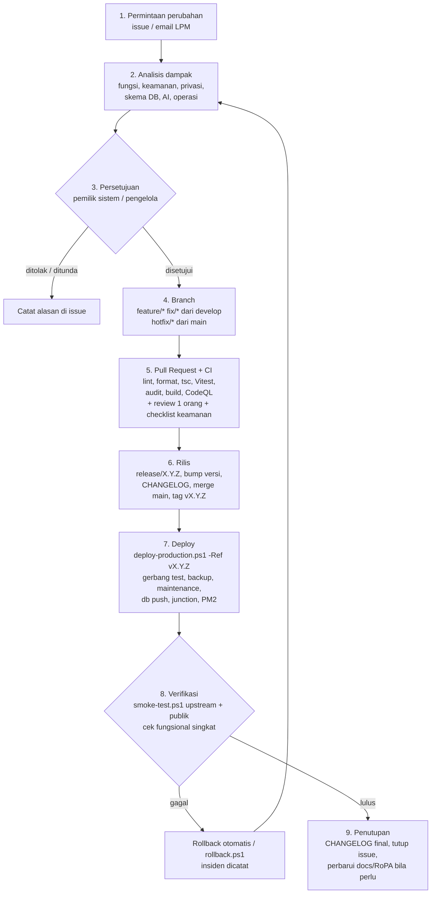

# Rencana Pemeliharaan Perangkat Lunak — SPMI

Rencana pemeliharaan (ISO/IEC/IEEE 12207:2017 §6.4.13 Maintenance & §6.4.14 Disposal; ISO/IEC 14764:2022)
untuk **Sistem Informasi SPMI — LPM Universitas Pahlawan Tuanku Tambusai** (`https://spmi.universitaspahlawan.ac.id`).

| Versi dokumen | Tanggal         | Versi aplikasi | Klasifikasi      | Status                                    |
| ------------- | --------------- | -------------- | ---------------- | ----------------------------------------- |
| 1.0           | 17 Oktober 2026 | v1.1.3         | Dokumen Internal | Usulan — ⏳ pengesahan Ketua LPM & Puskom |

## 1. Ruang Lingkup dan Peran

| Komponen dipelihara                  | Lokasi                                                                                       |
| ------------------------------------ | -------------------------------------------------------------------------------------------- |
| Kode aplikasi (Next.js 16, Prisma 6) | Repositori `github.com/Puskom-UP/lpm-new` (privat), salinan kerja `E:\www\lpm-new`           |
| Rilis produksi                       | `E:\www\spmi-prod\releases\<ts>` ← junction `current`                                        |
| Runtime Node.js                      | `E:\www\spmi-prod\runtime\node` → junction ke `node-v24.21.0-win-x64` (Node 24 LTS portabel) |
| Basis data                           | Kontainer Docker `spmi-db` (`mysql:8.0`, `127.0.0.1:33063`, volume `spmi_mysql_data`)        |
| Reverse proxy & TLS                  | IIS 10 + URL Rewrite + ARR, win-acme (Let's Encrypt), Cloudflare                             |
| Skrip operasi & tugas terjadwal      | `scripts/deploy/*` → `E:\www\spmi-prod\ops\`, folder Task Scheduler `\SPMI\`                 |
| Dokumentasi                          | `docs/`, `CHANGELOG.md`, `LAPORAN_KEAMANAN.md`                                               |

| Peran                | Tanggung jawab                                                            | Pemegang (usulan)                       |
| -------------------- | ------------------------------------------------------------------------- | --------------------------------------- |
| Pemilik sistem       | Menyetujui perubahan fungsional, prioritas, SLA; menerima risiko residual | Ketua LPM                               |
| Pengelola perubahan  | Menilai dampak, menyetujui rilis, menjaga CHANGELOG                       | Koordinator tim pengembang              |
| Pengembang           | Implementasi, uji, PR, perbaikan                                          | Tim pengembang SPMI                     |
| Administrator server | Deploy, backup, patch OS/IIS/Docker, pemantauan, insiden infrastruktur    | Puskom / Bagian TI                      |
| Pejabat/Petugas PDP  | Insiden data pribadi, permintaan subjek data                              | ⏳ belum ditunjuk (sementara Ketua LPM) |

## 2. Tingkat Prioritas dan SLA

Waktu dihitung pada **jam layanan** Senin–Jumat 08.00–16.00 WIB, **kecuali P1** yang berlaku 24×7 sejak diketahui.
"Respons" = tiket diterima, ditriase, dan pelapor diberi kabar. "Resolusi" = layanan pulih (perbaikan permanen
atau solusi sementara yang sah; perbaikan permanen P1/P2 menyusul sebagai `hotfix`/`fix` dalam rilis berikutnya).

| Prioritas     | Definisi                                                                                             | Contoh SPMI                                                                                                                                                               | Respons      | Resolusi / solusi sementara | Rilis perbaikan permanen     |
| ------------- | ---------------------------------------------------------------------------------------------------- | ------------------------------------------------------------------------------------------------------------------------------------------------------------------------- | ------------ | --------------------------- | ---------------------------- |
| **P1 Kritis** | Layanan tidak tersedia untuk semua pengguna, **atau** insiden keamanan/kebocoran data pribadi        | `/api/health` 503 / 502 IIS; DB `spmi-db` mati setelah reboot; superadmin diambil alih; berkas bukti dapat diunduh publik; `shared\.env` bocor                            | **1 jam**    | **4 jam**                   | `hotfix/*` ≤ 2 hari kerja    |
| **P2 Tinggi** | Fungsi inti terganggu tanpa solusi sementara, berdampak pada banyak pengguna atau tenggat siklus AMI | Auditee tidak dapat menyimpan jawaban/unggah bukti saat siklus berjalan; login SSO gagal untuk semua; ekspor PDF laporan gagal; kerentanan **high** di `npm audit`/CodeQL | **4 jam**    | **1 hari kerja**            | ≤ 5 hari kerja               |
| **P3 Sedang** | Fungsi terganggu dengan solusi sementara, atau berdampak pada sebagian kecil pengguna                | Satu unit salah cakupan pertanyaan; tampilan rusak di satu browser; filter analitik salah; peringatan Dependabot moderat                                                  | 1 hari kerja | 5 hari kerja                | Rilis MINOR/PATCH berikutnya |
| **P4 Rendah** | Kosmetik, pertanyaan, permintaan fitur, peningkatan                                                  | Salah ketik label; permintaan kolom baru; peningkatan skor Lighthouse mobile                                                                                              | 3 hari kerja | Dijadwalkan di backlog      | Sesuai roadmap               |

Aturan tambahan:

- Insiden yang melibatkan **data pribadi** selalu P1 dan mengikuti [legal/INSIDEN-DATA.md](../legal/INSIDEN-DATA.md)
  (notifikasi tertulis paling lambat **3 × 24 jam**, UU 27/2022 Pasal 46).
- Selama **masa pengisian siklus AMI** (siklus aktif), insiden P3 yang menghambat auditee dinaikkan menjadi P2.
- Eskalasi: bila target resolusi terlewati → koordinator tim pengembang → Ketua LPM (P1/P2 langsung diinformasikan).
- Kanal pelaporan: email `lpm@universitaspahlawan.ac.id` atau issue GitHub (templat `.github/ISSUE_TEMPLATE/bug_report.yml`).

## 3. Jenis Pemeliharaan (ISO/IEC 14764)

| Jenis         | Tujuan                                         | Contoh nyata SPMI                                                                                                                                                           | Branch / jalur               |
| ------------- | ---------------------------------------------- | --------------------------------------------------------------------------------------------------------------------------------------------------------------------------- | ---------------------------- |
| **Korektif**  | Memperbaiki kesalahan yang ditemukan           | v1.1.1 metadata di `<head>`; v1.1.2 dump/restore DB & ACL `logs` (insiden `EPERM`); 18 temuan audit B-1…B-18                                                                | `fix/*`, `hotfix/*`          |
| **Adaptif**   | Menyesuaikan dengan perubahan lingkungan       | Next.js 16 (`middleware` → `src/proxy.ts`, `next lint` dihapus); runtime Node 24 LTS portabel; perubahan API SSO UP; perubahan regulasi UU PDP                              | `feature/*`, `fix/*`         |
| **Perfektif** | Meningkatkan fungsi, performa, kemudahan pakai | v1.1.3 performa mobile (hapus `blur-3xl`, `backdrop-filter` hanya desktop); aksesibilitas WCAG 2.1 AA; fitur baru atas permintaan LPM                                       | `feature/*`                  |
| **Preventif** | Mencegah masalah sebelum terjadi               | Dependabot mingguan; `npm audit` & CodeQL di CI; rotasi log; uji restore per semester; perpanjangan sertifikat otomatis; watchdog Docker/PM2; peralihan ke `prisma migrate` | `build(deps)`, `ci`, `chore` |

Target proporsi upaya (indikatif): korektif ≤ 30 %, preventif ≥ 20 %.

## 4. Prosedur Manajemen Perubahan

| Langkah            | Rincian wajib                                                                                                                                                                                                                                                                                                                                                                                                                                                                                                                                          | Bukti/artefak                                                   |
| ------------------ | ------------------------------------------------------------------------------------------------------------------------------------------------------------------------------------------------------------------------------------------------------------------------------------------------------------------------------------------------------------------------------------------------------------------------------------------------------------------------------------------------------------------------------------------------------ | --------------------------------------------------------------- |
| 1. Permintaan      | Deskripsi, alasan, pelapor, prioritas usulan (P1–P4)                                                                                                                                                                                                                                                                                                                                                                                                                                                                                                   | Issue GitHub / email                                            |
| 2. Analisis dampak | (a) modul & peran terdampak; (b) **keamanan** — checklist [07 §6](../07-STANDAR-ENGINEERING.md#6-keamanan-wajib-per-pr), STRIDE bila ada aliran data baru; (c) **privasi** — data pribadi baru? perbarui [RoPA](../legal/RoPA.md), naikkan `CONSENT_VERSION` bila kebijakan privasi berubah; (d) **skema DB** — `db push` tanpa `--accept-data-loss` gagal pada perubahan destruktif → rencanakan migrasi data; (e) **AI** — pemicu [42001 §3](42001-AI.md#3-kondisi-pemicu-kapan-42001-menjadi-berlaku); (f) operasi — env baru, tugas terjadwal, IIS | Komentar issue / deskripsi PR                                   |
| 3. Persetujuan     | Perubahan fungsional: pemilik sistem. Perubahan teknis/dependensi: pengelola perubahan. Darurat P1: boleh disetujui pasca-fakta ≤ 1 hari kerja                                                                                                                                                                                                                                                                                                                                                                                                         | Label/komentar persetujuan                                      |
| 4. Branch          | Penamaan Git Flow ([CONTRIBUTING §2](../../CONTRIBUTING.md#2-alur-branch-git-flow)); commit Conventional Commits (hook `commit-msg`)                                                                                                                                                                                                                                                                                                                                                                                                                   | Riwayat Git                                                     |
| 5. PR + CI         | Template PR terisi; CI hijau (`ci.yml`, `codeql.yml`); 1 reviewer; uji baru untuk perilaku baru/bug                                                                                                                                                                                                                                                                                                                                                                                                                                                    | PR, hasil Actions                                               |
| 6. Rilis           | `npm version X.Y.Z --no-git-tag-version`; pindahkan `[Unreleased]` di CHANGELOG; tag beranotasi                                                                                                                                                                                                                                                                                                                                                                                                                                                        | `CHANGELOG.md`, tag                                             |
| 7. Deploy          | Hanya dari tag; `-SkipTests` hanya darurat dengan alasan tercatat; jendela pemeliharaan diumumkan untuk perubahan skema                                                                                                                                                                                                                                                                                                                                                                                                                                | `E:\www\spmi-prod\logs\deploy-<ts>.log`, `current\release.json` |
| 8. Verifikasi      | `smoke-test.ps1` (health `"db":"ok"`, halaman publik, header keamanan, 404) + cek manual login & satu alur inti; `GET /api/health` menampilkan versi baru                                                                                                                                                                                                                                                                                                                                                                                              | Keluaran smoke test                                             |
| 9. Penutupan       | Issue ditutup dengan tautan rilis; docs diperbarui pada PR yang sama (docs-as-code)                                                                                                                                                                                                                                                                                                                                                                                                                                                                    | Issue, `docs/`                                                  |

**Perubahan darurat (hotfix P1):** langkah 2–3 boleh diringkas (analisis dampak lisan, persetujuan pasca-fakta),
tetapi langkah 5 (CI) dan 7–8 (deploy bergerbang + smoke test) **tidak boleh dilewati**, kecuali `-SkipTests`
untuk kasus gerbang test tidak dapat dijalankan — alasan dicatat di catatan rilis.

## 5. Kadensi Rilis

| Jenis rilis   | Kadensi                                                                                        | Isi                                                 |
| ------------- | ---------------------------------------------------------------------------------------------- | --------------------------------------------------- |
| PATCH `x.y.Z` | Sesuai kebutuhan (target ≤ 2 minggu sekali bila ada perbaikan)                                 | `fix`, `perf`, pembaruan dependensi aman            |
| MINOR `x.Y.0` | ±1× per bulan, **di luar** masa pengisian siklus AMI bila ada perubahan alur pengguna          | `feat`, perubahan skema kompatibel                  |
| MAJOR `X.0.0` | Terencana (≥ 2 minggu pemberitahuan), disertai audit keamanan ulang (CHECKLIST-KEPATUHAN K-15) | Perubahan tidak kompatibel, upgrade framework mayor |
| Hotfix        | Segera (SLA P1/P2)                                                                             | Perbaikan kritis                                    |

**Pembekuan perubahan (change freeze):** 3 hari kerja sebelum tenggat penutupan siklus AMI hanya hotfix P1/P2.
Deploy rutin dilakukan pada jam sepi (disarankan 19.00–22.00 WIB) karena maintenance 503 aktif selama deploy.

## 6. Kebijakan Pembaruan Dependensi

| Sumber               | Mekanisme                                                                                                                                                                     | Target penanganan                                                                                                                                                                                           |
| -------------------- | ----------------------------------------------------------------------------------------------------------------------------------------------------------------------------- | ----------------------------------------------------------------------------------------------------------------------------------------------------------------------------------------------------------- |
| npm (produksi & dev) | **Dependabot** mingguan (Senin) ke `develop`, maks. 5 PR, grup `lint-test` (`.github/dependabot.yml`)                                                                         | PATCH/MINOR: digabung dalam ≤ 2 minggu bila CI hijau                                                                                                                                                        |
| GitHub Actions       | Dependabot bulanan (prefiks `ci`)                                                                                                                                             | ≤ 1 bulan                                                                                                                                                                                                   |
| Kerentanan           | `npm audit --omit=dev --audit-level=high` di CI (`ci.yml` job `audit`); CodeQL `security-extended` (push/PR + mingguan)                                                       | **Critical/High dapat dieksploitasi:** P1/P2 (≤ 2/≤ 5 hari kerja). **High tak terjangkau runtime** (mis. `deepmerge-ts` via CLI Prisma): dicatat + override/mitigasi, ≤ 30 hari. Moderate: rilis berikutnya |
| Upgrade mayor        | Bukan otomatis; dianalisis sebagai perubahan adaptif (baca catatan migrasi; untuk Next.js: `node_modules/next/dist/docs/` sesuai `AGENTS.md`), uji E2E 5 profil browser wajib | Terjadwal per kuartal                                                                                                                                                                                       |
| Kunci versi          | `package-lock.json` + `npm ci` di CI & deploy; `overrides` untuk perbaikan transitif (`deepmerge-ts` 8.0.2)                                                                   | —                                                                                                                                                                                                           |
| Dependensi baru      | Checklist PR: lisensi kompatibel, aktif dipelihara, `npm run audit` bersih                                                                                                    | —                                                                                                                                                                                                           |

Backlog upgrade yang sudah diketahui: **Prisma 6 → 7** (menutup rantai `deepmerge-ts` tanpa override),
**`prisma db push` → `prisma migrate deploy`**, **MySQL 8.0 → 8.4 LTS** (§7).

## 7. Kebijakan End-of-Life (EOL)

Prinsip: produksi hanya memakai komponen dengan dukungan keamanan aktif; upgrade direncanakan **≥ 3 bulan sebelum EOL**.

| Komponen       | Versi saat ini                                                    | EOL (jadwal upstream)                                                | Status / rencana                                                                                                                                                        |
| -------------- | ----------------------------------------------------------------- | -------------------------------------------------------------------- | ----------------------------------------------------------------------------------------------------------------------------------------------------------------------- |
| Node.js (prod) | **24 LTS** portabel `v24.21.0` di `E:\www\spmi-prod\runtime\node` | Akhir April 2028                                                     | ✅ Dipakai PM2 (`interpreter` di `deploy/ecosystem.config.cjs`) & `privacy-purge.ps1`; independen dari Node global server. Rencana migrasi ke LTS berikutnya ≤ Jan 2028 |
| Node.js (CI)   | 22 (`NODE_VERSION` di `ci.yml`, `e2e.yml`)                        | Akhir April 2027                                                     | ⚠️ Berbeda dari produksi — samakan ke 24 pada perubahan `ci` berikutnya                                                                                                 |
| Node.js (dev)  | 20.19 di mesin dev                                                | **Sudah EOL** (30 April 2026)                                        | ⚠️ Upgrade dev ke 24 LTS (`engines` `>=20.19.0` di `package.json` sebaiknya dinaikkan)                                                                                  |
| Next.js        | 16.x                                                              | Dukungan keamanan mengikuti kebijakan Vercel untuk rilis mayor aktif | Ikuti rilis 16.x via Dependabot; evaluasi mayor berikutnya ≤ 6 bulan setelah rilis                                                                                      |
| Prisma         | 6.x                                                               | Mengikuti dukungan mayor Prisma                                      | Upgrade ke 7 terjadwal (§6)                                                                                                                                             |
| MySQL          | `mysql:8.0` (`deploy/docker-compose.db.yml`)                      | **8.0 EOL April 2026**                                               | ⚠️ Rencanakan ke **8.4 LTS**: uji dump/restore ke kontainer 8.4, ganti image, deploy di jendela pemeliharaan                                                            |
| Windows Server | 2025 Datacenter                                                   | Dukungan diperpanjang hingga 2034                                    | ✅ Patch bulanan oleh Puskom                                                                                                                                            |
| Docker Desktop | Dipakai sebagai engine kontainer DB                               | Rilis bergulir                                                       | ⚠️ Butuh sesi pengguna — mitigasi `scripts/deploy/docker-autostart.ps1` + `watchdog.ps1` (sedang diterapkan); alternatif jangka panjang: MySQL native/Docker Engine     |
| PM2, win-acme  | Terbaru                                                           | Rilis bergulir                                                       | Perbarui per kuartal                                                                                                                                                    |

Prosedur ganti runtime Node (tanpa mengubah Node global): ekstrak `node-vNN-win-x64` ke `E:\www\spmi-prod\runtime\`,
ubah junction `runtime\node`, jalankan `pm2 startOrReload E:\www\spmi-prod\ecosystem.config.cjs`, lalu `smoke-test.ps1`;
rollback = kembalikan junction.

## 8. Pemeliharaan Preventif Terjadwal

| Kegiatan                                                     | Frekuensi                              | Mekanisme / bukti                                                             |
| ------------------------------------------------------------ | -------------------------------------- | ----------------------------------------------------------------------------- |
| Backup DB + unggahan, salinan ke `D:\backup\spmi`            | Harian 01:30                           | `\SPMI\SPMI Backup Harian` → `ops\backup.ps1`, `logs\backup.log`              |
| Retensi data pribadi (log login 90 hari, aktivitas 365 hari) | Harian 02:00                           | `\SPMI\SPMI Retensi Data` → `ops\privacy-purge.ps1`, `logs\privacy-purge.log` |
| Watchdog engine Docker → `spmi-db` → `/api/health` → PM2     | Saat boot + 5 menit                    | `\SPMI\SPMI Watchdog` → `ops\watchdog.ps1`, `logs\watchdog.log`               |
| Rotasi log PM2/operasi, retensi **90 hari**                  | Harian                                 | ⏳ sedang diterapkan (tugas rotasi log)                                       |
| Perpanjangan sertifikat TLS                                  | Otomatis (win-acme)                    | Berikutnya 11 Des 2026                                                        |
| Tinjau Dependabot / `npm audit` / CodeQL                     | Mingguan                               | PR Dependabot, tab Security GitHub                                            |
| Uji restore backup ke DB terpisah                            | 1× per semester                        | Terakhir **17 Okt 2026** (`Invoke-DbRestore <dump> restore_test`)             |
| Patch OS, IIS, Docker, PM2                                   | Bulanan                                | Puskom                                                                        |
| Tinjau akun & peran (akun nonaktif, superadmin, akun awal)   | Per semester / awal siklus AMI         | Menu Role & Penempatan                                                        |
| Tinjau register risiko, RoPA, dokumen ISO ini                | 1× per tahun atau saat perubahan besar | [RISK-REGISTER](RISK-REGISTER.md), [RoPA](../legal/RoPA.md)                   |
| Ukur ulang Lighthouse/axe                                    | Per rilis MINOR                        | [09 §5–6](../09-DAFTAR-STANDAR.md)                                            |

## 9. Disposal, Penonaktifan, dan Retensi Data

### 9.1 Retensi selama operasi

| Data                          | Retensi                                    | Mekanisme                                                                                                                                |
| ----------------------------- | ------------------------------------------ | ---------------------------------------------------------------------------------------------------------------------------------------- |
| Log login                     | 90 hari (`log.loginRetentionDays`)         | `purgeExpiredData()` di `src/lib/privacy.ts`, tugas 02:00                                                                                |
| Log aktivitas                 | 365 hari (`log.activityRetentionDays`)     | idem                                                                                                                                     |
| Log PM2/operasi (berkas)      | 90 hari                                    | ⏳ tugas rotasi log (sedang diterapkan)                                                                                                  |
| Backup harian                 | 30 hari (`backup.ps1 -RetentionDays`)      | Otomatis; salinan D: mengikuti (`robocopy /MIR`)                                                                                         |
| Backup pra-deploy             | Mengikuti 5 rilis terakhir                 | Hapus manual yang lebih lama                                                                                                             |
| Jawaban, bukti, laporan audit | Siklus + 5 tahun (usulan, ⏳ Bagian Hukum) | Hapus siklus oleh Admin LPM; berkas fisik ikut dihapus (best-effort, `deleteUpload`/`cleanupUnreferencedUploads` di `src/lib/upload.ts`) |
| Rilis lama                    | 5 terakhir (`-KeepReleases 5`)             | `deploy-production.ps1`                                                                                                                  |

### 9.2 Penonaktifan (decommission) SPMI

Dijalankan bila SPMI digantikan sistem lain atau dihentikan, atas keputusan tertulis Ketua LPM:

1. **Pengumuman** ke pengguna ≥ 30 hari sebelumnya; tetapkan tanggal baca-saja.
2. **Mode baca-saja**: aktifkan **Pengaturan → Pemeliharaan** (hanya superadmin dapat mengubah); beri waktu pengguna
   mengunduh data pribadi (`GET /api/me/export`) dan laporan PDF.
3. **Ekspor arsip**: laporan PDF per siklus/unit (`/api/export`), dump DB final (`Invoke-DbDump`), salinan
   `shared\storage\uploads`; hitung checksum SHA-256; simpan terenkripsi (BitLocker/7-Zip AES-256) sesuai masa retensi
   arsip akreditasi; catat lokasi & penanggung jawab.
4. **Migrasi** (bila ada sistem pengganti): petakan data, verifikasi jumlah baris & checksum, simpan berita acara.
5. **Matikan layanan**: `pm2 delete spmi` + `pm2 save`; hapus tugas `\SPMI\*`; hapus site & app pool IIS; hapus
   DNS `spmi` di Cloudflare; cabut Client ID/Redirect URI di SSO UP; cabut sertifikat (win-acme).
6. **Cabut rahasia**: hapus `shared\.env`, `db.env`; rotasi/cabut kredensial SSO; hapus secret GitHub Actions.
7. **Pemusnahan data** setelah masa retensi: `docker compose down -v` (volume `spmi_mysql_data`), hapus
   `E:\www\spmi-prod` dan `D:\backup\spmi`; media fisik dihapus aman (DoD/NIST SP 800-88 _Clear/Purge_) atau dihancurkan;
   buat **berita acara pemusnahan** (UU 27/2022 Pasal 43–44).
8. **Repositori**: arsipkan (_Archive_) repositori GitHub; tandai ADR baru "Dihentikan".

### 9.3 Disposal komponen (tanpa menghentikan SPMI)

- Rilis lama, worktree `builds\<ts>`, backup kedaluwarsa: dihapus otomatis/manual sesuai §9.1.
- Server/disk yang dipensiunkan: hapus aman sebelum dipakai ulang (ISO/IEC 27001 A.7.14).
- Dependensi yang dihapus: hapus dari `package.json`, perbarui lockfile, catat di CHANGELOG.

## 10. Pengesahan

| Peran                  | Nama | Tanda tangan | Tanggal |
| ---------------------- | ---- | ------------ | ------- |
| Ketua LPM (pemilik)    |      |              |         |
| Kepala Puskom          |      |              |         |
| Koordinator pengembang |      |              |         |
