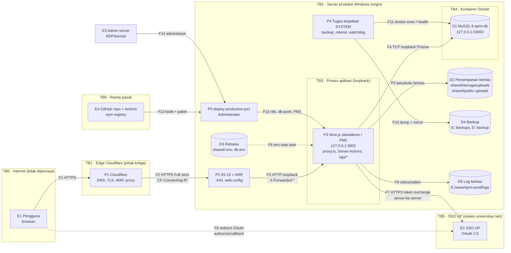

# Model Ancaman STRIDE — SPMI

Model ancaman aplikasi (ISO/IEC 27034-1 §8 "Application Security Verification"/analisis risiko aplikasi; metode
Microsoft STRIDE per elemen DFD) untuk **Sistem Informasi SPMI — LPM Universitas Pahlawan Tuanku Tambusai**.

| Versi dokumen | Tanggal         | Versi aplikasi | Klasifikasi      |
| ------------- | --------------- | -------------- | ---------------- |
| 1.0           | 17 Oktober 2026 | v1.1.3         | Dokumen Internal |

Terkait: [27034-KEAMANAN-APLIKASI](27034-KEAMANAN-APLIKASI.md) · [RISK-REGISTER](RISK-REGISTER.md) ·
[LAPORAN_KEAMANAN.md](../../LAPORAN_KEAMANAN.md) · [ADR](../adr/).

## 1. Metode

1. Gambarkan diagram aliran data (DFD) dengan **batas kepercayaan** (trust boundary, TB).
2. Untuk tiap elemen (entitas eksternal, proses, penyimpanan data, aliran data) terapkan kategori STRIDE yang relevan:
   **S**poofing, **T**ampering, **R**epudiation, **I**nformation disclosure, **D**enial of service, **E**levation of privilege.
3. Catat mitigasi **yang benar-benar ada di kode/konfigurasi** (dengan rujukan berkas) dan **risiko residual**
   (Rendah / Sedang / Tinggi). Residual Sedang/Tinggi dibawa ke [RISK-REGISTER](RISK-REGISTER.md).
4. Ditinjau ulang setiap ada aliran data/integrasi baru (lihat [RENCANA-PEMELIHARAAN §4](RENCANA-PEMELIHARAAN.md#4-prosedur-manajemen-perubahan)).

## 2. Diagram Aliran Data dan Batas Kepercayaan

| Batas     | Keterangan                  | Kontrol utama di batas                                                                               |
| --------- | --------------------------- | ---------------------------------------------------------------------------------------------------- |
| TB0→TB1   | Internet ke edge Cloudflare | TLS publik, Always Use HTTPS, HSTS, WAF/Bot (setelan Cloudflare)                                     |
| TB1→TB2   | Cloudflare ke origin        | TLS Full (strict) ke sertifikat Let's Encrypt; firewall origin hanya IP Cloudflare (⏳ verifikasi)   |
| TB2→TB3   | IIS ke proses Node          | Node hanya `127.0.0.1` (`HOSTNAME`); IP klien hanya dipercaya dari hop Cloudflare (`src/lib/net.ts`) |
| TB3→TB4   | Aplikasi ke DB kontainer    | Port hanya loopback; kredensial di `shared\.env`; Prisma terparameter                                |
| TB3→D2/D3 | Aplikasi ke sistem berkas   | Whitelist folder, nama acak, validasi path; ACL `shared\` Administrators + SYSTEM                    |
| TB3→TB5   | Aplikasi ke SSO UP          | HTTPS, Client Secret hanya di server, `state` OAuth, klaim role tidak dipercaya                      |
| TB6→TB2   | Rantai pasok ke produksi    | Tag Git, worktree bersih, `npm ci` lockfile, gerbang test, `npm audit`, CodeQL                       |

## 3. Daftar Elemen

| ID  | Elemen                 | Jenis                 | Aset/data utama                                                |
| --- | ---------------------- | --------------------- | -------------------------------------------------------------- |
| E1  | Pengguna (browser)     | Entitas eksternal     | Cookie sesi `__Host-lpm_session`, berkas bukti yang diunggah   |
| E2  | SSO UP                 | Entitas eksternal     | Kode otorisasi, token akses, userinfo                          |
| E3  | Admin server           | Entitas eksternal     | Akses Administrator ke server                                  |
| E4  | GitHub / npm           | Entitas eksternal     | Kode sumber, paket dependensi, workflow CI                     |
| P1  | Cloudflare             | Proses (pihak ketiga) | Lalu lintas terdekripsi di edge                                |
| P2  | IIS ARR                | Proses                | Reverse proxy, maintenance 503                                 |
| P3  | Aplikasi Next.js (PM2) | Proses                | Logika bisnis, RBAC, sesi                                      |
| P4  | Tugas terjadwal        | Proses                | Backup, retensi, watchdog                                      |
| P5  | Skrip deploy           | Proses                | Rilis, migrasi skema                                           |
| D1  | MySQL `spmi-db`        | Penyimpanan           | Akun, jawaban, log, pengaturan (termasuk Client Secret SSO)    |
| D2  | Berkas unggahan        | Penyimpanan           | Bukti audit PDF (dapat memuat data pribadi), dokumen, branding |
| D3  | Rahasia `shared\`      | Penyimpanan           | `AUTH_SECRET`, `DATABASE_URL`, kredensial MySQL                |
| D4  | Backup                 | Penyimpanan           | Dump DB penuh + mirror berkas                                  |
| D5  | Log berkas             | Penyimpanan           | Log PM2/deploy/backup (tersamarkan)                            |

## 4. Ancaman, Mitigasi, dan Risiko Residual

### 4.1 Spoofing (pemalsuan identitas)

| ID  | Elemen | Ancaman                                                                                    | Mitigasi yang diterapkan                                                                                                                                                                     | Residual |   Risiko   |
| --- | ------ | ------------------------------------------------------------------------------------------ | -------------------------------------------------------------------------------------------------------------------------------------------------------------------------------------------- | :------: | :--------: |
| T01 | P3/E1  | Brute force / credential stuffing login lokal                                              | Rate limit 5×/menit per email+IP & 30×/menit per IP (`src/lib/actions/auth.ts`, `src/lib/ratelimit.ts`); bcrypt cost 10; kebijakan sandi (`src/lib/password.ts`); log login                  |  Sedang  | R-13, R-01 |
| T02 | F1/P3  | Pemalsuan / pencurian token sesi                                                           | JWT HS256 dikunci algoritma, `iss`/`aud` diverifikasi, `AUTH_SECRET` ≥ 32 wajib (fail-closed); cookie `__Host-` httpOnly Secure SameSite=Lax; revokasi `session_version` (`src/lib/auth.ts`) |  Rendah  |     —      |
| T03 | F8/P3  | Login CSRF pada alur OAuth (memasukkan korban ke akun penyerang)                           | `state` acak 256-bit di cookie `__Host-spmi_sso_state` (10 menit, sekali pakai, `timingSafeEqual`) (`src/app/api/sso/[...sso]/route.ts`)                                                     |  Rendah  |     —      |
| T04 | F2/F3  | Pemalsuan IP klien via `X-Forwarded-For`/`CF-Connecting-IP` (bypass rate limit, log palsu) | `clientIpFromHeaders()` mempercayai `CF-Connecting-IP` hanya bila hop terakhir berada di rentang IP Cloudflare (`src/lib/net.ts`, `TRUST_PROXY`)                                             |  Sedang  |    R-09    |
| T05 | E2     | Pengambilalihan akun via penautan SSO berdasarkan email                                    | Pencocokan username → email → sso_id; akun baru `pengunjung`; klaim role SSO diabaikan (`resolveLocalRole`, `src/lib/sso.ts`)                                                                |  Rendah  |    R-14    |
| T06 | F2     | Akses langsung ke origin melewati Cloudflare (WAF terlewati, header CF dipalsukan)         | Pemeriksaan hop Cloudflare di `net.ts`; HSTS; IIS hanya host binding domain. Firewall origin hanya IP Cloudflare **belum terverifikasi**                                                     |  Sedang  |    R-09    |

### 4.2 Tampering (pengubahan tanpa hak)

| ID  | Elemen | Ancaman                                                                       | Mitigasi yang diterapkan                                                                                                                                                                         | Residual | Risiko |
| --- | ------ | ----------------------------------------------------------------------------- | ------------------------------------------------------------------------------------------------------------------------------------------------------------------------------------------------ | :------: | :----: |
| T07 | P3     | CSRF pada mutasi (Server Actions)                                             | Pemeriksaan `Origin` Server Actions + `allowedOrigins` = host publik (`next.config.ts`); `SameSite=Lax`; tidak ada GET yang mengubah data ([ADR-0004](../adr/0004-jwt-cookie-session.md))        |  Rendah  |   —    |
| T08 | P3     | Manipulasi parameter: mass assignment, IDOR (`existingFile`), peran dari form | Whitelist field/enum/ID & batas panjang (`src/lib/validate.ts`); kepemilikan sumber daya diperiksa (B-2, `src/lib/actions/responses.ts`); validasi peran vs hak pemanggil (B-1)                  |  Rendah  |   —    |
| T09 | D1     | SQL injection                                                                 | Prisma terparameter; satu-satunya kueri mentah adalah template bertanda `SELECT 1` di `/api/health`                                                                                              |  Rendah  |   —    |
| T10 | D2     | Unggah berkas berbahaya / path traversal / overwrite                          | Whitelist folder & ekstensi, magic bytes `%PDF-`, tolak `/JavaScript` & `/Launch`, gambar tanpa SVG, nama 100% acak, path divalidasi ulang saat baca (`src/lib/upload.ts`)                       |  Rendah  |   —    |
| T11 | E1/P3  | XSS tersimpan/terpantul; injeksi CSS                                          | React escaping; CSP nonce per permintaan tanpa `'unsafe-inline'` di `script-src` (`src/proxy.ts`); tautan dibatasi `http(s)` (`isSafeHttpUrl`); `nosniff`. **Sisa:** `style-src 'unsafe-inline'` |  Sedang  |  R-10  |
| T12 | E4/P5  | Rantai pasok: paket npm berbahaya, Action terkompromi                         | `package-lock.json` + `npm ci`; `npm audit` CI; Dependabot (review manusia); CodeQL; gerbang test. **Sisa:** Actions dipin ke tag mayor, bukan SHA; tanpa verifikasi provenance                  |  Sedang  |  R-15  |
| T13 | P5/D1  | Perubahan skema merusak data (`prisma db push`)                               | Tanpa `--accept-data-loss` (perubahan destruktif gagal); backup pra-deploy; rollback otomatis + restore. **Sisa:** tanpa riwayat migrasi berversi                                                |  Sedang  |  R-16  |
| T14 | D3/E3  | Perubahan konfigurasi/rahasia di server                                       | ACL `shared\` Administrators + SYSTEM; konfigurasi sebagai kode di `deploy/`                                                                                                                     |  Rendah  |  R-19  |

### 4.3 Repudiation (penyangkalan)

| ID  | Elemen | Ancaman                                                               | Mitigasi yang diterapkan                                                                                                                                                                                                      | Residual | Risiko |
| --- | ------ | --------------------------------------------------------------------- | ----------------------------------------------------------------------------------------------------------------------------------------------------------------------------------------------------------------------------- | :------: | :----: |
| T15 | P3/D1  | Pengguna menyangkal aksi (verifikasi, hapus, ubah peran)              | `activity_logs` (userId, aksi, entitas, IP tervalidasi, waktu) & `login_logs` (`src/lib/logs.ts`); pembersihan log meninggalkan jejak (B-12). **Sisa:** log di DB yang sama, dapat dihapus superadmin, tidak ada salinan WORM |  Sedang  |  R-17  |
| T16 | E3/P5  | Tindakan admin server tidak tercatat (`docker exec`, `prisma studio`) | Transkrip deploy `logs\deploy-<ts>.log`; log backup/purge. Tindakan manual di luar skrip tidak tercatat                                                                                                                       |  Sedang  |  R-17  |

### 4.4 Information disclosure (kebocoran informasi)

| ID  | Elemen | Ancaman                                                                                         | Mitigasi yang diterapkan                                                                                                                                                                                                               | Residual |   Risiko   |
| --- | ------ | ----------------------------------------------------------------------------------------------- | -------------------------------------------------------------------------------------------------------------------------------------------------------------------------------------------------------------------------------------- | :------: | :--------: |
| T17 | D2     | Berkas bukti diunduh tanpa login / oleh unit lain                                               | Penyimpanan privat `UPLOAD_DIR` di luar web root; `/api/files/*` memeriksa sesi + otorisasi per berkas; URL lama `/uploads/*` di-rewrite ke route terautentikasi ([ADR-0006](../adr/0006-private-upload-storage.md))                   |  Rendah  |     —      |
| T18 | P3     | Kebocoran detail internal lewat pesan error                                                     | `toActionError`/`jsonError` pesan generik (`src/lib/errors.ts`); galat SSO → `/login?sso_error=<kode>`                                                                                                                                 |  Rendah  |     —      |
| T19 | D5     | Data pribadi/rahasia di log                                                                     | `maskEmail`, `maskToken`, `redactText`, `logError` (`src/lib/redact.ts`); nilai pengaturan tidak dilog                                                                                                                                 |  Rendah  |     —      |
| T20 | D4     | Pencurian/kehilangan backup (dump penuh DB + berkas)                                            | ACL `backups\` Administrators + SYSTEM. **Sisa:** tidak terenkripsi; seluruh salinan di server yang sama (E: dan D:)                                                                                                                   |  Tinggi  |    R-05    |
| T21 | P1     | Cloudflare melihat lalu lintas terdekripsi; skrip pihak ketiga disisipkan (Insights, challenge) | CSP hanya mengizinkan `static.cloudflareinsights.com`; skrip inline tanpa nonce diblokir; rekomendasi mematikan Rocket Loader/Email Obfuscation/JS Detections ([09 §6](../09-DAFTAR-STANDAR.md))                                       |  Sedang  |    R-11    |
| T22 | P3     | Enumerasi akun via pesan/waktu respons login                                                    | Pesan seragam; bcrypt tiruan untuk email tak terdaftar (B-18, `verifyPassword` di `src/lib/auth.ts`)                                                                                                                                   |  Rendah  |     —      |
| T23 | F3/F4  | Penyadapan lalu lintas loopback (HTTP IIS→Node, TCP Node→MySQL)                                 | Hanya antarmuka loopback; memerlukan akses lokal ke server                                                                                                                                                                             |  Rendah  |     —      |
| T24 | P3     | Ekspor data pribadi pengguna lain (`/api/me/export`)                                            | Hanya data milik sesi; tanpa hash sandi/versi sesi; rate limit 5×/menit; dicatat `privacy.export` (`src/app/api/me/export/route.ts`)                                                                                                   |  Rendah  |     —      |
| T25 | D1/D3  | Kebocoran rahasia (repo, dump DB)                                                               | `.env` & `storage/` di `.gitignore`; rahasia di `shared\.env`; Client Secret SSO tidak pernah dikirim ke klien (`getSettingsForAdmin`). **Sisa:** Client Secret SSO tersimpan **plaintext** di `app_settings` → ikut dalam dump backup |  Sedang  | R-05, R-19 |

### 4.5 Denial of service (penolakan layanan)

| ID  | Elemen | Ancaman                                                            | Mitigasi yang diterapkan                                                                                                                                          | Residual | Risiko |
| --- | ------ | ------------------------------------------------------------------ | ----------------------------------------------------------------------------------------------------------------------------------------------------------------- | :------: | :----: |
| T26 | P3     | Banjir permintaan / ekspor PDF berat                               | Rate limit ekspor 10×/menit, unduh 120×/menit, SSO 20×/menit/IP; Cloudflare. **Sisa:** limiter in-memory satu instance, ter-reset saat restart                    |  Sedang  |  R-01  |
| T27 | P3     | Unggahan besar menghabiskan memori/disk                            | Batas 10 MB (aplikasi), 12 MB (Server Action, `next.config.ts`), 20 MB (IIS); rate limit unggah 30×/menit                                                         |  Rendah  |   —    |
| T28 | D1     | DB tidak hidup setelah reboot (Docker Desktop butuh sesi pengguna) | `restart: unless-stopped`; tugas `Docker Desktop Autostart` + `SPMI Watchdog` 5 menit (`scripts/deploy/docker-autostart.ps1`, `watchdog.ps1` — sedang diterapkan) |  Sedang  |  R-04  |
| T29 | P3     | Crash/kebocoran memori proses Node                                 | PM2 `autorestart`, `max_memory_restart 768M`, `max_restarts 10`; watchdog memeriksa `/api/health`                                                                 |  Rendah  |   —    |
| T30 | E2     | SSO UP tidak tersedia                                              | Login lokal tetap tersedia untuk akun LPM ([ADR-0003](../adr/0003-sso-up-oauth2.md))                                                                              |  Sedang  |  R-14  |
| T31 | P3     | Kehabisan memori rate limiter oleh kunci acak                      | `MAX_BUCKETS = 50_000` + sapuan bucket kedaluwarsa (`src/lib/ratelimit.ts`)                                                                                       |  Rendah  |   —    |

### 4.6 Elevation of privilege (peningkatan hak)

| ID  | Elemen | Ancaman                                                                             | Mitigasi yang diterapkan                                                                                                                                                                | Residual |      Risiko      |
| --- | ------ | ----------------------------------------------------------------------------------- | --------------------------------------------------------------------------------------------------------------------------------------------------------------------------------------- | :------: | :--------------: |
| T32 | P3     | Admin LPM menjadikan diri/akun lain superadmin                                      | Validasi peran vs pemanggil (B-1); `createSuperadmin` hanya superadmin (`src/lib/actions/units.ts`, `settings.ts`)                                                                      |  Rendah  |        —         |
| T33 | P3     | Memanggil Server Action langsung (POST) melewati UI, layout, atau mode pemeliharaan | `requireUser/requireAccess/requireLpm/requireLpmAdmin/requireSuperadmin/requireUnitMember` di baris pertama + `assertNotMaintenance` (`src/lib/guards.ts`); `tests/unit/guards.test.ts` |  Rendah  |        —         |
| T34 | E2     | Mempercayai klaim role dari SSO                                                     | Diabaikan kecuali `SSO_TRUST_ROLE=true`; hanya `sso.adminEmails` → `lpm_admin` (`resolveLocalRole`)                                                                                     |  Rendah  |        —         |
| T35 | P3     | Pengunjung/akun nonaktif mengakses data                                             | `requireAccess` menolak `pengunjung`; `getCurrentUser()` membaca ulang status aktif per permintaan                                                                                      |  Rendah  |        —         |
| T36 | P3/P2  | RCE via kerentanan framework/dependensi atau server                                 | Pembaruan Dependabot, `npm audit`, CodeQL; Node tidak terekspos publik. **Sisa:** Defender real-time nonaktif; MySQL 8.0 EOL; belum ada pentest independen                              |  Sedang  | R-21, R-24, R-06 |

## 5. Ringkasan

| Kategori STRIDE        | Jumlah ancaman | Residual Rendah | Residual Sedang | Residual Tinggi |
| ---------------------- | :------------: | :-------------: | :-------------: | :-------------: |
| Spoofing               |       6        |        3        |        3        |        0        |
| Tampering              |       8        |        5        |        3        |        0        |
| Repudiation            |       2        |        0        |        2        |        0        |
| Information disclosure |       9        |        6        |        2        |        1        |
| Denial of service      |       6        |        3        |        3        |        0        |
| Elevation of privilege |       5        |        4        |        1        |        0        |
| **Total**              |     **36**     |     **21**      |     **14**      |      **1**      |

Prioritas penurunan residual: **T20** (enkripsi + salinan backup luar server), T06/T04 (firewall origin), T36
(Defender real-time, MySQL 8.4), T28 (DB saat reboot), T15/T16 (log ke penyimpanan terpisah), T11 (CSS tanpa `unsafe-inline`).
