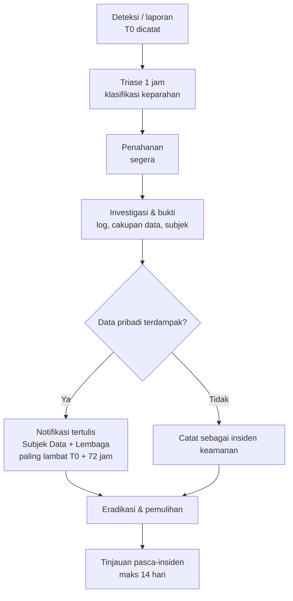

# Prosedur Respons Insiden dan Kegagalan Pelindungan Data Pribadi

**Dasar:** UU 27/2022 tentang Pelindungan Data Pribadi — Pasal 46 (pemberitahuan tertulis paling lambat
**3 × 24 jam** kepada Subjek Data Pribadi dan Lembaga), Pasal 35, 39; PP 71/2019 tentang Penyelenggaraan Sistem dan
Transaksi Elektronik.
**Berlaku untuk:** SPMI (<https://spmi.universitaspahlawan.ac.id>) dan seluruh salinan datanya (backup, ekspor PDF).

## 1. Definisi

- **Insiden keamanan**: kejadian yang mengancam kerahasiaan, integritas, atau ketersediaan SPMI.
- **Kegagalan Pelindungan Data Pribadi** (Pasal 46): kegagalan melindungi data pribadi yang mengakibatkan data
  terungkap, diubah, hilang, atau diakses tanpa hak — termasuk karena kelalaian internal.

Contoh: akun superadmin diambil alih; `AUTH_SECRET`/`shared\.env` bocor; berkas bukti dapat diunduh publik;
dump database atau backup hilang/bocor; laptop berisi ekspor PDF hilang; ransomware pada server.

## 2. Tim dan Kontak

| Peran               | Penanggung jawab                                                                                                                             | Kontak                          |
| ------------------- | -------------------------------------------------------------------------------------------------------------------------------------------- | ------------------------------- |
| Koordinator insiden | Pejabat/Petugas PDP (⏳ belum ditunjuk; sementara Ketua LPM)                                                                                 | `lpm@universitaspahlawan.ac.id` |
| Teknis              | Administrator server / Bagian TI                                                                                                             | _isi_                           |
| Pengembang aplikasi | Tim pengembang SPMI                                                                                                                          | _isi_                           |
| Hukum & komunikasi  | Bagian Hukum, Humas                                                                                                                          | _isi_                           |
| Pimpinan            | Rektor / Wakil Rektor terkait                                                                                                                | _isi_                           |
| Eksternal           | Lembaga Pelindungan Data Pribadi (sampai lembaga beroperasi penuh: Kementerian Komunikasi dan Digital), BSSN (CSIRT), Kepolisian bila pidana | _isi saluran resmi terbaru_     |

## 3. Alur Respons



**T0** = saat Pengendali mengetahui terjadinya kegagalan pelindungan (bukan saat investigasi selesai).

### 3.1 Triase (≤ 1 jam)

| Tingkat | Kriteria                                                                      | Contoh                                 |
| ------- | ----------------------------------------------------------------------------- | -------------------------------------- |
| Kritis  | Data pribadi banyak subjek terungkap/diubah, atau kendali sistem diambil alih | Dump DB bocor, superadmin diambil alih |
| Tinggi  | Data pribadi sebagian subjek terungkap                                        | Bukti unit dapat diunduh publik        |
| Sedang  | Kerentanan tereksploitasi tanpa bukti kebocoran                               | Brute force berhasil dihentikan        |
| Rendah  | Upaya gagal / tanpa dampak                                                    | Pemindaian otomatis                    |

### 3.2 Penahanan (segera)

| Tindakan                   | Cara di SPMI                                                                                                                                                       |
| -------------------------- | ------------------------------------------------------------------------------------------------------------------------------------------------------------------ |
| Batasi akses pengguna      | **Pengaturan → Pemeliharaan** (hanya superadmin dapat masuk), atau halaman 503 IIS: salin `deploy\iis\web.maintenance.config` ke `E:\www\spmi-prod\iis\web.config` |
| Cabut semua sesi           | Ganti `AUTH_SECRET` di `shared\.env` → `pm2 reload spmi --update-env`                                                                                              |
| Nonaktifkan akun tersangka | **Role & Penempatan** → ubah akun → nonaktif (berlaku pada permintaan berikutnya)                                                                                  |
| Rotasi kredensial          | Client Secret SSO (minta ke Admin SSO UP, isi di Pengaturan), password MySQL (`shared\db.env` + `DATABASE_URL`), akun Windows/Cloudflare                           |
| Blokir sumber              | Cloudflare WAF (blok IP/negara/ASN, _Under Attack Mode_)                                                                                                           |
| Lepas jaringan             | Bila ransomware: putuskan server dari jaringan, jangan matikan (preservasi memori)                                                                                 |

### 3.3 Investigasi & Preservasi Bukti

- Salin (jangan ubah) sebelum pembersihan: `login_logs`, `activity_logs` (ekspor SQL), `E:\www\spmi-prod\logs\*`,
  log IIS `C:\inetpub\logs\LogFiles\W3SVC<id>\`, log Cloudflare, `current\release.json`.
- Hitung hash SHA-256 setiap salinan bukti; catat rantai penguasaan (_chain of custody_).
- Tentukan: data apa, berapa subjek, kategori subjek (lihat [RoPA.md](RoPA.md)), periode, cara terjadinya, apakah data spesifik terdampak.

### 3.4 Notifikasi (Pasal 46) — paling lambat 3 × 24 jam sejak T0

Pemberitahuan **tertulis** kepada **Subjek Data Pribadi** yang terdampak **dan** kepada **Lembaga**, sekurang-kurangnya memuat:

1. data pribadi yang terungkap;
2. kapan dan bagaimana data pribadi terungkap;
3. upaya penanganan dan pemulihan atas terungkapnya data pribadi oleh Pengendali.

Dalam hal tertentu (mis. kebocoran berdampak luas atau mengganggu pelayanan publik), Pengendali **wajib** juga
memberitahukan kepada **masyarakat** (Pasal 46 ayat 3) — keputusan oleh pimpinan atas saran Bagian Hukum.

Saluran: email resmi universitas ke alamat email subjek di `users.email`, pengumuman di SPMI (banner), surat resmi ke Lembaga.
Bila informasi belum lengkap pada batas 72 jam, kirim pemberitahuan awal dan susulkan pembaruan.

### 3.5 Eradikasi & Pemulihan

1. Tutup celah (patch kode → rilis `hotfix/*`, lihat [02-PANDUAN-PENGEMBANGAN.md](../02-PANDUAN-PENGEMBANGAN.md#4-alur-git-git-flow)).
2. Bila data rusak: `scripts\deploy\rollback.ps1 -To <rilis> -RestoreDb <backup>` atau restore dari `backups\daily-*`;
   berkas dari `backups\uploads-mirror`.
3. Jalankan `scripts\deploy\smoke-test.ps1`, verifikasi integritas data bersama LPM, cabut mode pemeliharaan.
4. Minta pengguna terdampak mengganti kata sandi lokal.

### 3.6 Tinjauan Pasca-Insiden (≤ 14 hari)

Laporan berisi kronologi, akar masalah, dampak, efektivitas respons, dan tindakan perbaikan (pemilik + tenggat).
Perbarui [CHECKLIST-KEPATUHAN.md](CHECKLIST-KEPATUHAN.md), [RoPA.md](RoPA.md), dan prosedur ini bila perlu.

## 4. Templat Pemberitahuan kepada Subjek Data

```
Perihal: Pemberitahuan Kegagalan Pelindungan Data Pribadi — Sistem SPMI

Yth. Bapak/Ibu <Nama>,

Pada <tanggal, jam WIB> kami mengetahui adanya <uraian singkat kejadian> pada Sistem Penjaminan Mutu
Internal (SPMI) LPM Universitas Pahlawan Tuanku Tambusai.

1. Data pribadi yang terungkap : <mis. nama, email, berkas bukti audit unit X>
2. Waktu dan cara terungkap   : <periode; penyebab>
3. Upaya penanganan/pemulihan : <tindakan yang telah dan akan dilakukan>

Langkah yang kami sarankan  : <mis. ganti kata sandi, waspadai email phishing>
Narahubung                   : <Pejabat PDP>, lpm@universitaspahlawan.ac.id

Hormat kami,
<Nama, Jabatan>
```

## 5. Templat Laporan kepada Lembaga

| Butir                                      | Isi                                          |
| ------------------------------------------ | -------------------------------------------- |
| Pengendali                                 | Universitas Pahlawan Tuanku Tambusai — LPM   |
| Sistem                                     | SPMI, https://spmi.universitaspahlawan.ac.id |
| Waktu diketahui (T0) / waktu kejadian      |                                              |
| Uraian kejadian & penyebab                 |                                              |
| Kategori & jumlah subjek terdampak         |                                              |
| Kategori & jumlah data terdampak           |                                              |
| Data spesifik terdampak?                   | Ya / Tidak                                   |
| Dampak yang mungkin timbul                 |                                              |
| Upaya penanganan & pemulihan               |                                              |
| Pemberitahuan ke subjek (tanggal, saluran) |                                              |
| Narahubung                                 |                                              |

## 6. Log Insiden

| No  | T0  | Tingkat | Ringkasan | Data pribadi? | Notifikasi subjek | Notifikasi Lembaga | Ditutup |
| --- | --- | ------- | --------- | ------------- | ----------------- | ------------------ | ------- |
|     |     |         |           |               |                   |                    |         |

Latihan simulasi (_tabletop_) prosedur ini dilakukan minimal 1× per tahun.
